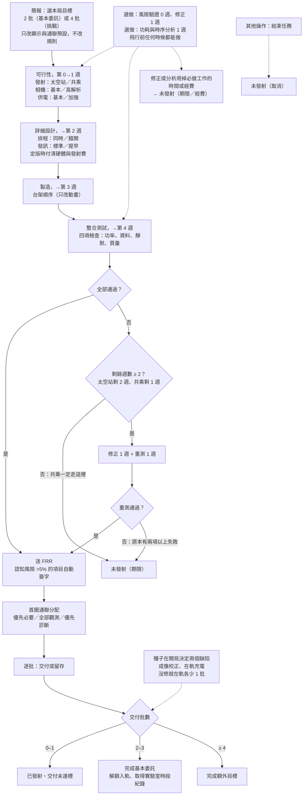

# 立方衛星章節：分支、後果與修正方案

分析對象：`main`（`034e54e`）加上 2026-11-15 凌晨工作目錄中尚未提交的改動，包含另一個 session 正在加入的「發射與軌道」選項和質量檢查。數字取自 `src/missions/cubesat.ts` 當下的設定（預算 110 經費＝$1,100,000，期限 6 週）。這些檔案還在改，引用的行號以 2026-11-15 02:30 前後的版本為準。

驗證方式：

- 用一次性腳本直接呼叫 `runMission` 窮舉 32 種配置、各種修正與通聯分配，風險項目跑種子 1–2000。腳本放在 session 的 scratchpad，沒有進 repo。
- 用內建瀏覽器載入「共乘發射＋高解析成像儀＋基本供電、整合退回」的存檔，確認修正畫面三個選項都標「剩餘工期或經費不足」卻仍可選。之後開發伺服器因另一個 session 改到一半（大廳缺文案鍵）無法載入，其餘路線只用腳本驗證，腳本走的是同一套規則程式。

代號：發射 `ISS`＝太空站載運、`RS`＝共乘；相機 `B`＝基本、`A`＝高解析；供電 `S`＝基本、`R`＝加強；排程 `O`＝同時、`G`＝錯開；發訊 `C`＝標準、`E`＝提早。例如 `ISS/B/S/O/C` 是預設配置。

## 1. 分支圖

## 2. 決策點與後果

### 2.1 選項數值

| 決策 | 選項 | 成本（經費） | 功率 | 質量 | 資料 | 時間 | 風險項目成熟度 |
| --- | --- | ---: | --- | --- | --- | --- | --- |
| 發射 | 太空站 | 10 | — | 上限 4 kg | 通聯 5 格 | 期限 6 週 | — |
| | 共乘 | 16 | — | 上限 6 kg | 通聯 6 格 | 期限 5 週 | — |
| 相機 | 基本 | 14 | 3 W | 0.4 kg | 收集 2 批 | — | 成像校正：沿用（缺陷 20%） |
| | 高解析 | 21 | 7 W | 0.8 kg | 收集 5 批 | — | 成像校正：新設計（40%） |
| 供電 | 基本 | 12 | 上限 10 W | 0.5 kg | — | — | 在軌充電：沿用（20%） |
| | 加強 | 22 | 上限 14 W | 1.0 kg | — | — | 在軌充電：新設計（40%） |
| 排程 | 同時 | 0 | 尖峰＝2＋相機＋4 | — | — | — | — |
| | 錯開 | 0 | 尖峰＝max(2＋相機, 6) | — | 收集量 −2 | — | — |
| 發訊 | 標準 | 0 | — | — | 通聯 −1 格 | T+32 分（過靜默） | — |
| | 提早 | 0 | — | — | 不扣格 | T+20 分（不過靜默） | — |

平台 2.4 kg、2 W，下傳 4 W。可交付批數＝min(收集量, 通聯格數)。必做工作：可行性 6、定版 6＋上表硬體、製造 9、整合 8，各 1 週，第 4 週到 FRR。必做總額 65–88 經費，扣完剩 22–45。

### 2.2 32 種配置的整合結果

| 類型 | 配置 | 整合結果 | 太空站 | 共乘 |
| --- | --- | --- | --- | --- |
| 直接通過 | `B/S/O/C`、`B/R/O/C` | 2 批 | 第 4 週 FRR | 第 4 週 FRR |
| | `A/S/G/C` | 3 批 | 同上 | 同上 |
| | `A/R/G/C` | 3 批 | 質量 4.2 > 4，退回 | 第 4 週 FRR |
| | `A/R/O/C` | 共乘 5 批 | 質量 4.2 > 4，退回 | 第 4 週 FRR，**全遊戲唯一能交 4 批的配置** |
| 只有提早發訊不過 | `*/*/*/*/E`（其他都過） | 靜默不過 | 恢復標準發訊，第 6 週 FRR | 修完立刻未發射 |
| 基本相機＋錯開 | `B/*/G/C` | 收集 0 批，資料不過 | 「換成基本成像儀」或「更換加強供電」都只是把排程改回同時，第 6 週交 2 批 | 修完立刻未發射 |
| 高解析＋基本供電＋同時 | `A/S/O/C` | 13／10 W 超載 | 錯開 → 3 批；換基本相機 → 2 批；加強供電因 4.2 kg 不提供 | 三種修正都修完立刻未發射 |
| 兩項以上不過 | 例：`B/S/G/E`、`A/S/O/E`、`A/R/O/E`（太空站） | — | 只能修一項，重測仍退回，期限用完 | 修完立刻未發射 |

結論：

- 共乘發射在整合失敗後沒有任何活路。修正花 1 週後剩 0 週，規則直接判未發射（`src/game/mission.ts` 的 `checkResources`）。
- 4 批挑戰只有 `RS/A/R/O/C` 一條路，必須在定版前一次選對，沒有返工餘裕。
- 太空站整合失敗時最多修一次。

### 2.3 選做驗證、修正與分析

| 動作 | 時間 | 經費 | 效果 |
| --- | --- | --- | --- |
| 分析／單元測試／端到端（每項 3 級） | 0 週 | 4／7／12 | 更新認知，不改真相。偵測率 50%／85%／97%。 |
| 修正（成像重新校正、修改充電電路） | 1 週 | 5 | 缺陷消失 |
| 分析功耗與操作時序 | 1 週 | 5 | 重複畫面上免費的功率預估，並把兩項風險做到分析級 |

種子 1–2000 的實測（「驗證並修正」＝依畫面的經費保留規則逐級驗證，測到就修）：

| 配置 | 畫面顯示的達標機率 | 不驗證：交 ≥2 批 | 驗證並修正：交 ≥2 批 | 畫面允許的修正導致未發射 |
| --- | ---: | ---: | ---: | ---: |
| `ISS/B/S/O/C`（預設） | 64% | 65% | 97% | 0% |
| `ISS/B/R/O/C` | 48% | 46% | 75% | 經費不足 19% |
| `ISS/A/S/G/C` | 92% | 93% | 99% | 經費不足 20% |
| `RS/B/S/O/C` | 64% | 65% | 93% | 期限 4% |
| `RS/A/R/O/C`（挑戰） | 100% | 100%（4 批 82%） | 100%（4 批 96%） | 經費 20%＋期限 10% |

### 2.4 通聯與逐批交付

以 seed 6、無缺陷為例：

| 配置 | 優先必要 | 全部觀測 | 優先診斷 |
| --- | --- | --- | --- |
| `ISS/B/S/O/C` | 2 批 | 2 批 | 0 批，未達標 |
| `ISS/A/S/G/C` | 2 批 | 3 批 | 0 批，未達標 |
| `RS/A/R/O/C` | 2 批 | 5 批 | 1 批，未達標 |

診斷固定占 4 格，任何可放行的配置選了都交不到 2 批，而且規則裡診斷沒有任何好處。「優先必要」永遠不比「全部觀測」多。逐批「留存」只會減少交付，也沒有任何好處。

### 2.5 結局與跨章影響

| 結局 | 條件 | 跨章 |
| --- | --- | --- |
| 未發射 | 期限、經費或手動結束 | 無 |
| 已發射・交付未達標 | 交 0–1 批 | 無 |
| 完成基本委託 | 交 2–3 批 | 解鎖入軌、聲望 +1、取得 `cubesat:partnerVerified`（入軌開局送實驗室時段） |
| 完成額外目標 | 交 ≥ 4 批（與本局目標無關） | 再加聲望 +1 |

## 3. 決策點檢查：動機、層級、對等

每個決策點檢查三件事：

- **動機**：情境有沒有交代玩家為什麼要做這個選擇；真實任務會不會在這個時間點做這個決定。
- **層級**：這是不是專案經理（玩家）該做的決定，還是任務架構、子系統工程師或地面站人員的事。
- **對等**：同一題的選項是不是同一類東西；有沒有明顯最好或明顯陷阱的選項；代價和收益是不是同一個量級。

判定：✓ 合理、△ 需調整、✗ 有問題。

| 決策點 | 動機 | 層級 | 對等 | 判定 |
| --- | --- | --- | --- | --- |
| 本局目標（簡報） | 研究負責人說明 2 批能比對、4 批能看下游，清楚。真實任務的需求由委託方訂，不是由 PM 挑難度。 | 任務需求層級，屬於題目要求的「定義任務目標」，可保留。 | 兩個目標不改規則，只改顯示和通聯預設。4 批只有一條路（H2），兩個選項的可達性差很多。 | △ |
| 發射與軌道 | 旁白說明發射決定軌道、質量上限和交件時間。但 `docs/story/cubesat.md` 的前提是「研究單位爭取到一個搭載名額」，和玩家自己挑發射衝突。對地球觀測最重要的差異（太陽同步軌道光照一致）沒用上。 | 任務架構層級，PM 在可行性階段決定是對的。但旁白由「飛行審查負責人」講（`src/ui/Single.tsx` `configPrompts.launch` 的 `review`），角色不對。 | 選項列出高度、傾角、壽命，除了質量上限和通聯格數，其他都不影響本局。代價量級不對等：共乘多 6 經費只是小錢，少 1 週卻等於整合失敗就沒救（H1）。 | ✗ |
| 觀測相機 | 研究需求直接對應，清楚。 | 酬載選擇，PM 依科學組建議決定，對。 | 基本：2 批、便宜；高解析：5 批、耗電、新設計，是真的取捨。基本剛好等於最低要求、零餘裕這件事沒有顯示（M4）。 | ✓ |
| 供電 | 旁白只說「選能支應尖峰的電源」。玩家選供電時還不知道後面有錯開排程這個替代方案。 | 電源系統是子系統層級。以「各組提案」形式讓 PM 二選一可以接受。 | 答案幾乎被相機決定：基本相機配加強供電只有壞處（多花錢、多 0.5 kg、新設計使達標機率 64% → 48%）。高解析時是「加強供電或錯開」二選一，但這兩個選項分在不同階段問。 | △ |
| 操作排程 | 旁白說「錯開省電但少拍」。真實情況是河道和地面站通常不會同時在視野內，大多先拍後傳，「同時觀測與下傳」本身需要說明。 | 操作構想（ConOps）屬於任務設計，PM 層級對；但真實任務在可行性就和功率預算一起定，不是在詳細設計才決定。 | 基本相機時錯開只有壞處（收集 0 批）。高解析＋基本供電時，錯開是唯一能飛的解。兩種情況都沒有權衡。 | ✗ |
| 發訊計時 | 有引用 CubeSat 101 的靜默要求，動機清楚。 | 首次發訊時間是遵守搭載方介面規範的韌體設定，不是 PM 的取捨。真實團隊不會選擇違規。 | 提早發訊在任何配置都過不了整合，是純陷阱。多 1 格通聯的誘因和「不能飛」的代價不在同一量級。 | ✗ |
| 功耗與時序分析（選做） | 結果和畫面上免費的預估重複，沒有理由去做（M8）。 | 系統分析，PM 層級對。 | 被風險面板的兩項分析支配：多 1 週只省 3 經費。 | ✗ |
| 台架順序（製造） | 文案已說明只影響演出。 | 台架作業順序是技術員層級，不是 PM 的事。 | 兩個選項結果相同。 | ✗ |
| 示波器時機（整合） | 同上。 | 測試工程師層級。 | 兩個選項結果相同。 | ✗ |
| 風險驗證（逐項逐級） | 「驗證買的是資訊」說明充分。 | 太細：PM 逐項逐級點 6 個測試按鈕，屬於驗證負責人的工作。真實的 PM 在 PDR、CDR 核定驗證計畫，測到問題時才決定修不修。 | 4／7／12 經費對上「少 1 批」，量級相當，是真的取捨。 | △ |
| 風險修正 | 測出問題後要修不修，清楚。 | PM 層級，對。 | 修（1 週＋5 經費）對上「確定少 1 批」，量級相當。另有 M1 的時間經費檢查缺漏。 | ✓ |
| 送 FRR | 審查流程清楚。 | PM 層級，對。 | 立方衛星沒有選擇，送審就自動簽字，只顯示提示文字。其他兩章要勾選簽字（`docs/game-review.md` U-9），三章不一致。 | △ |
| 退回後的修正 | 退回原因和選項並列，動機清楚。 | PM 在工程方案之間選擇，層級對。 | 經費 5–16、都是 1 週，量級相當。但選項名稱和實際效果不符（H3），共乘時全部無效（H1）。 | △ |
| 首圈通聯分配 | 真實任務的首圈通常先收信標和健康遙測，確認衛星正常才開始科學觀測。遊戲把真實做法（診斷）做成陷阱，又沒說明診斷的用途。 | 通聯計畫是任務操作層級，PM 可以決定。 | 診斷占 4 格、沒有好處；「優先必要」被「全部觀測」完全支配（M3）。三個選項沒有一個需要權衡。 | ✗ |
| 逐批交付／留存 | 沒有交代為什麼要把資料留在實驗室。 | 資料分發是地面站或研究單位的事，不是 PM 一批一批決定。 | 留存只會少交，純陷阱。 | ✗ |
| 等一週、結束任務 | 等一週在本章沒有理由（L3）；結束任務合理。 | PM 層級。 | 等一週只有壞處。 | △ |

由此衍生的問題（和第 4 節的 H、M、L 編號分開）：

**中**

- **Q1 發訊計時是合規項目，卻包裝成取捨題。** 層級錯，選項也不對等（提早發訊永遠不能飛）。玩家學到的是「別選錯的那個」，不是「介面規範不能議價」。更根本的是，提早發訊的誘因根本不存在：腳本逐一檢查 8 種能放行的配置，收集量都不超過標準發訊的通聯格數，多出來的 1 格在任何能飛的設計上都用不到。對應 F11。
- **Q2 首圈通聯的動機和真實任務相反。** 真實首圈先確認衛星健康，遊戲卻把診斷做成陷阱。「同時觀測與下傳」也需要交代河道和地面站的相對位置。對應 F12。
- **Q3 功率解法拆成兩題、分在兩個階段。** 真正的題目是「同時操作超載怎麼解：加強供電、錯開，或換相機」。現在玩家在可行性選供電時看不到錯開這個解法，到了詳細設計，排程題又多半只有一個正確答案。對應 F13。
- **Q4 發射題的動機和屬性對不上。** 故事前提是「研究單位給了名額」；選項列出壽命、傾角，卻不影響本局；真正和河道前後比對有關的光照差異沒有用上；旁白角色不對；時間代價遠大於費用代價。共乘選項寫的「地面站過境較長」（通聯多 1 格）也和 Q1 一樣從來用不到。所以這題實際上只是「質量上限 6 kg」對上「便宜 6 經費、多 1 週」。對應 F14，代價量級併 F1。
- **Q5 風險驗證的層級太細。** PM 逐項逐級點測試，和真實「核定驗證計畫」的層級不符，也讓工作台按鈕過多。對應 F15。

**低**

- **Q6 本局目標不改規則。** 作為「定義任務目標」的教學可以保留，但挑戰目標只有一條路，對等性要靠 F1、F2 補。
- **Q7 非 PM 層級又沒有取捨的選項。** 台架順序、示波器時機、逐批留存、等一週，處理見 F6、F10、F16。
- **Q8 立方衛星的 FRR 沒有簽字動作。** 和其他兩章不一致。建議三章統一，依 `docs/game-review.md` U-9 的結論一起處理。

## 4. 問題清單

### 高

**H1 共乘發射一旦整合失敗必定未發射，修正按鈕卻仍可按並扣錢。** 共乘的期限是 5 週（`src/missions/cubesat.ts:31` `leadWeeks: 1`、`:315` `effectiveDeadline`），第 4 週整合後只剩 1 週，修正＋重測要 2 週。修正選項只檢查修正本身夠不夠（`src/ui/Single.tsx:597`、`:600`，`src/game/mission.ts:385` 的 `repair`），所以玩家能付錢修正，完成那一刻就被判未發射。瀏覽器確認三個選項都標著「剩餘工期或經費不足以同時完成修正與重測」，仍可選取。共乘是 4 批挑戰的必經路線，等於挑戰玩家整合一失誤就沒有任何補救，而 `docs/story/cubesat.md` 與 `docs/gameplay-revision-plan.md` 描述的「整合退回後比較三種修正」在共乘上不存在。

**H2 4 批挑戰的文案和實際條件不符，既有的 Demo 路線已失效。** 能交 4 批的配置只剩 `RS/A/R/O/C`：太空站上限 4 kg 擋掉高解析＋加強供電（4.2 kg），基本供電同時操作又超載。簡報的挑戰說明（`src/i18n/en.ts:234`、`src/i18n/zh-TW.ts:236`）只寫「用高解析成像儀並安排額外的供電需求」，沒提要換共乘、也沒提共乘沒有返工時間。`docs/game-review.md` 推薦的 Demo「高解析 → 13／10 W → 退回 → 加強供電 → 交 4 批」在太空站會因質量不提供加強供電，在共乘會撞上 H1。

**H3 修正名稱和實際效果不一致。** `applyRemedy` 的 `basic` 與 `reinforced` 都會順便把排程改回同時（`src/missions/cubesat.ts:189-190`）。基本相機配錯開排程（收集 0 批）時，遊戲提供「換成基本成像儀」（相機本來就是基本的）和「更換加強供電」（`ISS/B/R/G/C` 時供電本來就是加強的），兩者實際效果都只是取消錯開，卻收 10 或 16 經費。結算照樣寫「『換成基本成像儀』並重測」。另外沒有「取消錯開」或「換回基本供電」的修正，質量超標時只能換基本相機（`ISS/A/R/G/C` 換回基本供電本可交 3 批，現在只能 2 批）。

**H4 未發射的結算不說原因。** 「你的決定影響了什麼」對未發射局只顯示「最近通過：CDR」和「基本委託未完成，交付 0 批」（`src/missions/cubesat-ui.tsx` 的 `decisionLessons` 沒有處理 `stop`）。修正後設計變了，`currentEvidence` 為 null，`Findings` 也不顯示（`:191`）。玩家看不到「共乘少 1 週＋修正與重測要 2 週」或「修正用掉了定版的錢」這條因果。

### 中

**M1 修正與分析不檢查必做工作的時間和經費。** 驗證按鈕有經費保留檢查（`src/ui/Single.tsx:301` `tooCostly`），修正按鈕只看自己付不付得起（`:311`，`src/game/mission.ts:398`），分析也一樣（`src/game/mission.ts:380`）。依畫面規則驗證後點修正，多種配置有 19–25% 的種子後來經費不足、共乘有 4–10% 期限不足，都是事後才在某一步突然未發射。共乘先修兩項，第 5 週製造完成時直接判期限（seed 9 實測）。

**M2 驗證與修正不分階段，因果不合真實流程。** 第 0 週、硬體還沒採購（定版才付錢）就能「用標靶做成像儀台架測試」「端到端演練一整圈軌道的充放電」，也能「重新校正成像儀」「修改充電電路」。真實 CubeSat 的分析在設計階段，元件測試要有硬體，端到端演練要在整合後。

**M3 通聯分配和留存沒有真正的取捨。** 見 2.4：診斷占 4 格（`src/missions/cubesat.ts:21`、`:291-296`）必定交不到 2 批且沒有好處；「優先必要」被「全部觀測」完全支配；逐批留存（`src/ui/Single.tsx:387-389`）只會少交。選本局目標 2 批的玩家預設是「優先必要」（`src/ui/Single.tsx:356`），能交 5 批的配置也只交 2 批，額外目標的聲望會在沒有提示的情況下錯過。

**M4 預設配置「剛好達標」的風險沒交代。** 基本相機只收 2 批，任一缺陷就交不到 2 批，不驗證時 36% 失敗。簡報的基本目標說明寫「基本成像儀和標準供電就能規劃達標」（`src/i18n/en.ts:232`、`zh-TW.ts:234`），預覽格顯示綠色「2／2 批」，風險面板收在第二層摺疊。`docs/story/cubesat.md` 寫的「基本成像儀沒有餘裕」這個教學點在畫面上看不到。

**M5 「你的決定影響了什麼」會指錯原因。** 實測：

- 預設配置因成像缺陷只交 1 批時，第二條寫「基本成像儀比高解析省 $70,000」，像在稱讚這個選擇，沒說正是 2 批零餘裕讓一個缺陷就失敗。
- `ISS/A/R` 因質量退回、換基本相機後，修正說明只講功率「量到 9 W、上限 14 W」，沒提質量；接著又顯示「太空站省 $60,000，3.8 kg 在 4 kg 上限內」，等於稱讚正是擋掉挑戰的那個限制。
- 選了共乘但太空站其實裝得下（例 `RS/B/S/O/C`）時，沒有發射心得，多花的 $60,000 和少掉的一週沒被提起。
- 只保留前兩條（`src/missions/cubesat-ui.tsx:175-176`），發射心得一律排最後，常被切掉。`lessonLaunchSaved` 把「一週」寫死在文案（`en.ts:294`、`zh-TW.ts:296`），沒用 `leadWeeks`。

**M6 「驗證紀錄」換實驗室時段的伏筆沒有兌現。** 入軌開局事件寫「立方衛星的驗證紀錄換來研究實驗室一個免費時段」「你們的報告是我們收過最完整的」（`zh-TW.ts:1077-1078`、`en.ts:1075-1076`），`docs/story/cubesat.md` 也寫要「端到端驗證紀錄」。實際條件是 `flight.delivered && evidence.checks.every(Boolean)`（`src/missions/cubesat.ts:332`），能飛就一定通過四項檢查，等於「交到 2 批」就給。一項驗證都沒做、甚至留存一半資料的局也拿得到。

**M7 發射選項的時程文案。** 共乘選項寫「delivery 1 wk earlier」（`src/ui/Single.tsx:178`、`en.ts:286`），英文讀起來像好處（資料早一週到），實際是開發時間少一週。中文「交件提前 1 週」（`zh-TW.ts:288`）意思對，但沒說代價。發射費用原本標成「硬體多花」，最新版已改用 `planLaunchMore`（`src/ui/Single.tsx:177`），這部分已解決。

**M8 「分析功耗與操作時序」名不副實。** 1 週、5 經費（`src/missions/cubesat.ts:69`），功率結果和畫面上免費的預估一樣，真正的作用是兩項風險的分析級驗證，但按鈕、結果文字（「分析顯示供電充足」）都沒提。和風險面板 0 週、8 經費的兩項分析相比，多花 1 週只省 3 經費，在共乘上還會吃掉唯一的餘裕。同一個動作有三個名字：「選做功耗分析」「分析功耗與操作時序」「可行性分析」。

### 低

- **L1 台架順序與示波器時機只改動畫。** 文案已說明（`reportBenchChoice`、`reportIntegrationFocus`），`docs/gameplay-revision-plan.md` 也已列入。
- **L2 加強供電是新設計，但選項上看不到。** 基本相機配加強供電（`B/R`）多花 $100,000、多 0.5 kg，達標機率由 64% 降到 48%，選型時卻看不到成熟度。
- **L3 「讓時間經過一週」在本章沒有用途。** 只會縮短期限。
- **L4 `firstPassMinutes: 20` 沒有被任何規則讀取**（`src/missions/cubesat.ts:47`）。標準發訊少一格是寫死的 `missedSlots: 1`，改通聯開始時間不會連動。
- **L5 DITL 時間軸。** 展開裝置在 T+15 分鐘釋放（`src/missions/cubesat.ts:62`）。CubeSat Design Specification 也要求展開物在施放後至少等 30 分鐘才展開（請隊員對照 CDS 原文確認版本），懂的人會覺得早於靜默期的展開不合理。
- **L6 太空站與共乘的交件時間。** 經太空站補給船載運的 CubeSat 通常要比直接共乘更早交件（要先裝船、上站後再排施放）。遊戲設定剛好相反。已標為遊戲設定，可以接受，但說明文字可以少一句「共乘要早一週交件」的暗示性理由。
- **L7 `docs/story/cubesat.md` 與現況不同步。** 仍寫「最低要求是一批」、預算 100、「高解析收 5 批、通聯只傳得下 4 批」、結局表「下傳一批」，也沒有發射選項與質量檢查。

## 5. 修正方案

每項列出要改的規則或文案和預期效果；中英文同時改。

建議順序：

1. 先修 F1–F10。這些是規則錯誤與文案落差，不改變決策結構。
2. 再做 F11–F16 重整決策結構。

F11、F13、F15 會改變兩個階段的題目，要一起做：詳細設計階段拿掉排程和發訊，換成驗證計畫。F13 做了以後，F3 裡「改回同時」「換回基本供電」兩個修正只剩整合退回時用得到，數值照 F3。

截止前時間有限時，F11（刪題）和 F16（移位置）改動最小，可以先做。

### F1 共乘留出返工時間（解 H1、H2 的一半）

二選一：

| 方案 | 改動 | 效果 |
| --- | --- | --- |
| A（建議） | `launches.rideshare.leadWeeks` 1 → 0；成本差維持 6 經費或提高到 8–10 經費。 | 共乘第 4 週後剩 2 週，可修一次。發射選擇改成「省錢但 4 kg 上限」對「貴但能裝挑戰配置、通聯多一格」。 |
| B | `deadline` 6 → 7，`leadWeeks` 維持 1。 | 太空站剩 3 週、共乘剩 2 週，兩者都能修一次，共乘仍有時間代價。簡報期限改 7 週。 |

不論哪個方案都要同時做：

- 修正的可選條件改成修正＋重測都來得及。規則：`src/game/mission.ts` `case 'repair'` 改成 `affordable(game, { weeks: c.weeks + integrate.weeks, credits: c.credits + integrate.credits })`；畫面：`src/ui/Single.tsx` `Repair` 的 `disabled` 與送出按鈕用同一個 `total`。
- 退回時若沒有任何修正來得及，主欄直接說明並只留「結束任務」：
  - zh：「剩 {weeks} 週，任何修正加重測都要 2 週，來不及在交件前重新通過整合。」
  - en: “{weeks} wk left. Every correction plus retest needs 2 wk, so the spacecraft cannot pass integration again before hand-over.”
- 選共乘時，選項預覽多一行：
  - zh：「整合退回時只剩 {count} 週返工」
  - en: “{count} wk left for rework if integration fails”

驗收（方案 A）：`RS/A/S/O/C` 退回後選「更換加強供電」，第 6 週重測通過並交 5 批。`RS/B/S/G/E` 兩項不過，修一項後重測仍退回，這時畫面說明來不及，只留「結束任務」。

### F2 挑戰目標的文案說清楚條件（解 H2）

- `scienceGoalStretchDetail`：
  - zh：「要高解析成像儀、能撐同時操作的供電，以及載得動 4 kg 以上的發射。」
  - en: “Needs the high-resolution imager, a supply that covers simultaneous operation, and a launch that carries more than 4 kg.”
- `scienceGoalMinimumDetail`（併解 M4）：
  - zh：「基本成像儀加標準供電剛好收 2 批，沒有餘裕；一個在軌缺陷就會少交。」
  - en: “The baseline imager with standard power collects exactly 2 batches with no margin. One fault in orbit leaves you short.”
- 更新 `docs/game-review.md` 的 Demo 路線：在 F1 方案 A 下改為「共乘＋高解析＋基本供電 → 13／10 W → 退回 → 加強供電 → 交 5 批」。

### F3 修正選項照實際效果命名並補齊（解 H3）

`src/missions/cubesat.ts`：

- `remedies` 加 `overlap`（取消錯開，1 週、4 經費）和 `standardSupply`（換回基本供電，1 週、6 經費）。
- `applyRemedy` 的 `basic` 與 `reinforced` 不再改排程：`basic` → `{ ...design, payload: 'basic' }`，`reinforced` → `{ ...design, supply: 'reinforced' }`。
- `repairOptions` 排除「改了等於沒改」的選項：相機已是基本就不給 `basic`，供電已是加強就不給 `reinforced`，排程已是同時就不給 `overlap`。

新增文案：

| 鍵 | zh | en |
| --- | --- | --- |
| `remedyOverlap` | 改回同時觀測與下傳 | Return to simultaneous operations |
| `remedyStandardSupply` | 換回基本供電 | Switch back to standard power |

`lessonRepair` 依修正前未通過的檢查選擇描述（功率、資料、質量），不要一律寫功率。

預期：`ISS/B/S/G/C` 只出現「改回同時觀測與下傳」，4＋8 經費、2 週，交 2 批；`ISS/A/R/G/C` 出現「換回基本供電」→ 3.7 kg、9／10 W、交 3 批，和「換基本成像儀」→ 2 批可比較。

### F4 修正、分析也要保留必做工作的時間和經費（解 M1）

- `src/game/mission.ts` 加 `baselineRemainingWeeks(game)`（剩下的必做工作週數，`review` 為 0）。
- `fix` 與 `analyze` 在規則與畫面上都要求：
  - `credits - cost.credits >= baselineRemainingCost(game)`
  - `availableWeeks(game) - cost.weeks >= baselineRemainingWeeks(game)`
- 不符時沿用 `riskTooCostly`，另加時間版：
  - zh：「修了就來不及完成必做工作。」
  - en: “Fixing it now leaves too little time for the required work.”

預期：照畫面操作不會再出現「之後某一步突然經費或期限不足」；2.3 表最右欄全部降為 0%。

### F5 驗證與修正依階段開放（解 M2）

| 等級 | 何時能做 |
| --- | --- |
| 分析 | 可行性、詳細設計 |
| 單元（台架）測試 | 製造之後，有硬體才能測 |
| 端到端演練 | 整合之後，含審查退回 |

修正：

- 定版前測出的缺陷，修正改為「換設計細節」：0 週、3 經費。
- 製造後才測出的維持 1 週、5 經費。

`riskAddOnNote` 改寫：

- zh：「分析在設計階段做，台架測試要等硬體做好，端到端演練要等整合完成。」
- en: “Analysis happens during design, bench tests once the hardware is built, and end-to-end rehearsals after integration.”

注意：這會讓驗證集中在第 3–4 週，F1 留出的返工時間變得更重要；調整後要重跑 2.3 的種子實測，確認「驗證並修正」的預設配置仍在 95% 左右。

### F6 通聯分配給診斷真正的取捨，拿掉陷阱（解 M3）

- `diagnosticBatches` 4 → 2；`flightChoices` 刪掉 `priority`，只留「全部觀測」和「觀測＋診斷」。
- 選診斷時取得紀錄 `cubesat:flightDiagnostics`：
  - 本章結算說明哪一項在軌出問題：「診斷資料確認是在軌充電不良」。
  - 交給入軌章節當實際好處，例如資料鏈風險從分析級開始。這一項請和入軌故事 session 對齊。
- 逐批「留存實驗室」在本章拿掉，每批自動交付，只保留進度顯示（呼應 `docs/game-review.md` U-7）。

預期：`RS/A/R/O/C` 選診斷會從 5 批降到 3 批、錯過挑戰但換到跨章好處；`ISS/A/S/G/C` 選診斷仍交 2 批。這個取捨只在有餘裕時才成立，和「餘裕是投資」的教學一致。

### F7 預覽與結算點出餘裕（解 M4、M5）

`CubeSatForecast`（`src/ui/Single.tsx`）加一格「交付餘裕」：

- zh：「{margin} 批」
- en: “{margin} batches”

margin＝batches − 2。為 0 時標警示：

- zh：「一個在軌缺陷就交不到最低要求。」
- en: “One fault in orbit drops you below the minimum.”

`decisionLessons`：

- 有在軌缺陷而且原本 margin 為 0 時，用新文案取代 `lessonBasic`：
  - zh：「基本成像儀只收 {collected} 批，剛好等於最低要求。{items}少了 1 批，就交不到 {minimum} 批。」
  - en: “The baseline imager collected only {collected} batches, exactly the minimum. Losing one to {items} left you short of {minimum}.”
- 有質量退回時加 `lessonMass`，並且不顯示 `lessonLaunchSaved`：
  - zh：「衛星 {mass} kg 超過太空站上限 {limit} kg。{remedy}後降到 {after} kg，交 {count} 批。改搭共乘就能保留原設計。」
  - en: “At {mass} kg the satellite was over the {limit} kg ISS limit. {remedy} brought it to {after} kg and {count} batches. A rideshare would have kept the original design.”
- 共乘但太空站裝得下時加 `lessonRideshareUnneeded`：
  - zh：「這個 {mass} kg 的設計太空站也載得動。共乘多花 {cost}，換到通聯多 1 格，本局{used}。」
  - en: “The ISS could have carried this {mass} kg design. The rideshare cost {cost} more for one extra contact slot, which this run {used}.”
- 排序改成「造成未達標或未達挑戰的原因」優先，發射心得不再固定排最後；`lessonLaunchSaved` 的週數改用 `leadWeeks` 帶入。

### F8 未發射也要有因果說明（解 H4）

`decisionLessons` 在 `game.stop` 時至少給一條：

- 期限：「交件期限第 {deadline} 週（{launch}）。必做工作 4 週，{extras}又用掉 {used} 週，剩 {left} 週不夠修正加重測的 2 週。」{extras} 列出分析、修正、風險修正等額外週數。
- 經費：「選做驗證與修正共花 {spent}，剩 {left}，不夠付{work}的 {cost}。」
- 若最後一份整合證據未通過，即使設計已改版也顯示該份的 `Findings`，並註明是舊版設計。

### F9 實驗室時段只給真的有驗證紀錄的局（解 M6、L7）

- `records` 改成：交付達標，且兩個風險項目都至少驗到單元測試或已修正，且沒有留存（若 F6 拿掉留存，這個條件可省）。
- 本章結算達成時加一行預告：
  - zh：「研究單位收到你的驗證紀錄，下一個任務會借你實驗室時段。」
  - en: “The research partner received your verification record and will lend you lab time on the next mission.”
- 沒達成時改寫：「交付完成，但兩個風險項目都沒驗證到台架測試，研究單位不會出借實驗室。」
- 同步改 `docs/story/cubesat.md`：數字（2 批、110 經費、發射選項、質量上限）、結局表、紀錄條件。

預期：入軌開局的「你們的報告最完整」只出現在真的做過驗證的局，玩家看得出驗證在跨章的價值。

### F10 文案與小修（解 M7、M8、L2–L5）

| 位置 | 改成 |
| --- | --- |
| `launchEarlierDelivery` | zh：「交件提前 {count} 週，開發少 {count} 週」 en: “hand-over {count} wk earlier · {count} wk less to build” |
| 分析按鈕與報告 | 名稱統一為「功耗與時序分析」 結果加：「同時完成成像校正與在軌充電的分析級驗證：{results}」 週數改 0 或在按鈕註明「多花 1 週」 |
| 供電、相機選項說明 | 加成熟度，例：「新設計・缺陷機率較高」 |
| 「讓時間經過一週」 | 本章隱藏 |
| `firstPassMinutes` | `missedSlots` 改由 `firstTxMinutes > firstPassMinutes` 算出，或刪掉 `firstPassMinutes` |
| `deployMinutes` | 15 → 30，或在說明標「遊戲簡化」 |

### F11 發訊計時不再是選擇題（解 Q1）

- 刪掉發訊計時這一題：`radios` 只留 `compliant`，`configurationSteps.design` 拿掉 `radio`，`remedies` 拿掉 `compliant`。
- DITL 仍放在整合測試報告，照樣顯示「分離 T+0、展開、首次發訊 T+32、門檻 30 分鐘」的時間戳和 CubeSat 101 連結。這樣保留「搭載介面規範要靠測試證明」的教學，不必再讓玩家選擇要不要違規。
- 想保留「介面規範不能議價」這一課，可以改成詳細設計階段的一張事件卡。通訊組提議：「提早到 T+20 發訊，多搶一格通聯。」唯一合理的回應是拒絕，所以卡片的重點放在說明，選項只有「依規範」一個，或「依規範」加上一個會被搭載方直接退件的「申請豁免」。在 Q1 的條件下，這張卡不需要提供假的好處。

預期：少一個陷阱題，詳細設計階段騰出位置給 F13、F15。

### F12 首圈通聯的動機照真實任務交代（解 Q2，補充 F6）

- 文案先交代真實做法：
  - zh：「真實任務的第一次通聯先收信標和健康遙測，確認衛星正常；本局委託要求首圈就交觀測，所以健康資料和觀測要共用這次通聯。」
  - en: “Real missions spend the first pass on the beacon and health telemetry. This commission wants observations on the first pass, so health data and observations share it.”
- 「同時觀測與下傳」的說明補上前提：
  - zh：「河道就在地面站附近，衛星能一邊拍一邊傳。」
  - en: “The river lies near the ground station, so the satellite can image and transmit in the same pass.”
- 診斷依 F6 改成 2 格並給跨章好處，另加一條規則：只有在診斷會擠掉觀測時才問玩家。通聯容量有剩時（例如基本相機收 2 批、容量 4 格），診斷自動用剩下的格數傳，不出現選項。
  - 原因：容量有剩時，診斷沒有代價，選項一定有一個是最好的，不該問。
  - 曾考慮的替代：「留 1 格傳成像校正影像，成像有缺陷就能救回那一批」。腳本實測在所有能放行的配置上都只有好處（例如預設配置交 ≥2 批的機率由 64% 升到 80%，代價為 0），等於又一個明顯最好的選項，所以不建議。

預期：通聯題只在高產量配置出現，而且一定是「多交觀測」對上「下一章的好處」的真取捨。

### F13 功率解法合成一題（解 Q3）

- 可行性階段選完發射和相機後，若同時操作超載，才出現「超載怎麼解」一題，三個選項並列尖峰功率、批數、質量、成本和成熟度：

| 選項 | 例：高解析＋基本供電（13／10 W） |
| --- | --- |
| 加強供電 | 13／14 W、5 批、+0.5 kg、多 $100,000、新設計 |
| 錯開觀測與下傳 | 9／10 W、3 批、不加重、不加錢 |
| 換回基本成像儀 | 9／10 W、2 批、−0.4 kg、省 $70,000 |

- 不超載時不出現這一題，供電固定為基本、排程固定為同時。
- 排程題從詳細設計拿掉。基本相機配錯開、基本相機配加強供電這兩個只有壞處的組合因此不會出現；H3 的錯誤修正也少了大半觸發機會。
- 修正方案（F3）照用同一組三個選項，玩家在整合退回時看到的比較和規劃時相同。

預期：PM 只在真的有衝突時做功率決策，三個選項各有一個好處（批數、重量、錢），是對等的取捨。這也和 `docs/gameplay-revision-plan.md` P0-2「排程調整提供定版前的比較入口」一致。

### F14 發射題的動機與屬性（解 Q4）

- 前提改成研究單位談到兩個搭載機會，請團隊選一個。`docs/story/cubesat.md` 的開頭同步改：
  - zh：「研究單位談到兩個搭載機會：太空站補給船，或一週後截止收件的太陽同步共乘。」
  - en: “The research partner has two rides on offer: an ISS cargo flight, or a sun-synchronous rideshare that closes its manifest a week earlier.”
- 選項只列會影響本局的屬性：質量上限、交件時間、費用。高度、傾角、壽命移到說明。如果保留通聯格數差異，要讓它在某個配置真的會用到；否則刪掉 `passSlots` 的差異和「地面站過境較長」。
- 補上和委託直接相關的軌道差異，至少寫成說明。要成為規則也可以，例如太空站軌道的前後比對要多 1 批才算可用，讓共乘多一個真實好處。
  - zh：「太陽同步軌道每次經過河道的當地時間相同，前後影像光照一致，最好比對；太空站軌道每天經過的時間不同。」
  - en: “A sun-synchronous orbit passes over the river at the same local time, so before and after images share the same lighting. The ISS orbit passes at a different time each day.”
- 旁白改由任務經理或發射仲介講：`configPrompts.launch` 的講者從 `review` 換成新的 `launchBroker`。
- 時間代價依 F1 縮小到能修一次的程度。

預期：發射題變成「便宜、多時間、但 4 kg」對上「貴、能裝挑戰配置、比對品質較好」，兩邊各有在本局看得到的好處。

### F15 驗證改成核定驗證計畫（解 Q5）

- 詳細設計階段（F11、F13 拿掉兩題後空出來）新增一題「核定驗證計畫」：

| 計畫 | 內容 | 經費 |
| --- | --- | ---: |
| 精簡 | 兩項都只做分析 | 8 |
| 標準 | 成像驗到台架測試，充電驗到端到端（即 `docs/story/cubesat.md` 實測 96% 的建議做法） | 34 |
| 完整 | 兩項都驗到端到端 | 46 |

- 計畫內的測試依 F5 的階段自動排入，測到缺陷時才停下來請 PM 決定修不修。
- 計畫付不起時標示「扣除必做工作後不足」並停用，不讓玩家選了才在後面卡住。
- 逐項逐級的按鈕保留在風險項目的細節裡，給想自己微調的玩家。

預期：PM 做的是「花多少錢買確定性」這個 PM 層級的取捨，工作台的主要按鈕從 6 個測試降為 1 題；和 NASA 在 PDR、CDR 核定驗證與確認計畫的流程一致。

### F16 拿掉不是決策的選項（解 Q7）

- 台架順序、示波器時機：移到實驗室面板當作「觀看哪一段」的切換，不放在主欄、不用選項卡外觀，也不要求在按主要工作前選。
- 逐批留存：依 F6 拿掉。
- 等一週：依 F10 本章隱藏。

預期：主欄每一個需要玩家選的地方都會影響結果，符合 `docs/gameplay-revision-plan.md`「操作順序和工程選擇看起來一樣重要」那一條的要求。

## 6. 修正後的驗收路線

| 路線 | 操作 | 預期 |
| --- | --- | --- |
| 預設、缺陷 | seed 20，預設配置不驗證 | 預覽顯示餘裕 0；結算指出零餘裕＋成像缺陷 |
| 預設、驗證修正 | seed 20，做成像分析並修正 | 第 5 週 FRR，交 2 批，結算寫出驗證＋修正的代價 |
| 挑戰、規劃 | seed 6，`RS/A/R/O/C` | 交 5 批；選診斷時交 3 批並取得診斷紀錄 |
| 挑戰、返工 | seed 6，`RS/A/S/O/C` → 退回 → 加強供電 | 第 6 週 FRR、交 5 批（F1 方案 A） |
| 質量 | seed 6，`ISS/A/R/G/C` | 退回後可選「換回基本供電」（3 批）或「換基本成像儀」（2 批），結算有質量說明 |
| 錯開誤用 | seed 6，`ISS/B/S/G/C` | 只出現「改回同時觀測與下傳」 |
| 來不及 | 任一配置先修兩個缺陷再整合失敗 | 修正按鈕事前就停用並說明原因；結算列出週數帳 |
| 跨章 | 不驗證交 2 批／驗到台架交 2 批 | 前者入軌沒有實驗室時段，後者有 |
| 只問有取捨的題 | 預設配置走完全程 | 不出現功率解法、發訊計時、通聯診斷三題；主欄沒有台架順序和示波器選項 |
| 功率解法 | 選高解析＋基本供電 | 可行性階段出現三選一，並列 W、批數、kg、成本、成熟度 |
| 驗證計畫 | 詳細設計選「標準」 | 測試依階段自動執行；測到缺陷才停下來問修不修；「完整」在經費不足時停用並說明 |
| 通聯取捨 | `RS/A/R/O/C` 到首圈通聯 | 只有在診斷會擠掉觀測時才出現選項，並寫明跨章好處 |

## 7. 首局委託版處理狀態

§1–§6 記錄改版前玩法與提案。新存檔走 `cubesat-commission.ts`，既有單人 v2 與多人審查仍依原規則續玩。

| 項目 | 狀態 | 現行規則與理由 |
| --- | --- | --- |
| F1 | 已修 | 太空站第 7 週、共乘第 6 週交件。兩者都能在第 5 週整合後撤加裝並重測；原位返工還需 2 週。按鈕與規則共用成本。 |
| F2 | 已修 | 洪災通行圖要 2 批可見光影像，海灣排水調查要 3 段溫度帶。追加目標由實際通聯餘裕開放。 |
| F3 | 已修 | 新局的修正是修副感測器介面或撤加裝，均須重測。發射、質量與工期在配置時同頁比較。 |
| F4 | 已修 | 早測、修正與定版保留必做支出。整合失敗時才依當時的剩餘工期決定救援。 |
| F5 | 已修 | 經費與工期允許時可做設計期介面早測。製造前改圖面，製造後返工加重測。 |
| F6 | 部分 | 自動交付與存檔。健康遙測是例行作業，飛行選擇用於加拍；研發回報來自通過的副感測器整合。首局診斷競爭方案依拍板原則替換。 |
| F7 | 已修 | 顯示主儀器、名目通聯槽、尖峰功率、質量和返工餘裕。主儀器說明交代遮擋會留下缺口。 |
| F8 | 已修 | 錯過窗口時保留失敗的整合報告，結算列出期限、剩餘資源與救援總價。 |
| F9 | 已修 | 合格副感測器整合加基本交付才給借用紀錄；結算明列邀約。 |
| F10 | 已修 | 交件週在搭載卡顯示；把分析換成有新證據的早測。拿掉等一週，報告列出遊戲化 DITL 時間戳。 |
| F11 | 已修 | 首局發訊依固定搭載介面要求驗證。 |
| F12 | 已修 | 先收信標與健康遙測。名目槽數、實際槽數與追加機會依序使用。 |
| F13 | 已修 | 同頁核准主儀器、轉向餘裕、副感測器或兩者並用，顯示每組方案的限制。供電和排程由工程組依方案設計。 |
| F14 | 已修 | 兩個搭載機會各有質量上限、交件週、費用和下傳容量，數字直接影響放行與追加。 |
| F15 | 部分 | 首局是一項可選介面早測與一次必做整合，依拍板原則採單項測試，完整分級驗證計畫留給後續章節。 |
| F16 | 已修 | 新局移除台架順序、示波器焦點、手工逐批交付和等待。 |
