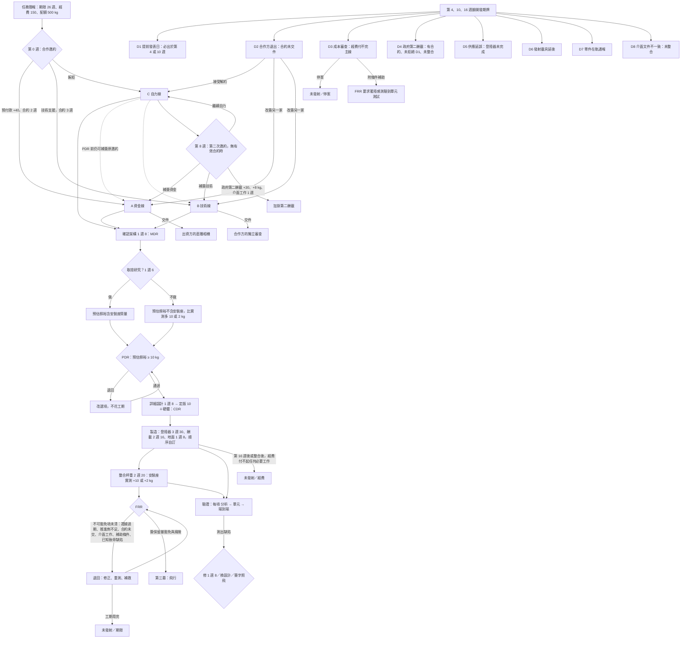
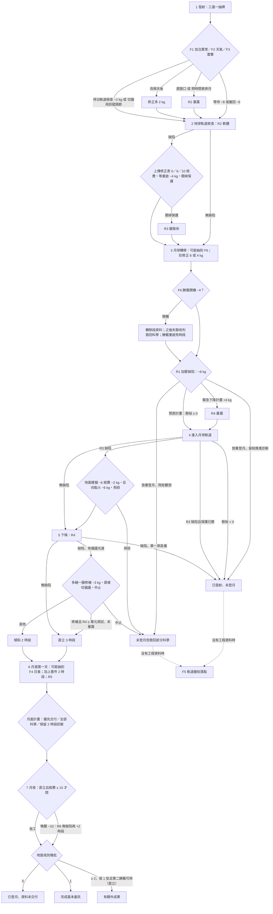

# 登月章節故事梳理

這份文件把「登月計畫」一章從開局到結算的每個決策點、它當下改變什麼、之後在哪裡回收、最後落到哪個結局，整理成圖和表，並列出不通順的地方與修正方案。故事設計原稿是 [`docs/story/lunar-mission.md`](story/lunar-mission.md)，史料表是 [`docs/story/lunar-history.md`](story/lunar-history.md)。

## 依據的版本與驗證方式

- 程式：`main`（`034e54e`）加上工作目錄裡尚未提交的改動，以 2026-11-15 凌晨 2 點前後的檔案為準。另一個 session 同時在修 `docs/game-review.md` 的項目，已處理的部分列在[第 7 節](#7-已由其他-session-處理的項目)。行號會隨後續修改移動，文案一律以鍵名標示。
- 規則來源：[`lunar-mission.ts`](../src/missions/lunar-mission.ts)（數值、事件卡、飛行模擬 `lunarFlight`、結局判定）、[`lunar-rules.ts`](../src/missions/lunar-rules.ts)（工作、合約、事件觸發、審查、停止條件）、[`lunar-flight.ts`](../src/missions/lunar-flight.ts)（飛行段接上引擎、落點影像卡）、[`chapter-ui.tsx`](../src/missions/chapter-ui.tsx)（結局文字、結算）、[`mission.ts`](../src/game/mission.ts)、[`risk.ts`](../src/game/risk.ts)。
- 驗證：在 scratchpad 寫一次性腳本，直接呼叫真實引擎 `newGame`／`runMission` 和 `lunarFlight`（沒有用 `tests/lunar-run.ts`，它是另一套重寫的規則，見 L-16）。飛行段對 8 種配置 × 400 個種子窮舉所有選項，共 112,828 條分支，另用幾組配置補查特定結局；開發期問題用固定種子重現。文中的「分支數」都來自這次窮舉。沒有用瀏覽器實測，因為檔案正在被另一個 session 修改，而腳本走的是同一套規則函式。

---

## 1. 分支圖

### 1.1 開發期（第一、二幕）

### 1.2 飛行（第三幕）

`lunarFlight`（[`lunar-mission.ts`](../src/missions/lunar-mission.ts) 的 `function* lunarFlight`）。缺陷的真相開局就由種子決定，飛行時不擲骰；「暴露」是事件牌加上的第二個缺陷來源，機率 20%。

---

## 2. 決策點與當下影響

### 2.1 開局與合約

| 決策點 | 選項 | 當下影響 | 之後回收的地方 |
| --- | --- | --- | --- |
| 合作邀約（第 0 週） | 預付款合作 | +40 經費（入軌履歷「準時」再 +10，交件款相應 −10）。之後 2 週合約工作，不花經費但占主線回合。 | 交件 +20 → 觸發「直播相機」。合約未交件前可能抽到 D2。可抽到 D4。結算標籤「出資方續約」。 |
| | 技術支援 | 3 週合約工作。 | 交件得 3 個支援時段（入軌履歷「完整驗證」+1）→ 觸發「獨立審查」。可抽到 D2、D4。標籤「技術夥伴共同署名」。 |
| | 婉拒 | 無。 | MDR 後、PDR 前可用 `contract:funding`／`contract:tech` 補簽原條件。第 8 週無合約時觸發「第二次邀約」。抽不到 D4。標籤「獨立完成」。 |
| 支援時段用途 | 製造登陸器 | 3 週 30 → 2 週 20 | — |
| | 整合 | 2 週 20 → 1 週 10 | — |
| | 定版時用輕量化安裝座 | 免 16 經費 | 實測介面質量 2 kg |
| | 任一級驗證 | 該級免經費，仍 1 週 | — |
| | 定版後重做安裝座（補救） | 1 週、0 經費 | 整合後要重測 |
| | 「獨立審查」代驗、「零件通報」請合作方檢查 | 驗證升一級，不花工期 | 見 L-13 |

### 2.2 設計選項（定版前可免費改，定版時付硬體費）

| 群組 | 選項 | 經費 | 質量 | 直接效果 | 後續影響 |
| --- | --- | ---: | ---: | --- | --- |
| 酬載 | 巡查型光譜儀 | 20 | 20 kg | 每批收集 2 時段＋下傳 1，最多 2 批；沿用設計（缺陷 20%） | 直立 3 時段剛好 1 批，**少 1 個時段就 0 批**（日食保溫、斷電重啟、傾斜著陸、低速率通道都會踩到，見 L-02） |
| | 高速率光譜儀 | 34 | 30 kg | 每批 1＋1，最多 3 批；新設計（40%） | 傾斜著陸仍有 1 批 |
| 著陸感測 | 單一雷射測高儀 | 12 | 6 kg | R4 致命 | — |
| | 加備援光達 | 24 | 12 kg | R4 降級 | 配巡查型＋月晝供電時，傾斜著陸一定 0 批：備援把「未登月」換成「資料未交付」 |
| 月面供電 | 月晝供電 | 0 | 0 | 3 時段；R6 新設計 | 喚醒成功率 60%（見 L-10） |
| | 延長操作套件 | 16 | 12 kg | 加 2 時段；R6 沿用設計 | 日食可用電池選項；可在整合後拆除換回 12 kg |
| 路線 | 直接轉移 | 0 | 需 270 kg | 修正 6 kg | — |
| | 低能量轉移 | 6 | 需 258 kg | 修正 4 kg | FRR 期限提前 2 週 |
| 安裝座 | 標準 | 0 | 實測 +10 kg | 預估裡看不到，除非做取捨研究 | 初始配置整合後只剩 4 kg（見 L-01） |
| | 輕量化 | 16 或 1 時段 | 實測 +2 kg | — | — |

常見配置的餘裕（預估不含安裝座／實測）：初始配置 14／**4**；改低能量 26／16；改輕量化 14／12；高速率 4／−6；延長套件 2／−8；備援光達 8／−2；高速率＋輕量化＋低能量 16／14；套件＋輕量化＋低能量 14／12；備援＋輕量化＋低能量 20／18。

### 2.3 主線工作、審查與驗證

| 決策點 | 選項 | 當下影響 | 之後 |
| --- | --- | --- | --- |
| 取捨研究（選做） | 做／不做 | 1 週 6。預估改用實測安裝座質量。 | 做了：初始配置 PDR 會退回（預估 4 kg），逼玩家在定版前改。沒做：PDR 用 14 kg 通過，整合時才看到 4 kg。研究本身沒有報告畫面（L-14）。 |
| PDR | 送審 | 預估餘裕 ≥ 10 kg 才過。 | 過了之後再改選項會回到 PDR，也會重新開放合約（L-15）。 |
| 製造順序 | 登陸器／酬載／地面先做 | 決定哪些單元測試先解鎖。 | 登陸器先做可避開 D5。 |
| 整合秤重 | — | 2 週 20，產生整合證據。 | 證據之後被任何改設計作廢，要重測 1 週 10。 |
| 驗證（每項三級） | 分析 3／單元 6／端到端 10，各 1 週 | 沿用設計可信風險 20→11→4→1%，新設計 40→25→9→2%。 | FRR 門檻 5%：沿用設計驗到單元、新設計驗到端到端才免簽字。單元測試要先有該項硬體，端到端要有目前的整合證據。 |
| 測出缺陷 | 修（1 週 8） | 缺陷排除，飛行不再發生。 | 整合後修理不會讓證據作廢（L-12）。 |
| | 換設計（補救） | 見下表。 | 驗證歸零，新零件有新真相。 |
| | 簽字照飛 | FRR 簽「已知缺陷」。 | 飛行到該步必定發生。單一測高儀的 R4 不能簽。 |

| 補救（定版後） | 經費 | 效果 | 條件 |
| --- | ---: | --- | --- |
| 改輕量化安裝座 | 16 | 介面 10 → 2 kg | — |
| 請合作方重做安裝座 | 0 | 同上 | 1 個支援時段 |
| 拆除延長套件 | 0 | −12 kg，少 2 時段 | 有套件 |
| 改低能量轉移 | 6 | 需求 −12 kg，期限 −2 週 | 提前後的期限還趕得上 |
| 換巡查型光譜儀 | 8 | −10 kg | 有高速率 |
| 加裝備援光達 | 12 | R4 改為降級，+6 kg | 單一測高儀 |

全部 1 週；整合後執行要再重測。補救按鈕只顯示名稱與花費，說明與條件文案沒有顯示（L-14）。

### 2.4 FRR

| 項目 | 規則 | 可否豁免 |
| --- | --- | --- |
| 整合證據對應目前設計 | 不對就退回 | 否 |
| 可裝推進劑 ≥ 路線需求 | 餘裕 < 0 退回 | 否 |
| 合約已交件或已終止 | — | 否 |
| 第二酬載介面工作 | — | 否 |
| 成本審查補助的條件 | R4 驗證等級 ≥ 單元測試 | 否（L-03） |
| 推進劑保留量 ≥ 10 kg | 0–9 kg 可簽 | 是（L-01） |
| R1–R5 可信風險 > 5% | 逐項簽 | 是；單一測高儀的 R4 已知缺陷不行 |

### 2.5 開發期事件卡與故事事件

| 卡 | 觸發（程式） | 選項：當下影響 | 之後的回收 |
| --- | --- | --- | --- |
| D1 政府提前發表日（H03） | 種子決定第 4 或第 10 週，必出 | 接受：期限 −2、+12。折衷：−1。拒絕：−10，需經費 ≥ 10。 | 拒絕 → D4 不出現、第二次邀約沒有政府選項、標籤「政府保持距離」。 |
| D2 合作方退出（H01） | 有效合約且未交件 | 接受：剩餘合約取消，預付款保留。改簽：另一家補位合約（資金 +30／技術 2 週 1 時段）。談判：1 週，資金 +10 或技術 1 時段，合約終止。 | 標籤「合作中止」；改簽者交件後照常觸發相機或審查。 |
| D3 成本審查（H02） | 經費 < 剩餘主線費用 | 補助：+16，FRR 加 R4 條件。砍額外目標：退回巡查型與月晝供電，定版後退一半價差。停案：未發射／撤案。 | 補助條件可能卡死（L-03）。 |
| D4 政府第二酬載（H14） | 有未終止合約、沒拒絕 D1、尚未整合 | 接受：+30、+8 kg、介面工作 1 週。輕量介面：+18、+4 kg。婉拒。 | 直立著陸且至少 1 批時升級為「有額外成果」；標籤「政府搭載」。 |
| D5 供應延誤（H02） | 登陸器未完成 | 等：製造多 1 週。急件：−8。庫存件：+4 kg。 | — |
| D6 發射載具延後（H02） | 永遠可抽 | 跟著延：期限 +2、−6。維持：無。 | — |
| D7 零件在軌通報（H16） | 永遠可抽 | 拆檢：1 週 4，R3 升一級。合作方：1 時段，R3 升一級。照飛：無。 | 照飛只在結算加一行，R3 真相不變。 |
| D8 介面文件不一致（H09、H11） | 尚未有整合證據 | 審查：1 週，R2 升一級，飛行中上傳修正表免費。自行對表：上傳修正表多 4。 | 在 R2 出問題時回收。 |
| A 直播相機（H27） | 資金合約交件 | 裝上：+8、+2 kg。控制室直播：+3。婉拒。 | 只有質量影響；台詞說「下一輪就好談」沒有回收（L-17）。 |
| B 獨立審查（H32） | 技術合約交件 | 用 1 時段：可信風險最高的一項升一級。記下。 | — |
| C 第二次邀約（H01、H14） | 第 8 週、無有效合約 | 補簽資金（文案 +30，實際 +60，L-04）、補簽技術、政府第二酬載、繼續自力。 | 政府選項等同 D4 接受。 |

### 2.6 飛行期

| 步驟 | 決策 | 選項：代價 | 後果 |
| --- | --- | --- | --- |
| 1 發射 | F1 加注異常（H05、H07） | 等：−8（需經費）。趕窗口：R2 暴露。 | — |
| | F2 天氣（H06） | 撤回：−6。兩天後：修正多 2 kg。 | — |
| | F3 雷擊（H08） | 檢查：−2 kg。照時間表：R2 暴露。切備用訊號調節：需 R2 驗到端到端且未測出缺陷。 | — |
| 2 地球軌道檢查 | R2 缺陷 | 上傳修正表：6（D8 審查過 0，略過 10）。等重啟：−4 kg。關保護：免費。 | 關保護 → R3 變致命，結算列出。 |
| 3 轉移 | F6 科學機會（H14） | 開機：−4。關機。 | 開機 → 之後失聯改判救回科學（推進診斷例外，L-08），酬載重啟不花時段。 |
| | R1 加壓缺陷（H12、H14、H18） | 緊急下降：+4 kg、R4 暴露。照原計畫：餘裕需 ≥ 0。飛掠：救回科學。診斷：未登月＋工程資料。 | — |
| 4 入軌 | 餘裕 < 0 | — | 未登月；關鍵項目是最後一個失效項目，否則是「保留量」 |
| | R3 缺陷（H13、H15–H17） | 地面模擬：−6 經費 −2 kg。反向點火：−6 kg。飛掠：救回科學。 | 保護已關時直接未登月。 |
| 5 下降 | R4 缺陷（H20–H23） | 單一測高儀：未登月。備援：修補 −3 kg（R4 ≥ 單元且未暴露才直立）、切備援（傾斜）、中止（救回科學）。 | 傾斜 2 時段、不會有月夜步驟。 |
| 6 月面 | F4 日食（H09、H27） | 保溫：−1 時段。套件電池：日落後時段 −1。照常：R5 暴露。 | 見 L-02。 |
| | R5 缺陷（H04、H25、H26） | 重啟：−1 時段（F6 開過機免）。低速率：每批多 1 時段。工程資料：0 批。 | 見 L-02。 |
| | 月面計畫 | 優先交付（1 批即停）、全部科學、保留 2 時段診斷。 | 選項已顯示可交批數（另一 session 已加）。 |
| 7 月夜 | 直立且經費 ≥ 10 | 收工／喚醒 −10。 | R6 無缺陷 +2 時段，與剩餘時段合併。見 L-10。 |
| 失聯後 | F5 落點影像（H24） | 公開／婉拒。 | 只加標籤；不分失聯在哪一步（L-07）。 |

### 2.7 結局判定

[`lunar-mission.ts`](../src/missions/lunar-mission.ts) 的 `end()` 與 `if (batches === 0)` 區塊決定成果與收尾；文字由 [`chapter-ui.tsx`](../src/missions/chapter-ui.tsx) 的 `lunarUi.outcome` 帶值。

| 成果 | 收尾 | 程式條件 | 文案鍵 |
| --- | --- | --- | --- |
| 未發射 | 期限／經費／停案 | `game.stop` | `lunarEndingStopped*` |
| 已發射、未登月 或 救回科學 | 自己的取捨 | 不會發生 | — |
| | 清單上的那一項 | 關鍵是「保留量」，或關鍵項目未達「看過」 | `lunarEnding{Lost,Salvage}Listed`（另一 session 已加 `LostListedMiss`） |
| | 查了也修了 | 關鍵項目「看過」：未暴露，且已修或（未測出缺陷且等級 ≥ 2） | `lunarEnding{Lost,Salvage}Missed` |
| 資料未交付 | 自己的取捨 | 0 批，且（保留了診斷時段且原時段夠 1 批）或沒有任何失效 | `lunarEndingNoDataTradeoff` |
| | 清單上／查了也修了 | 0 批，其餘情況；關鍵項目 = 傾斜時 R4，否則最後一個失效項目 | `lunarEndingNoData{Listed,Missed}` |
| 基本委託／額外成果 | 救回來的 | 飛行中有 R1–R5 失效 | `lunarEnding{Success,Extra}Recovered` |
| | 看過才飛的 | 飛行用到的項目最多 1 項未「看過」 | `…Checked` |
| | 根本沒去看 | 2 項以上未「看過」 | `…Unchecked` |

飛行的 13 格在窮舉中都出現（「有額外成果／看過才飛的」要高速率光譜儀且五項驗到端到端才出現），未發射的 3 格用引擎重現過，沒有到不了的結局。問題在於好幾格會被錯誤的原因觸發（L-01、L-02、L-05、L-20）。

### 2.8 伏筆與回收

| 早期選擇 | 回收位置 | 狀態 |
| --- | --- | --- |
| 取捨研究 | PDR 預估、整合秤重 | 有回收，但研究沒有報告畫面（L-14） |
| 輕量化安裝座 | 整合秤重 +2 kg | 有 |
| 低能量轉移 | FRR 期限、修正量 | 有 |
| 備援光達 | 下降段 | 有；巡查型＋月晝供電時效果只剩換結局分類 |
| 延長套件 | 月面時段、日食電池、月夜成熟度 | 有 |
| D1 拒絕 | D4、第二次邀約、標籤 | 有 |
| D8 介面審查 | R2 上傳修正表的價格 | 有 |
| D7 照飛 | 結算一行字 | 只有文字 |
| 直播相機裝上 | +2 kg | 台詞的「下一輪」沒有回收 |
| F6 開機 | 失聯改判、重啟免時段 | 有；推進診斷例外（L-08） |
| 緊急下降計畫 | R4 暴露、修補無法直立 | 有 |
| 關掉故障保護 | R3 致命 | 有 |
| 補助條件 | FRR | 有，但可能卡死（L-03） |
| 「結算會指出哪個選擇造成缺口／留下餘裕」 | `lunarEndingStoppedFunds`、`lunarEndingSuccessRecovered` | 結算沒有這一段（L-09） |

---

## 3. 問題清單

嚴重度：**高**＝玩家會卡住、被規則騙進必敗、或結局文字和事實相反；**中**＝因果說明錯位、選擇沒有預告後果、真實任務因果明顯不對；**低**＝措辭、被支配的選項、少數邊角。

本節是規則與文案的錯誤（L-01～L-23）。決策本身的動機、層級、對等問題在[第 4 節](#4-決策品質動機層級對等)，編號接續為 L-24～L-32。

### 高

**L-01　保留量豁免可以簽到必敗，結局還說「檢查它要 0 週 0 經費」**

- 位置：[`lunar-rules.ts`](../src/missions/lunar-rules.ts) `frr()` 的 `waiver = { id: 'reserve' …`；[`lunar-mission.ts`](../src/missions/lunar-mission.ts) `if (spareKg < 0) return lost(failures.at(-1) ?? 'reserve')`；[`chapter-ui.tsx`](../src/missions/chapter-ui.tsx) `lunarUi.outcome` 的 `item`／`percent`／`credits`；[`lunar-flight.ts`](../src/missions/lunar-flight.ts) `reportFor` 的 `lunarTransferFail`；文案 `lunarWaiverReserveDetail`。
- 現象：餘裕 0–9 kg 都能簽豁免，但轉移段固定扣直接轉移 6 kg、低能量 4 kg。窮舉 300 個種子：直接轉移餘裕 0–5 kg、低能量 0–3 kg，**不論飛行中怎麼選都到不了月面（100%）**，多數停在進入月球軌道。餘裕到 6 kg（直接）或 4 kg（低能量）時，必敗率掉到 4%。
- 最常見的新手路線就會踩到：初始配置不做取捨研究，PDR 用預估 14 kg 通過，整合實測 4 kg，FRR 只剩一個可勾的豁免框，文案只寫「目前餘裕 4 kg，保留量目標 10 kg」。
- 結局（種子 1 實測）：「The mission ended at Lunar orbit insertion on Accept the reduced propellant reserve. It was on the list signed at flight review, believed to carry a 48% risk. Checking it would have cost 0 week and 0 credits.」`{item}` 是豁免按鈕的標籤，48% 是「所有飛行項目都沒壞」的機率，0 週 0 經費來自 `lunarPlanCost` 已無剩餘工作。飛行紀錄的 `lunarTransferFail` 也寫成「需要 2 kg、餘裕 0 kg」，實際是需要 6 kg、餘裕 4 kg。
- 修正：
  1. 規則：`frr()` 把「餘裕 < 本路線修正量（`routes[route].correctionKg`）」改成不可豁免的退回項，新鍵 `lunarFrrReturnCorrection`：「餘裕 {margin} kg 不夠本路線預定的修正 {need} kg。」只有 `correctionKg ≤ 餘裕 < reserveKg` 才給豁免框。
  2. 豁免說明 `lunarWaiverReserveDetail` 改為：「餘裕 {margin} kg，本路線預定修正用 {correction} kg，保留量目標 {need} kg。簽了之後，任何額外的推進劑支出（改期發射、漏氣、晚一步修正）都會讓登陸器進不了月球軌道。」
  3. 結局：`critical === 'reserve'` 另用 `lunarEndingLostReserve`／`lunarEndingSalvageReserve`：「登陸器到月球時只剩 {spare} kg。FRR 時保留量簽到 {margin} kg，途中這些支出把它用完：{spends}。」`{spends}` 由 `steps` 裡有扣推進劑的選擇組成。不帶 `{percent}`、`{weeks}`、`{credits}`。
  4. `reportFor` 的 `lunarTransferFail` 改傳 `need: correctionKg + correctionExtra`、`margin: setup.marginKg`（需要從 `lunarFlight` 回傳這兩個值）。
- 預期：FRR 不再核准必敗的飛行；新手在退回畫面看到可用的補救（改低能量、輕量化安裝座）；結局說出真正的原因。

**L-02　月面時段用掉後 0 批，結局說成「時段給了工程資料」或怪到不相干的項目**

- 位置：[`lunar-mission.ts`](../src/missions/lunar-mission.ts) 日食 `if (choice === 'Shelter') windows -= 1`、酬載應對 `Restart`／`LowRate`、`if (batches === 0)` 的 `byChoice` 與 `failures.at(-1)`；文案 `lunarCardEclipseShelterDetail`、`lunarRiskPayloadRestartDetail`、`lunarRiskPayloadLowRateDetail`、`lunarRiskDescentSwitchDetail`、`lunarEndingNoDataTradeoff`、`lunarClosingTradeoffText`。
- 現象：初始配置（巡查型＋月晝供電）直立著陸只有 3 時段，一批正好要 3 時段。以下任何一個都會讓當天 0 批：日食選「關機保溫」、酬載缺陷選「斷電重啟」（F6 沒開機時）、選「低速率通道」（每批變 4 時段）、備援光達傾斜著陸（2 時段）。這些選項的說明只寫「少 1 個時段」，沒說會掉到 0 批。另一個 session 已讓月面上每個決策都顯示 `lunarSurfaceBudget`（剩幾個時段、一批要幾個），並在「月面計畫」選項顯示可交批數；但日食與酬載應對的選項本身仍不說選了之後剩幾批，玩家要自己減。日食那一步顯示的時段還沒加上延長套件的 2 個（`windows += nightWindows` 在日食之後才執行），有套件的玩家會看到偏少的數字。下降段的「直接切備援」發生在月面之前，沒有任何預告。
- 結局歸因錯誤（窮舉）：
  - 沒有任何項目失效、只因保溫而 0 批：判成「自己的取捨」，文案說「時段給了工程資料」。2,552 條分支。
  - 早先有別的項目失效又被救回（例如 R1 選「照原計畫」），之後因保溫 0 批：關鍵項目變成那個早先的項目，文案寫「加壓系統只驗到沒驗證，去查它要 1 週 3 經費」。5,159 條分支。
  - 酬載出問題時，三個應對當天都拿不到 1 批，只能靠月夜喚醒救回（直立、經費 ≥ 10、R6 沒缺陷）。巡查型＋月晝供電下，36% 的情況連喚醒都救不回。
  - 備援光達＋巡查型＋月晝供電傾斜著陸：0% 交付。說明文字 `lunarSensorRedundantDetail` 只說「備援會讓登陸器傾斜著陸」。
- 測試的 `cautious` 策略從不選「關機保溫」，所以現有測試抓不到。
- 修正：
  1. `lunarFlight` 記一本時段帳：`windowSpends: { source: 'tilt' | 'eclipse' | 'restart' | 'lowRate' | 'diagnostics'; windows: number }[]`，和另一 session 加的 `surface` 帳合併。
  2. `batches === 0` 時：如果酬載沒有失效或已救回，`critical` 改成新值 `'windows'`，收尾仍是 `tradeoff`，但文案依來源分開。`lunarEndingNoDataTradeoff` 只留給 `diagnostics`。新鍵 `lunarEndingNoDataWindows`：「酬載是好的。著陸後有 {landed} 個時段，{spends}，一批要 {each} 個，地面一批也沒收到。」只有 R5 本身失效、或傾斜著陸（R4）造成時段不足時，才把關鍵項目指向 R5／R4。
  3. 在日食、酬載應對、下降應對的選項說明後面加「→ 今天可交 {result} 批」，用已有的 `lunarPlanBatches` 計算（需把當下 `windows`、`nightWindows`、`downlink` 傳給 `describe`）。結果是 0 時改用警告樣式。`lunarFlight` 把 `windows += nightWindows` 移到日食之前，讓 `lunarSurfaceBudget` 顯示的數字和最後計算一致。
  4. `lunarSensorRedundantDetail` 補一句：「傾斜著陸只有 {tilted} 個時段。」
- 預期：玩家在選之前就知道哪個選擇會讓委託落空；結局指向真正花掉時段的那一步。

**L-03　附條件補助在「分析就找到並修好 R4」時永遠過不了 FRR**

- 位置：[`lunar-rules.ts`](../src/missions/lunar-rules.ts) `frr()` 的 `if (state.grant && risks.descent.level < mission.checkedLevel)`；文案 `lunarCardCostReviewGrantDetail`、`lunarGrantCondition`。
- 現象：條件只看等級。R4 在分析（等級 1）就測出缺陷並修好後，驗證步驟要求 `!found && !fixed`，再也不能往上驗；備援光達也不換 R4 的身分。FRR 永遠有一個不可豁免的「補助條件」，只能等到期限。重現：種子 8，低能量轉移，第 2 週做下降軌跡模擬測出缺陷、修好，第 10 週成本審查選補助，整合後 FRR 只剩補助條件擋住，最後以「未發射／期限」結束，結局文字還說「風險清單清到只剩最後幾行」。
- 修正：條件改為 `!(risks.descent.fixed || (!risks.descent.found && risks.descent.level >= checkedLevel))`，與飛行端 `checked()` 同一個定義；文案改「著陸感測要驗到單元測試，或測出問題並修好」。`tests/lunar-run.ts` 的 `mustDescent` 同步。
- 預期：補助條件只要求「看過」，不會懲罰提早找到問題的玩家。

**L-04　第 8 週補簽資金合約入帳 +60，卡面寫 +30**

- 位置：[`lunar-mission.ts`](../src/missions/lunar-mission.ts) `card('SecondOffer', … { Funding: { credits: 30 } …})`；[`lunar-rules.ts`](../src/missions/lunar-rules.ts) `chooseCard` 先加 `effect.credits`，再呼叫 `sign(…, true)` 加 `latePartnerships.funding.advance`。
- 重現：種子 1，婉拒後第 8 週選補簽資金，製造登陸器後經費 114；選繼續自力是 54。卡面 `lunarCardSecondOfferFundingDetail` 與設計文件都寫 +30。`tests/lunar-run.ts` 只加一次，平衡測試看不到。
- 修正：`Funding: {}`，金額只由 `sign()` 給；`values` 的 `credits` 改讀 `latePartnerships.funding.advance`。
- 預期：自力線轉資金線的報酬回到設計值，卡面與入帳一致。

**L-05　結局承諾「再深一級就看得到」，實際不可能或不會看到**

- 位置：[`lunar-mission.ts`](../src/missions/lunar-mission.ts) `end()` 的收尾；[`chapter-ui.tsx`](../src/missions/chapter-ui.tsx) `lunarUi.outcome`；文案 `lunarEndingLostMissed`、`lunarEndingSalvageListed`、`lunarEndingNoDataMissed`、`lunarEndingLostListed`、`lunarClosingListedText`。
- 另一 session 已處理：`listed` 收尾在下一級也會漏時，改用 `lunarEndingLostListedMiss`／`lunarEndingNoDataListedMiss`。仍未處理的三種（窮舉分支數）：
  - `missed` 收尾仍寫「再深一級要 {weeks} 週和 {credits} 經費」，但下一級同樣會漏：488。
  - 關鍵項目已驗到端到端，下一級不存在，文字帶出「0 週 0 經費」：`listed` 1,150、`missed` 303。這些多半是飛行中選了趕窗口、照時間表奔月、緊急下降或不保溫造成的暴露。
  - `listed` 文案說「它在飛行審查簽過字的清單上」，但該項可信風險 ≤ 5%、FRR 根本沒要求簽，失敗來自飛行中的暴露：3,450。
- 修正：在 `outcome` 算出 `cause`：`exposed`（`flight.exposed` 含關鍵項目且真相本來沒有缺陷）、`known`（`found && !fixed`）、`signed`（可信風險 > 5%）、`unsigned`。依 `cause` 選文案：
  - `exposed`：新鍵 `lunarEnding{Lost,Salvage,NoData}Exposed`：「{item} 在地面驗到{level}都正常。缺陷來自飛行中的「{decision}」，地面測試看不到這一種。」`{decision}` 取 `steps` 裡造成暴露的選項標籤。
  - 下一級不存在或也會漏：沿用 `riskDebriefTop` 的意思：「它通過了每一級做過的測試；就算做 {work} 也會漏掉。」
  - `listed` 的「簽過字」只在 `signed`／`known` 時出現。
- 預期：結局標題和下方逐項結算不再互相矛盾，「測試會漏」的教學一致。

### 中

**L-06　手動結束任務被寫成「接受成本審查的停案」**

- 位置：[`Single.tsx`](../src/ui/Single.tsx) 任務動作裡的 `cancel`；文案 `lunarClosingCancelledText`、`lunarEndingStoppedCancelled`。
- 現象：任何時候按「結束任務」都會走到 `stop: 'cancelled'`，結局說「審查之後計畫停案」「團隊在成本審查接受了停案」。重現：種子 2 第 1 週就結束。
- 修正：`outcome` 依 `game.events.includes('CostReview:Stop')` 分流；手動結束用新鍵 `lunarEndingStoppedWithdrawn`：「團隊在發射前結束了計畫。已完成的硬體和測試紀錄留給下一隊。」
- 預期：停案結局只在真的停案時出現。

**L-07　軌道器「拍到撞擊暗點」出現在沒有撞月的結局**

- 位置：[`lunar-flight.ts`](../src/missions/lunar-flight.ts) `replay` 的 `imaging:` 條件；文案 `lunarCardImagingStory`、`lunarCardImagingShareResult`。
- 現象：只要是未登月或救回科學、且沒有工程資料就出現。窮舉中轉移段放棄（飛掠）2,934、入軌失敗或飛掠 4,804、下降中止留在軌道 80。這些情況登陸器沒有撞月，結果卻是「離目標幾百公尺的暗點」。H24（HAKUTO-R）是下降中失事。
- 修正：條件加 `next.value.segment === 'descent' && !decisions.includes('Abort')`。轉移與入軌失敗如要保留收尾，另寫一張「深太空網路追蹤最後的軌道」卡，或不出卡。
- 預期：史料卡只出現在對應的處境。

**L-08　轉移段已取得科學資料，選「推進診斷」仍判「未登月、沒有科學」**

- 位置：[`lunar-mission.ts`](../src/missions/lunar-mission.ts) `else if (choice === 'Diagnose') { engineering = true; return end('lost', 'pressure') }`。
- 現象：其他失聯都會因 `cruiseData` 改判救回科學，只有這裡寫死 `lost`；結算同時出現「轉移段資料已收集」標籤。1,075 條分支。
- 修正：`end(cruiseData ? 'salvage' : 'lost', 'pressure')`，保留 `engineering = true`。`lunarRiskPressureDiagnoseDetail` 的「也沒有科學資料」改成依是否已有轉移段資料顯示。
- 預期：F6 的承諾一致成立。

**L-09　「未發射」結局假設單一原因，並承諾結算沒有的內容**

- 位置：文案 `lunarEndingStoppedDeadline`、`lunarEndingStoppedFunds`、`lunarEndingSuccessRecovered`；未使用的 `lunarCauseLabel`。
- 現象：
  - 期限結局固定說「風險清單清到只剩最後幾行」，但期限也會在製造中途、或 L-03 卡住時觸發。
  - 經費結局說「登陸器還沒做完」「結算指出是哪個選擇造成 {credits} 經費的缺口」。經費停止也會發生在整合之後（付不起重測）；結算沒有任何「哪個選擇」的段落。
  - 救回來的結局說「結算指出是哪個前期決定留下了換回任務的餘裕」，結算只有剩餘推進劑一行。
- 修正：
  - 期限依停止時的 `stage` 分兩句：`review` 時用現有文案；其他用新鍵 `lunarEndingStoppedDeadlineBuild`：「發射窗口關閉時，{stage} 還沒完成。」
  - 在 `LunarDebrief` 加一段 `lunarCauseLabel`（「影響最大的決策」），從 `game.log` 取花費最大的三筆選做支出（驗證、補救、事件扣款、改期）與帶來質量的事件，各一行。經費與救回結局改成指向這一段。
- 預期：結局句子都能在結算頁找到依據。

**L-10　月夜喚醒常常加不出批數，月晝供電的喚醒成功率不合實情**

- 位置：[`lunar-mission.ts`](../src/missions/lunar-mission.ts) 月夜段、`powers.dayOnly` 的 `maturity: 'new'`；文案 `lunarNightWakeDetail`。
- 現象：巡查型＋月晝供電交了 1 批後剩 0 時段，喚醒 +2 仍不到一批要的 3，花 10 經費沒有任何效果；窮舉中喚醒成功卻沒有多一批的分支有 10,853（巡查型月晝 7,289、巡查型套件 2,619、高速率已達上限 945）。說明只寫「多 2 個時段」。另一方面，月晝供電的 R6 用新設計 40% 缺陷，等於六成機率撐過月夜；IM-1、Blue Ghost 1 號都沒有設計過夜，Surveyor 3 也沒有醒來（H29），只有 Surveyor 1、5 這類有熱控設計的撐過（H28、H30）。
- 修正：
  1. 喚醒說明加「→ 可多交 {more} 批」，算法同 `lunarFlight` 月夜段；`more` 為 0 時不出這一步，直接以收工結算。
  2. 月晝供電的 R6 改用新的成熟度等級，例如 `defectChance.unrated = 0.85`，或乾脆只在有延長套件時才問要不要喚醒。說明 `lunarRiskNightDetail` 同步。
- 預期：月夜決策只在有實質差別時出現，結果符合史料。

**L-11　整合後才交件的資金合約，裝上直播相機會讓整合證據作廢，卡面沒說**

- 位置：[`lunar-rules.ts`](../src/missions/lunar-rules.ts) `chooseCard` 的 `if (effect.massKg) { … if (currentEvidence(game)) next = reviseDesign(…) }`；文案 `lunarCardCameraMountDetail`、`lunarCardCameraStory`。
- 重現：種子 1，資金合約、先整合再做合約，第 15 週交件選「裝上」，證據過期，要重測 1 週 10。另外補簽的資金合約沒有交件款，`lunarCardCameraStory` 仍寫「交件款入帳」。
- 修正：有目前證據時，「裝上」說明加「已整合：要重測 {weeks} 週 {credits} 經費」，或直接不給這個選項（「太晚了，改在控制室直播」）。卡片敘述依 `contract.milestone > 0` 分兩句。
- 預期：同一條「整合後改動要重測」規則在卡片上看得到。

**L-12　整合後修理缺陷不必重測**

- 位置：[`lunar-rules.ts`](../src/missions/lunar-rules.ts) `task(fix, …)`。
- 現象：整合後做端到端測試測出缺陷，修好後證據仍有效（種子 4，R2）。同一章的補救、事件加質量都會讓證據作廢，CubeSat 101 §6.9 也要求改動後重測。
- 修正（二選一）：修理完成時若已有整合證據，`revision + 1` 讓證據作廢；或維持現狀，但把 `lunarFoundFix` 的說明改成「修理含回歸測試」，並把整合後修理改成 2 週 18 經費。前者較符合真實流程，但會讓晚期修理更貴，需重跑平衡。
- 預期：玩家學到的是一致的規則。

**L-13　事件卡的「驗證升一級」跳過硬體前置條件**

- 位置：[`lunar-rules.ts`](../src/missions/lunar-rules.ts) `chooseCard` 的 `PartsAlert`、`IcdMismatch`、`Review` 直接呼叫 `verify()`。
- 現象：第 4 週的介面審查可以把 R2 從分析升到「飛行軟體台架測試」，當時地面系統還沒建；零件通報可以把 R3 升到「閉迴路姿控測試」，當時還沒整合。
- 修正：卡片只在下一級的前置條件成立時升級；不成立時改成「記下：下一級驗證免費」的憑證（`missionState.vouchers`），條件成立後在驗證按鈕上兌現。說明文字依狀態顯示其中一種。
- 預期：驗證階梯的因果和真實流程一致。

**L-14　寫好的故事段落沒有顯示**

- 位置：下列鍵在 `src/` 中除了字典與型別檢查外沒有被使用：`lunarTradeReport`、`lunarTradeMount`、`lunarTradeRoute`、`lunarTradeData`、`lunarBatchForecast`、`lunarWindowFormula`、`lunarInterfaceTitle`／`Story`／`Why`／`Options`、`lunarRetestNote`、`lunarCauseLabel`、`lunarResume*`、`testStories`（`lunarTestNoResources`、`lunarTestBetter`、`lunarTestClean`、`lunarTestMissed`、`lunarFoundFly`、`lunarFoundRedesign`）、`lunarProposals` 與四組 `lunar*Brief`；補救的 `description`／`requires` 因 `RemedyPreview` 是空的、`Repair` 只給沒有 `tasks` 的章節，也不會顯示。
- 影響：取捨研究做完沒有報告，只是預估數字變了；整合秤重這個設計文件裡的關鍵轉折只是一行數字；補救按鈕看不到「FRR 期限提前 2 週」「之後要重測」；設計文件承諾的四種測試情境文案都沒出現。
- 修正：
  1. `lunarEstimate` 在 `completed(game, 'trade')` 時顯示 `lunarTradeMount`、`lunarTradeRoute`、`lunarTradeData`（批數用 `lunarPlanBatches(design, 'extra', daylight + night)`）。
  2. 整合工作的 `detail` 在安裝座增量 > 2 kg 時回傳 `lunarInterfaceStory`（帶 `growth`、`margin`），並附 `lunarInterfaceOptions`。
  3. 補救按鈕下方顯示 `description` 與 `requires`，整合後加 `lunarRetestNote`。
  4. `found:*` 事件的說明依資源選 `lunarTestNoResources` 或 `lunarFoundOptions`；`lunarFoundFly` 放進 FRR 的已知缺陷簽字項。
  5. 不打算做的（部門提案、`lunarResume*`）從字典與 `lunarMission` 刪除，避免誤以為有實作。
- 預期：設計文件裡的劇情節點都有畫面；玩家選補救前知道代價。

**L-15　PDR 通過後改一下設計，合作邀約又打開**

- 位置：[`mission.ts`](../src/game/mission.ts) `configure` 把 `gate` 改回 `PDR`；[`lunar-rules.ts`](../src/missions/lunar-rules.ts) `contract:*` 任務只看 `gate === 'PDR'`。
- 重現：種子 3，PDR 通過後切換一次感測器再切回，`contract:funding` 重新可用。邀約文案寫「保留到 PDR 通過前」。
- 修正：條件加「沒有任何 PDR 通過紀錄」：`!game.log.some(e => e.review?.gate === 'PDR' && e.review.passed)`。
- 預期：邀約期限與文案一致。

**L-16　`tests/lunar-run.ts` 是另一套規則，平衡數字可能不是遊戲實際的數字**

- 位置：[`tests/lunar-run.ts`](../tests/lunar-run.ts)（註解仍寫「lunar chapter is not wired into mission.ts yet」）。
- 差異：補簽資金 +30（遊戲 +60，L-04）；成本審查的觸發用自己的 `mainlineLeft()`（遊戲用 `lunarPlanCost`，後者含重測與介面工作）；不經過 `stopReason`，所以「第 16 週前經費不足先不停」的規則沒被測到；飛行選擇的 `cautious` 從不選日食「關機保溫」，L-02 抓不到。[`docs/story/lunar-mission.md`](story/lunar-mission.md) 的平衡表與 16 條路線都由它產生。
- 修正：改用 `newGame`＋`runMission` 驅動（本次 scratchpad 的寫法：事件依策略選、任務用 `{ type: 'task', task, turn: game.log.length }`），刪掉重寫的規則。
- 預期：平衡表反映玩家實際玩到的規則；L-01 到 L-04 這類問題會被測試抓到。

**L-20　五項都驗到端到端，仍被判成「根本沒去看」**

- 位置：[`lunar-mission.ts`](../src/missions/lunar-mission.ts) `checked()` 把暴露的項目算成沒看過；[`chapter-ui.tsx`](../src/missions/chapter-ui.tsx) `count:` 用另一個條件 `!fixed && level < checkedLevel`；文案 `lunarClosingUncheckedText`、`lunar{Success,Extra}Unchecked`。
- 現象：高速率光譜儀、R1–R5 都驗到端到端的配置，200 個種子中有 901 條成功分支（基本委託 475、額外成果 426）被判「真相本來就好，根本沒去看」。原因是飛行中選了「趕窗口」「照時間表奔月」「不保溫」等讓項目被暴露，加上喚醒時飛到的 R6，湊滿兩項。文案說「好幾項從沒好好查過」，`{count}` 卻算出 0 或 1，畫面是「0 items flew without a real check」。
- 修正：收尾分開計算「地面沒驗」與「飛行中暴露」。兩項以上地面沒驗才用 `unchecked`；地面都驗過、只是飛行中暴露的，歸 `checked`，並加一行標籤 `lunarTagExposed`「飛行中有 {count} 項跳過了檢查，這次沒有出事。」`{count}` 改用與判定相同的條件，英文補單複數。
- 預期：驗證做足的玩家不會被結局說成沒查；飛行中的冒險仍有記錄。

### 低

**L-17　被支配或沒有回收的選項**

- 直播相機「婉拒」被「控制室直播」完全支配（+3、無代價）；「裝上」只多 2 kg，出資方台詞的「下一輪就好談」沒有回收。建議：「續約」標籤只給裝上或控制室直播；裝上且直立著陸時加一個「月面直播」標籤，引用 H27 的日食影像。
- 下降「多繞一圈修補」在 R4 未達單元測試時和「直接切備援」結果相同，還多花 3 kg（76 條分支）。建議等級不足時不列這個選項，或把說明前置成「目前驗證等級不夠，修補後仍會傾斜」。
- 零件通報在 R3 已達最高級或已測出缺陷時，「拆檢」仍收 1 週 4 經費但沒有效果。建議此時不列。

**L-18　結算把選項標籤當成敘述**

- [`chapter-ui.tsx`](../src/missions/chapter-ui.tsx) `LunarDebrief`：關掉故障保護時印 `lunarRiskSoftwareDisable`（「關掉這項保護繼續飛」），略過介面審查時印 `lunarCardIcdMismatchSkip`（「各組自行對表」）。建議新鍵 `lunarDebriefProtectionOff`「飛行中關掉了故障保護。」、`lunarDebriefIcdOpen`「介面文件沒有開跨組審查。」並把趕窗口、照時間表奔月、緊急下降、不保溫這四種暴露列進「已接受的風險」，與設計文件的標籤表一致。

**L-19　R2 測出缺陷並修好後，雷擊卡不給「切備用訊號調節」**

- [`lunar-mission.ts`](../src/missions/lunar-mission.ts) `states.software.level >= 3 && !states.software.found`。修好比單純通過更有把握，條件改 `level >= 3 && (!found || fixed)`。

**L-21　第二次邀約的時機與敘述**

- 第 8 週仍在 PDR 前的自力線玩家，會收到較差的補位條件，而原邀約其實還開著。「合作方退出」後的第二次邀約說「兩家合作方都回來了」，其中一家剛退出。建議第二次邀約只在 PDR 通過後觸發，退出後改用另一段敘述。

**L-22　設計文件與程式不一致**

- [`docs/story/lunar-mission.md`](story/lunar-mission.md) 分支圖有「R2 致命 → 已發射、未登月」，R2 從不致命。
- 同文件「查了也修了」的條件包含「修過之後又被跳過的檢查放進新的缺陷」，程式判成「清單上的那一項」。
- F6 說「之後任何一步失聯都改判救回科學」，推進診斷例外（L-08）。
- 延長套件的日落後時段寫在月夜步驟結算，程式在月面第一天就加進時段。
- 修正：L-02、L-05、L-08 改完後同步這幾段，並重畫分支圖（可直接用本文 1.2 節）。

**L-23　日食時長**

- 從月面看地球遮日，持續數小時；遊戲讓它吃掉一整個操作時段（一個月晝 3 個時段，約 4–5 個地球日）。日食卡也被放在「cruiseCards」牌組。建議時段代價保留，但說明改成「為了保溫，酬載要關機到電池回溫，前後約一個操作時段」，牌組改名 `surfaceCards`。

---

## 4. 決策品質：動機、層級、對等

每個決策點多檢查三件事：

- **動機**：玩家為什麼會碰到這個選擇，情境有沒有交代；真實任務裡，會不會在這個時間點、由這個角色做這個決定。
- **層級**：問題的層級對不對。有沒有把架構層的決定（路線、酬載）和元件細節（某個零件要不要多測）放在同一層問，或讓計畫經理決定該由別人決定的事。
- **對等**：同一題的選項是不是在比同一類東西；有沒有明顯最好或明顯是陷阱的選項；代價和收益是不是同一個量級。

**玩家的角色。** 簡報只寫「你的團隊」，沒有指定職位。實際上玩家同時當計畫經理、系統工程師、測試負責人、發射主任和飛控。下表的「層級」以 NASA 專案的分工判斷：計畫經理管合約、經費、時程，並向審查會提出要接受的風險；系統工程師管架構與介面；分系統負責人管元件與測試；發射服務商與靶場管發射場上的決定；飛控團隊管飛行中的應變；審查委員會與上級決定停案和接受殘餘風險。

**對等怎麼判斷。** 除了讀規則，也在 scratchpad 窮舉：4 種配置 × 250 個種子 × 2 種剩餘經費，對每個飛行決策節點，比較各選項之後「最好能到的結局」（先比結局等級：未登月 < 救回科學 < 資料未交付 < 基本委託 < 額外成果，再比批數）。這是在已知真相下比較，所以只能抓出「怎麼走都不會比較好」的選項；趕窗口、不保溫這類賭未知缺陷的選項不能用它判斷，改用規則推論。

另外確認了兩件影響對等的事實：章節進度（[`progress.ts`](../src/game/progress.ts)）只記「達到最低要求」「達到額外目標」兩個布林值；剩餘經費、簽了幾項風險、結算標籤都不影響任何分數或後續章節。

### 4.1 逐項檢查

判定：**好**＝三項都沒問題；**偏**＝有一項偏弱但仍是真的取捨；**失衡**＝有明顯最佳解或陷阱；**錯層**＝層級不對。

| 決策點 | 動機 | 層級 | 對等 | 判定 |
| --- | --- | --- | --- | --- |
| 合作邀約 | 簡報說兩家各有條件，但「主線約 140–146 經費對 150 預算」的缺口文案 `lunarOfferGap` 沒顯示，玩家看不出為什麼需要合作。時點合理：合作夥伴屬於實作方案，在概念階段就定。 | 計畫經理，對。 | 婉拒換到的是工期，但工期不稀缺（L-24）。設計文件的平衡表：自力不驗證 43%，資金線驗證 83%。 | 失衡 |
| 酬載、月面供電 | 由額外目標驅動，清楚。 | 架構層，計畫經理＋科學組，對。 | 經費、質量、時段、新設計的缺陷率四種代價互換，量級相近。 | 好 |
| 著陸感測 | 「致命或降級」說得清楚。 | 架構層，對。 | 搭巡查型＋月晝供電時，傾斜著陸一定 0 批，備援只換結局分類（L-02）。 | 偏 |
| 奔月路線 | 由質量驅動，清楚。 | 軌道設計屬架構層，對。 | 低能量 6 經費換 12 kg 需求和 2 kg 修正，代價只有提前 2 週；安裝座要 16 經費才換 8 kg。工期不稀缺時，直接轉移只剩「不提前」這個沒價值的好處。 | 失衡 |
| 酬載安裝座 | 沒做取捨研究的玩家不知道為什麼要花 16 經費選它。 | 支架與線束的質量是細部設計和整合的事，卻和路線、酬載放在同一個開局畫面（L-25）。 | 和路線比的是同一種東西（kg），可比。 | 錯層 |
| 取捨研究 | 做了反而讓 PDR 更難過，報告也不顯示（L-14）。 | 真實的取捨研究是概念階段的必做產出，不是選做工作（L-25）。 | 不做短期看起來比較好，卻直接通往 L-01 的必敗路線。 | 錯層、陷阱 |
| 製造順序 | 有理由（先解鎖哪項單元測試、避開 D5），但 D5 事前看不到。 | 整合測試排程，計畫經理可以決定。 | 可。 | 好 |
| 逐級驗證 | 靠畫面上的百分比和 FRR 的 5% 門檻驅動。 | 18 個「做某一項測試」的按鈕和合約、架構決定同一層（L-26）。真實任務在 PDR／CDR 訂驗證計畫，計畫經理決定的是預算分配和要接受哪些風險。 | 驗證要花錢花週，簽字接受風險不用任何代價（L-27）。 | 錯層、失衡 |
| 測出缺陷後 | 清楚。 | 對。 | 修（1 週 8）幾乎總是比換設計便宜：加光達要 12 經費、+6 kg，換回巡查型要 8 經費還失去批數。換設計只在修不起時才有意義。 | 偏 |
| 整合後補救 | 清楚。 | 把「減質量」（安裝座、套件、路線、酬載）和「改風險」（加光達，反而加 6 kg）混在同一份清單。 | 低能量 6 經費換 12 kg 最划算，其餘多半被它支配。 | 偏 |
| FRR 簽字 | 玩家自己簽自己的風險。真實任務由審查委員會與上級接受，計畫只負責提出。 | 簽字者的角色不對（L-27）。 | 簽字免費，見上。 | 錯層、失衡 |
| D1 提前發表日 | 清楚，政府聯絡人來電。 | 計畫經理談判，對。 | 工期寬鬆時「接受」等於白拿 12 經費；「折衷」只少提前 1 週卻拿不到錢，被「接受」支配；「拒絕」花 10 經費又失去 D4。 | 失衡 |
| D2 合作方退出 | 清楚（H01）。 | 對。 | 三個選項的代價同量級。 | 好 |
| D3 成本審查 | 清楚（H02）。 | 停案是機構或審查會的決定（VIPER 是 NASA 決定終止），不該是團隊自願按的按鈕（L-28）。 | 補助與砍目標可權衡；「停案」對玩家永遠不是好選擇。 | 錯層 |
| D4 政府第二酬載 | 清楚（H14）。 | 對。 | 「輕量介面」只要 +4 kg，正常著陸再交 1 批就算「額外成果」；另一條額外成果（交 2 批）要換高規硬體並撐過月面。兩條路難度差很多（L-29）。 | 失衡 |
| D5 供應延誤 | 清楚。 | 採購決定，計畫經理可以。 | 週、經費、質量三種貨幣，原本是好題；工期寬鬆時「等」幾乎免費。 | 偏 |
| D6 發射載具延後 | 清楚。 | 「維持原日期，改搭另一個發射檔期」而且免費，對專門送登陸器的發射不現實。 | 「維持」幾乎永遠最好；「跟著延」只在工期不夠時有用。 | 失衡 |
| D7 零件在軌通報 | 清楚（H16）。 | 零件通報本來就會送到計畫，可。 | 拆檢 4 經費、合作方 1 時段、照飛，同量級。 | 好 |
| D8 介面文件不一致 | 清楚（H09、H11）。 | 系統工程問題，可。 | 工期寬鬆時「開審查」只花 1 週卻全面較好。 | 偏 |
| 直播相機 | 清楚（H27）。 | 對。 | 「婉拒」被「控制室直播」完全支配（L-17）。 | 失衡 |
| 獨立審查 | 清楚（H32）。 | 對。 | 用時段多半較好，但時段也能拿去省工期，可權衡。 | 好 |
| 第二次邀約 | 清楚。 | 對。 | 補簽資金實拿 +60（L-04），壓倒其他選項。 | 失衡 |
| F1 加注異常、F2 天氣 | 情境清楚（H05–H07）。 | 取消發射、撤回機庫、壓縮發射前檢查都是發射服務商和靶場的決定，酬載團隊不能拍板（L-30）。 | 經費對暴露風險，可權衡。 | 錯層 |
| F3 雷擊 | 清楚（H08）。 | 飛控的決定，對；Apollo 12 正是飛控叫切開關。 | 可。 | 好 |
| R2、R3 應對 | 清楚。 | 飛控，對。 | 經費、推進劑、關保護三種代價，可權衡。 | 好 |
| R4 應對 | 清楚。 | 飛控，對。 | 「中止下降」在窮舉中從來不是最佳；「修補」在 R4 未達單元測試時被「切備援」支配（L-17）。 | 偏 |
| F6 轉移段開機 | 清楚（H14）。 | 對。 | 開機在 99% 的節點是最佳，關機沒有好處。史料 H04（Ranger 6）正是開機時電弧放電，開機本來應該有風險（L-31）。 | 失衡 |
| R1 應對 | 清楚（H12、H14、H18）。 | 飛控，對。 | 「推進診斷」從來不是最佳，被「飛掠觀測」完全支配，只換到「工程資料」標籤（L-31）。 | 失衡 |
| F4 日食 | 清楚（H09、H27）。 | 月面操作，對。 | 預設配置下「關機保溫」一定 0 批（L-02）。 | 失衡 |
| R5 應對 | 清楚（H04、H25、H26）。 | 對。 | 「把時段給工程資料」只在三個選項都 0 批時打平，其餘都較差（L-31）。 | 偏 |
| 月面計畫 | 清楚。 | 對。 | 「優先交付」從來不比「全部科學」好；「保留診斷時段」從來不是唯一最佳，換到的只有標籤（L-31）。 | 失衡 |
| 月夜 | 清楚（H28–H30）。 | 對。 | 「收工」從來不是唯一最佳，因為剩下的經費沒有用處（L-32）；喚醒加不出批數時也照樣問（L-10）。 | 失衡 |
| F5 落點影像 | 清楚（H24），但處境常對不上（L-07）。 | 對。 | 只差一個標籤，屬於收尾敘事，可以接受。 | 好 |

### 4.2 新增問題

**L-24　工期不稀缺，用工期當代價的選項都失去意義（中，對等）**

- 現象：期限 26 週（低能量轉移與 D1 接受後最少 22 週），主線 12 週加合約 2–3 週。設計文件的路線 2 在第 13 週就通過 FRR，期限是第 22 週，空出 9 週。婉拒合作、直接轉移、D1 折衷、D5「等」、D6「維持」、D8「開審查」這些選項的代價或收益都是「週」，結果不是白拿就是白給。
- 修正：讓時間花錢。每過一週扣固定的團隊開銷（例如每週 2 經費，D6 的文案「待命團隊的帳單」已經在講這件事），預算同步調高約 30，讓「週」和「經費」可以互換。另外在合作邀約畫面顯示 `lunarOfferGap`。
- 預期：自力線用工期換錢、低能量轉移提前 2 週、D1 的三個選項都變成真的取捨。改完要重跑平衡。

**L-25　安裝座與取捨研究放錯階段（中，層級）**

- 現象：開局的五組選項裡，路線、酬載、感測器、供電是架構層，安裝座是支架與線束的細部設計，卻放在同一層讓玩家一開始就選；取捨研究是概念階段的必做產出，卻做成選做，而且做了會讓 PDR 更難過。兩件事合起來，就是 L-01 那條「沒做研究 → 整合才發現少 10 kg → 簽豁免 → 必敗」的路。
- 修正：取捨研究併入「完成初步設計」，PDR 預估一律包含安裝座的範圍（2–10 kg），報告用 `lunarTradeMount`／`lunarTradeRoute`／`lunarTradeData` 顯示。安裝座選擇移到詳細設計（CDR 前），改寫成介面管理的決定：「各組照自己的圖做」或「訂共同質量目標（16 經費或 1 時段）」。整合秤重的劇情（`lunarInterfaceStory`）照原設計保留給選了前者的玩家。
- 預期：開局只問架構；介面質量變成「詳細設計時選的管理方式」的後果，故事與真實流程一致。

**L-26　驗證是一顆顆測試按鈕，和架構決定同層（中，層級）**

- 現象：PDR 前後工作台同時有合約、設計、取捨研究和 6 項 × 3 級的驗證按鈕。玩家在決定「要不要做感測器場測」這種分系統層級的事，同時又要決定合約和路線。
- 修正：CDR 時讓玩家為每個風險項目訂「驗到哪一級」（0–3），畫面顯示總週數、總經費和 FRR 時預計要簽幾項；之後前置條件一成立就自動排進工作，測出缺陷時才停下來問。四個組別的提案（現存但沒用到的 `lunarProposals` 與 `lunar*Brief`）可以當成各組長的建議值。
- 預期：玩家做的是計畫經理的決定（把錢和時間分給哪些風險），按鈕數從 18 個降到 6 個。

**L-27　簽字接受風險不用付任何代價（中，對等與層級）**

- 現象：驗證要花週和經費；FRR 時勾選簽字什麼都不用付，簽了幾項也不影響任何分數。驗證與簽字不是對等的兩條路，而是「付錢」對「免費」。簽字的人又是玩家自己，真實任務是審查會和上級接受殘餘風險。
- 修正：簽字畫面改成「向審查會提出接受理由」，審查會對每一項附條件：從預算凍結一筆應變準備金（沿用設計 3 經費、新設計 5 經費），這筆錢在飛行中只能用於該項目出問題時的應對。審查會同時要求，簽超過 3 項時多開一週補充審查。
- 預期：「多驗一級」和「簽字帶著飛」都有價錢，FRR 的 5% 門檻變成真的權衡；凍結的準備金和飛行中的應對連起來，修正 L-32 的一部分。

**L-28　「停案」是團隊自己按的按鈕（低，層級）**

- 現象：D3 的「接受停案」讓團隊自願結束任務。真實的停案由機構或審查會決定；而對玩家來說，這個選項永遠不是好選擇。
- 修正：D3 只留「補助」與「砍額外目標」。兩者都無法讓剩餘經費付得起主線時，審查會宣布停案，走原本的 `cancelled` 結局。手動結束任務另用 L-06 的文案。
- 預期：停案是處境的結果，不是一個沒人會選的選項。

**L-29　兩條「額外成果」難度差很多（中，對等）**

- 現象：交 2 批要換高速率光譜儀或延長套件（多 16–34 經費、10–12 kg），還要撐過月面；搭載政府第二酬載的「輕量介面」只要 +4 kg，還倒拿 18 經費，正常著陸再交 1 批就算額外成果。
- 修正：被動酬載上月面後要用 1 個時段做開機確認與雷射測距對準，才算「第二酬載可用」。這個時段和科學批數搶同一個池子，月面計畫多一個選項「先確認第二酬載」。
- 預期：第二酬載仍是比較便宜的額外成果，但要在月面時段上付出代價，和交第 2 批形成真的取捨。

**L-30　發射場的決定交給酬載團隊（低，層級）**

- 現象：F1「壓縮發射前檢查，趕同一個窗口」、F2「撤回機庫等天氣」都是發射服務商與靶場的決定，酬載團隊不能拍板。
- 修正：效果不變，換說法。F1：「服務商取消今天的發射，下次機會在兩天後。要讓團隊留在發射場，重跑登陸器的發射前檢查（−8）；還是讓登陸器維持封裝狀態直接等（R2 暴露）？」F2：「靶場決定撤回。要付錢讓團隊在場待命（−6），還是接受晚兩天、修正量較大的轉移軌道（+2 kg）？」
- 預期：玩家在自己的職權內做選擇，史料卡的因果不變。

**L-31　好幾個選項只換到一行標籤，或幾乎沒有壞處（中，對等）**

- 現象：「推進診斷」、「把時段給工程資料」、「保留診斷時段」只換到「工程資料已保存」這行標籤，結局一律較差；登月是最後一章，標籤沒有下一章可以回收。「優先交付」從來不比「全部科學」好。轉移段「開機」只花 4 經費卻沒有任何風險，「關機」沒有好處。
- 修正：
  1. 工程資料要有實際用處：保存了工程資料時，結算才揭曉每個項目的真相與「下一級會不會抓到」；沒有工程資料的項目顯示「無法判定」。用同一種子重玩時，留有工程資料的失效項目，下一級驗證免費。
  2. 「優先交付」給一個真的好處：月面第一天後段加一個由種子決定的「末段故障」（例如 20% 機率，最後一個時段失去），優先交付的那一批已經下傳不受影響；選「全部科學」則可能丟掉進行中的那一批。
  3. 轉移段開機讓 R5 多一個暴露來源（呼應 H04 Ranger 6 開機時的電弧），檔案卡加一句「開機也有開機的風險」。
- 預期：這些題目從「選哪個都一樣」或「只有一個對」變成兩邊各有理由。

**L-32　飛行中的經費代價近乎免費（中，對等）**

- 現象：發射等待 8、上傳修正表 6、地面模擬 6、轉移段開機 4、喚醒 10 都用經費付，但飛完剩多少錢不影響任何東西。只要 FRR 時還有餘額，這些選項就幾乎沒代價；窮舉中月夜「收工」從來不是唯一最佳。
- 修正：二選一。(a) 結算加一項「交還出資方的餘額」，餘額 ≥ 20 經費時給一顆效率星（呼應 `docs/game-review.md` R-5 的評等建議），並記進進度。(b) 飛行中的代價改用推進劑或時段等飛行資源，經費只在發射前有用。建議 (a)，並和 L-27 的應變準備金一起設計。
- 預期：發射前「多驗一級」和「留錢給飛行中的應變」變成真的取捨，月夜喚醒值不值得也要算。

## 5. 史料卡對照

| 卡或情境 | 史料 | 是否對得上 |
| --- | --- | --- |
| D1 提前發表日 | H03 2019 年五年內登月指示 | 對 |
| D2 合作方退出、第二次邀約 | H01 Orbit Beyond 解約 | 對；第二次邀約另引 H14，偏弱 |
| D3、D5、D6 | H02 VIPER | 三張共用一個來源；D6 的「發射延期」原文是 VIPER 隨登陸器延期，可以 |
| D4 第二酬載 | H14 Peregrine 被動式反射器 | 對 |
| D7 零件通報 | H16 Lunar Flashlight | 對 |
| D8、R2 | H09 LADEE、H11 CAPSTONE、H10 Lunar Trailblazer | 對 |
| 直播相機 | H27 Blue Ghost 1 號 | 對 |
| 獨立審查 | H32 Artemis I 隔熱罩 | 對 |
| F1、F2、F3 | H05–H08 | 對 |
| F4 日食 | H09、H27 | 對（時長見 L-23） |
| F5 落點影像 | H24 HAKUTO-R | 只對下降失事（L-07） |
| F6、救回科學 | H14、H17 | 對；推進診斷例外（L-08） |
| R1 | H12、H14、H18 | 對；H19 Apollo 13 放棄登月、繞月返航沒用到，可加在「飛掠觀測」 |
| R3 | H13、H15–H17 | 對 |
| R4 | H20–H23 | 對 |
| R5、傾斜著陸 | H04、H25、H26 | 對 |
| R6 月夜 | H28–H30 | 對，但月晝供電的成功率不符（L-10）；H31 沒用到 |

## 6. 從真實任務看因果

成立且教得好的：加壓漏氣改緊急下降計畫（Surveyor 5）、自旋時先地面模擬再上傳（CAPSTONE）、介面旗標誤讀（LADEE）、備援感測器把致命換成傾斜（IM-1）、被動式第二酬載只在直立時有用（Peregrine）、改設計後整合證據作廢。

不成立或會教錯的，依影響排序：

1. 保留量可以簽到低於預定修正量（L-01）。真實 FRR 不會核准確定不夠的推進劑預算；豁免只處理統計上的保留量。
2. 整合後修理不必重測（L-12）。
3. 事件卡讓驗證跳級（L-13）。
4. 沒有過夜設計的登陸器六成能醒（L-10）。
5. 沒撞月卻拍到撞擊點（L-07）。

## 7. 已由其他 session 處理的項目

撰寫時在工作目錄看到、尚未提交的改動，本文不再列為問題：

- `listed` 收尾在下一級也會漏時改用 `lunarEndingLostListedMiss`／`lunarEndingNoDataListedMiss`（`docs/game-review.md` ED-1 的一部分；`missed` 與已達最高級的情況仍見 L-05）。
- 月面計畫選項顯示可交批數；月面上每個決策（含日食、酬載應對）都顯示 `lunarSurfaceBudget`；結算加 `lunarSurfaceLedger` 時段帳（U-11、ED-2 的一部分；選項層級的預告與 0 批歸因仍見 L-02）。
- 介面文件「各組自行對表」的說明原本帶入 0 經費，已改為 `uplinkOpenExtra`。
- 驗證結果文案加上項目名稱與前後百分比。
- `lunarBriefMass` 改為「與火箭分離時」。
- 工作台加 `LunarPreview`：顯示推進劑餘裕，低於 10 kg 時用警告樣式。它沒有提到本路線的修正量，豁免仍可簽到必敗，L-01 不變。
- 引擎在只缺簽字時改用 `reviewUnsigned` 說明退回原因（`docs/game-review.md` U-9）。

最後一次核對在 02:09，用最新檔案重跑了本文所有重現腳本，L-01 到 L-23 都仍成立。第 4 節（L-24～L-32）是之後依同一版本補寫的。

## 8. 建議修正順序

| 順序 | 項目 | 工作量 | 會動到的測試 |
| ---: | --- | --- | --- |
| 1 | L-04 補簽金額 | 5 分鐘 | 無 |
| 2 | L-03 補助條件 | 10 分鐘 | `lunar-run.ts` 的 `mustDescent` |
| 3 | L-01 保留量豁免下限與結局 | 1 小時 | FRR 相關測試、路線 3、7 的豁免 |
| 4 | L-02 時段帳、選項預告、0 批歸因 | 1.5 小時 | 結局矩陣測試加「關機保溫」與「低速率」策略 |
| 5 | L-05 結局依原因選文案 | 1 小時 | 結局文字斷言 |
| 6 | L-06、L-07、L-08 | 各 15 分鐘 | 落點影像、停案 |
| 7 | L-16 測試改走真實引擎 | 2 小時 | `lunar-mission.test.ts` 全部；平衡表重算 |
| 8 | L-09、L-10、L-11、L-14、L-20 | 各 30–60 分鐘 | 視範圍 |
| 9 | L-12、L-13、L-15、低嚴重度 | 視時間 | 平衡需重跑 |
| 10 | L-30 發射卡改寫說法、L-28 停案改由審查會決定 | 各 30 分鐘 | 停案路線 |
| 11 | L-24 每週團隊開銷、L-27 簽字的應變準備金、L-32 餘額計分 | 半天，三項一起設計 | 平衡全部重跑 |
| 12 | L-25 安裝座與取捨研究換階段、L-26 驗證計畫、L-29、L-31 | 1–2 天 | 開發期流程與平衡全部重跑 |

L-16 建議在 1–5 之前先做，否則改完規則仍由舊的輔助程式驗證。第 10–12 列是玩法結構的調整，會改變平衡，適合截止後再做；其中 L-24、L-27、L-32 都是在處理「工期和剩餘經費沒有價值」，分開改會互相抵銷，要一起設計。

## 9. 改版處理狀態

| 項目 | 狀態 | 實作或原因 |
| --- | --- | --- |
| L-01 | 已修 | 推進劑不足正常修正量是不可豁免的 FRR 問題。預覽、審查和飛行紀錄顯示實際用量。 |
| L-02 | 已修 | 日食、重啟和備援通道預估可交批數；月面時段帳指出零交付的直接原因。 |
| L-03 | 已修 | 著陸感測通過單元測試或修好已知缺陷都符合補助條件。 |
| L-04 | 已修 | 補簽資金僅由合約給付一次 30 經費。 |
| L-05 | 已修 | 結算依實際已知、已簽署、在軌暴露或通過地面驗證分流。最高級驗後失敗不再假設有下一級。 |
| L-06 | 已修 | 手動結束和成本審查停案分流。 |
| L-07 | 已修 | 新局僅在下降失事且未中止返回軌道時提供撞擊位置確認。 |
| L-08 | 已修 | 推進診斷保留已有的航行科學資料。 |
| L-09 | 已修 | 未發射按實際停止原因敘述，結算列出較大的選做支出。 |
| L-10 | 已修 | 延長供電、有可增加批數且負擔得起時才提供喚醒。 |
| L-11 | 已修 | 相機裝上前顯示重測工期與費用，無法負擔時只給地面直播。 |
| L-12 | 已修 | 整合後修復使證據失效，修理開工前同時計入重測。 |
| L-13 | 已修 | 前置條件齊備才執行事件驗證，否則取得抵扣憑證。 |
| L-14 | 部分 | 初步設計、秤重、返工與重測接上實際畫面。部分舊提案及測試故事稿仍保留於原型字典。 |
| L-15 | 已修 | 首次 PDR 通過後原邀約停止。 |
| L-16 | 已修 | 測試策略呼叫正式任務引擎，工作、事件與飛行都與遊戲共用。 |
| L-17 | 已修 | 拿掉免費受支配的相機婉拒，下降修補要有證據，已無可驗項時隱藏拆檢。 |
| L-18 | 已修 | 結算顯示紀錄敘述與飛行暴露數。 |
| L-19 | 已修 | 端到端測試發現後已修復的軟體可切備用訊號流程。 |
| L-20 | 已修 | 地面驗證與在軌暴露分別計算。 |
| L-21 | 已修 | 補簽在首個 PDR 通過後、最早第 8 週出現，文案說明是新邀約。 |
| L-22 | 部分 | 路線數值與地面預估同步。原型的長路線表保留作對照，由本節及程式接替。 |
| L-23 | 已修 | 月面日食描述標出實際數小時，時段代表保溫和回溫的工作代價。 |
| L-24 | 不改 | 本輪採發射後應變準備金及提前窗口的資源代價。全面逐週扣開發費會改變所有已建立的合作和中斷成本，需另做合作方案平衡。 |
| L-25 | 已修 | 安裝座移到 CDR，PDR 比較安裝座質量範圍，初步設計附取捨結果。 |
| L-26 | 部分 | 分級測試維持收在選做工作，已按前置條件與階段開放；未加逐項自動排程和預驗簽字估算。 |
| L-27 | 部分 | FRR 鎖定按設計成熟度取得的應變準備金，供對應異常或任務結算退回。未加簽署數量觸發的另一次審查。 |
| L-28 | 部分 | 只有補助與縮減都無法補缺口才顯示審查會停案。由玩家確認該裁決。 |
| L-29 | 已修 | 直立著陸後需花一個時段對準反射器，並保留至少一批科學交付的時段。 |
| L-30 | 已修 | 靶場與服務商決定發射。玩家決定是否支付酬載組的待命和複檢成本。 |
| L-31 | 已修 | 末段通聯風險使先交基本資料有價值；轉移開機有額外暴露；工程診斷支援同種子重玩驗證。 |
| L-32 | 已修 | 交付且退回至少 20 經費取得效率星與進度紀錄。 |

正式引擎用 2,000 個種子驗證五種策略。基本交付率分別為自力 44.70%、自力加著陸驗證 40.45%、資金合作加驗證 81.85%、技術合作 40.20%、資金合作加額外酬載 58.15%。結果包含時間、資金、保留金和飛行效果。自力加測仍可能因可用準備金不足或無法完成重測而落後，需後續平衡。

瀏覽器以種子 1 驗證低能量轉移的基本交付、保溫零資料和攜帶跨章資金條件的完整流程。直接轉移標準安裝座在秤重後只有 4 kg，低於修正所需的 6 kg。
