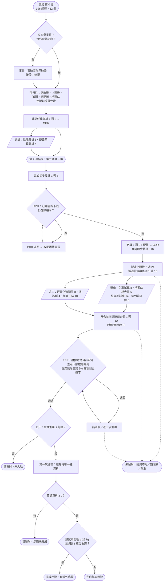
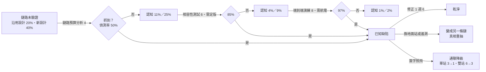

# 入軌火箭章節：故事分支與後果梳理

這份文件把「入軌火箭」一章從開局到結算的每個決策點、它造成的影響、會走到的狀態和結局整理在一起，標出不通順的地方，並給出可以直接動手的修正方案。規則設計本身（數值表、NASA 來源）寫在 [`docs/story/orbital-launch.md`](story/orbital-launch.md)，這裡不重複，只在規則和那份文件不一致時指出來。

## 對應的程式版本

- 基準：`main`（`034e54e`）加上 2026-11-15 工作樹裡尚未提交的改動，包含另一個 session 正在加的**目標軌道選擇**（400 km 測試軌道／550 km 太陽同步軌道）。
- 讀過的檔案：[`orbital-launch.ts`](../src/missions/orbital-launch.ts)、[`orbital-rules.ts`](../src/missions/orbital-rules.ts)、[`chapter-ui.tsx`](../src/missions/chapter-ui.tsx) 入軌部分、[`chapter.ts`](../src/missions/chapter.ts)、[`mission.ts`](../src/game/mission.ts)、[`types.ts`](../src/game/types.ts)、[`Single.tsx`](../src/ui/Single.tsx) 的工作台與結算、`en.ts`／`zh-TW.ts` 的 `orbital*` 與共用 `risk*` 文案。
- 寫作期間另一個 session 已經修掉的項目（本文不再列為問題）：FRR 只缺簽字時會顯示 `reviewUnsigned`；性能分析結果改用 `orbitalLiftRange`／`orbitalLiftRevealed`，補上主詞和原始範圍；工作台多了 `OrbitalPreview` 質量預覽；鏈路驗證結果改用 `riskTestPassedItem`，標出項目和前後百分比；結算的 `{cost}` 補上單位；結算的「實際支出」不再把第二期款削減算進去（`fundingReduced`）。
- 行號以上述工作樹為準。其他 session 還在改同一批檔案，動手前請以函式名稱重新定位。

## 驗證方法

1. 讀程式，把每個任務的開放條件、成本、狀態轉移逐條抄出。
2. 在 scratchpad 寫一次性腳本，直接呼叫遊戲引擎的 `runMission`（不是另寫一份規則），窮舉 32 種配置（軌道 2 × 上面級 2 × 遙測 2 × 適配器 2 × 地面站 2）× 16 種驗證深度（運載 0–3 級 × 鏈路 0–3 級）× 測出缺陷後「修」或「照飛」，每種跑種子 1–1000，共約 90 萬局。工作順序固定為「先做能做的驗證，再做必做工作」；熱試車測出餘裕不足時自動依序嘗試改輕量化適配器、拆診斷套件。腳本沒有放進 repo。
3. 另外用引擎逐步重現邊界情況：第 12 週 FRR 沒勾簽字、太陽同步軌道熱試車後超重、通聯兩種傳送順序的逐局比較、實驗室時段的可用週數。
4. 用內建瀏覽器以種子 3 存檔走完「測出鏈路缺陷 → 用實驗室時段整合 → 簽字照飛 → 通聯 → 結算」，確認畫面實際顯示的文案（繁中）。

## 1. 分支圖

### 1.1 主流程

### 1.2 地面資料鏈的子分支

「新設計」指鏈上有飛行診斷套件或兩座地面站。缺陷真相開局就抽好，驗證只改變玩家知道多少，修正才改變真相。

## 2. 決策點與後果

### 2.1 決策點總表

| 決策點 | 時機 | 選項 | 當下影響 | 後續狀態 | 會走到的結局 |
| --- | --- | --- | --- | --- | --- |
| 實驗室借用時段 | 第 0 週，只有立方衛星留下 `cubesat:partnerVerified` 時 | 接受／婉拒 | 無 | 接受後，整合測試或端到端演練可免費做一次，最晚第 8 週開工。整合前最多只能做 1 項選做驗證；演練要先做完兩級鏈路驗證並造好航電，照預設順序要到第 9 週才能開工，已過期。 | 省 12 或 8 經費，不改變結局種類。 |
| 目標軌道 | 定版前 | 400 km／550 km 太陽同步 | 太陽同步：運載能力 −14 kg，CDR 時 +16 經費。 | 沿用構型＋太陽同步只有搭輕量化適配器、基本遙測才過得了 PDR。輕量化構型＋太陽同步在熱試車後可能補救不了。 | 見 2.2。 |
| 上面級 | 定版前 | 沿用 30／輕量化 56 | 分析運載 106／130 kg。隱藏差距 0–7／0–45 kg。 | 沿用構型在 400 km 一定入軌；輕量化構型是唯一能證明 25 kg 餘裕的路。 | 輕量化構型不驗證時，未入軌率視配置從 0%（400 km＋輕量化適配器＋基本遙測）到 85%（太陽同步＋診斷套件＋標準適配器）。 |
| 遙測 | 定版前 | 基本 10／診斷套件 40 | +12 kg、+3 單位診斷。鏈路變新設計（40%）。 | 單站時診斷 3 單位永遠傳不完；只有雙站才可能靠診斷拿額外成果。 | 診斷＋單站：額外成果 0%。 |
| 適配器 | 定版前 | 標準 0／輕量化 8 | −16 kg。 | 定版後仍可返工（1 週 8）。 | 只影響運載餘裕。 |
| 地面站 | 定版前 | 單站 6／雙站 16 | 容量 3／6，有缺陷時 1／3。鏈路變新設計。 | 雙站有缺陷時仍收得到 2 單位確認資料。 | 雙站使鏈路風險不可能讓最低要求失敗。 |
| 選做驗證 | MDR 後；單元測試需定版，熱試車需上面級，演練需航電 | 6 項，各 1 週 | 4–14 經費。縮小差距範圍或改變鏈路認知。 | 每項 +1 週，FRR 晚一週。多於 3 週拿不到「準時交付」，多於 5 週趕不上截止。 | 可能在 PDR 前就揭露配置不可行，或吃掉整合測試的錢。 |
| 測出鏈路缺陷 | 任何一級測到時 | 修正／換地面站或遙測／簽字照飛 | 修正 1 週 6。換設計定版前免費、定版後 1 週 4 或 10。 | 照飛：單站一定只收到 1 單位確認資料。 | 單站照飛必定「示範未完成」。 |
| 第二期款削減 | 第 2 週結束，固定觸發 | 只能按「回到工作台」 | 經費 −20。 | 削減後才定版，玩家可以改配置。 | 兩項高規方案只剩 6 經費以下的空間。 |
| PDR | 完成初步設計後 | 送審 | 以已知差距**下限**計算餘裕，< 0 就退回。 | 退回後改配置立即可再送，不花週數。 | 先做性能分析可能讓原本能過的配置過不了。 |
| 定版後返工 | 製造、整合、審查階段 | 輕量化適配器／拆診斷／加第二站 | 1 週，8／4／10 經費。整合後再改要重測（1 週 8）。 | 拆診斷、加第二站會重置鏈路驗證。 | 熱試車後唯一的救援手段。 |
| FRR | 整合後 | 勾選要簽字的風險、送審 | 0 週。 | 退回後可補簽字或返工；第 12 週退回會立刻以「期限」結束。 | 見問題 O-H4。 |
| 通聯傳送順序 | 飛行第二段，只有裝了診斷套件才有第二個選項 | 先傳確認／先傳診斷 | 決定確認與診斷各收到幾單位。 | 先傳診斷從不比先傳確認好。 | 見問題 O-H2。 |

### 2.2 32 種配置的後果

代號：軌道 LEO＝400 km、SSO＝550 km 太陽同步；上面級 STD＝沿用、HM＝輕量化；遙測 bas＝基本、DIAG＝診斷套件；適配器 stdA＝標準、LtA＝輕量化；地面站 1st／2st。

- **餘裕上限**＝分析運載能力（扣軌道損失）－承載質量，尚未扣隱藏差距。
- **最壞情況**：隱藏差距可能超過餘裕上限的機率（沒做任何驗證時）。
- **熱試車後可補救**：熱試車揭露真實差距後，靠「輕量化適配器、拆診斷」兩項返工能不能讓餘裕蓋住。
- **砍後剩**：削減後的 176 經費（太陽同步再 +16）扣掉必做工作 68 和硬體費後剩下多少，用來買驗證、修正和返工。
- **不驗證達標**：只做必做工作、遇到 FRR 簽字就簽，1000 個種子的最低要求達成率。
- **最高額外**：16 種驗證深度裡額外成果率最高的一種。

| 配置 | 承載 kg | 餘裕上限 kg | PDR | 最壞情況 | 熱試車後可補救 | 必做＋硬體 | 砍後剩 | 不驗證達標 | 最高額外 |
| --- | ---: | ---: | --- | --- | --- | ---: | ---: | ---: | ---: |
| LEO/STD/bas/stdA/1st（預設） | 98 | 8 | 可 | 蓋住 | — | 114 | 62 | 80% | 0% |
| LEO/STD/bas/stdA/2st | 98 | 8 | 可 | 蓋住 | — | 124 | 52 | **100%** | 0% |
| LEO/STD/bas/LtA/1st | 82 | 24 | 可 | 蓋住 | — | 122 | 54 | 80% | 0% |
| LEO/STD/bas/LtA/2st | 82 | 24 | 可 | 蓋住 | — | 132 | 44 | 100% | 0% |
| LEO/STD/DIAG/stdA/* | 110 | −4 | 不可 | — | — | 144／154 | 32／22 | — | — |
| LEO/STD/DIAG/LtA/1st | 94 | 12 | 可 | 蓋住 | — | 152 | 24 | 59% | 0% |
| LEO/STD/DIAG/LtA/2st | 94 | 12 | 可 | 蓋住 | — | 162 | 14 | 100% | 80% |
| LEO/HM/bas/stdA/1st | 98 | 32 | 可 | 28% | 可 | 140 | 36 | 58% | 15% |
| LEO/HM/bas/stdA/2st | 98 | 32 | 可 | 28% | 可 | 150 | 26 | 73% | 0% |
| LEO/HM/bas/LtA/1st | 82 | 48 | 可 | 蓋住 | — | 148 | 28 | 80% | 40% |
| LEO/HM/bas/LtA/2st | 82 | 48 | 可 | 蓋住 | — | 158 | 18 | 100% | 0% |
| LEO/HM/DIAG/stdA/1st | 110 | 20 | 可 | 54% | 可 | 170 | 6 | 27% | 0% |
| LEO/HM/DIAG/stdA/2st | 110 | 20 | 可 | 54% | 可 | 180 | **−4** | 0%（經費中止） | 0% |
| LEO/HM/DIAG/LtA/1st | 94 | 36 | 可 | 19% | 可 | 178 | **−2** | 0%（經費中止） | 0% |
| LEO/HM/DIAG/LtA/2st | 94 | 36 | 可 | 19% | 可 | 188 | **−12** | 0%（經費中止） | 0% |
| SSO/STD/bas/stdA/* | 98 | −6 | 不可 | — | — | — | — | — | — |
| SSO/STD/bas/LtA/1st | 82 | 10 | 可 | 蓋住 | — | 122 | 70 | 80% | 0% |
| SSO/STD/bas/LtA/2st | 82 | 10 | 可 | 蓋住 | — | 132 | 60 | 100% | 0% |
| SSO/STD/DIAG/* | 94／110 | −2／−18 | 不可 | — | — | — | — | — | — |
| SSO/HM/bas/stdA/1st | 98 | 18 | 可 | 58% | **不可**（差距 > 34） | 140 | 52 | 33% | 0% |
| SSO/HM/bas/stdA/2st | 98 | 18 | 可 | 58% | **不可** | 150 | 42 | 41% | 0% |
| SSO/HM/bas/LtA/1st | 82 | 34 | 可 | 23% | **不可** | 148 | 44 | 61% | 19% |
| SSO/HM/bas/LtA/2st | 82 | 34 | 可 | 23% | **不可** | 158 | 34 | 77% | 21% |
| SSO/HM/DIAG/stdA/1st | 110 | 6 | 可 | 84% | **不可** | 170 | 22 | 9% | 0% |
| SSO/HM/DIAG/stdA/2st | 110 | 6 | 可 | 84% | **不可** | 180 | 12 | 15% | 14% |
| SSO/HM/DIAG/LtA/1st | 94 | 22 | 可 | 50% | **不可** | 178 | 14 | 30% | 0% |
| SSO/HM/DIAG/LtA/2st | 94 | 22 | 可 | 50% | **不可** | 188 | 4 | 50% | 29% |

從表上直接讀得到的事實：

- 32 種配置裡 8 種過不了 PDR，3 種過得了 PDR 和 CDR 但一定在製造或整合時經費用完。
- 輕量化構型在太陽同步軌道上，差距超過 34 kg（11/46 ≈ 24% 的種子）時，定版後沒有任何手段救得回來。
- 只要訂兩座地面站、上面級選沿用構型，不做任何驗證就是 100% 達標。

### 2.3 代表性策略（1000 個種子）

測出缺陷時一律修正、通聯先傳確認資料、FRR 遇到簽字就簽。

| 配置 | 驗證（運載級／鏈路級） | 達標 | 額外 | 未入軌 | 通聯不足 | 經費中止 | 卡在 FRR | 準時 | 驗證紀錄 | 平均 FRR 週 |
| --- | --- | ---: | ---: | ---: | ---: | ---: | ---: | ---: | ---: | ---: |
| LEO/STD/bas/stdA/1st | 0／0 | 80% | 0% | 0% | 20% | 0% | 0% | 80% | 0% | 7.0 |
| LEO/STD/bas/stdA/1st | 0／2 | 97% | 0% | 0% | 4% | 0% | 0% | 97% | 0% | 9.1 |
| LEO/STD/bas/stdA/1st | 1／2 | 97% | 0% | 0% | 4% | 0% | 0% | 90% | 87% | 10.1 |
| LEO/STD/bas/stdA/2st | 0／0 | 100% | 0% | 0% | 0% | 0% | 0% | 100% | 0% | 7.0 |
| LEO/STD/DIAG/LtA/2st | 0／1 | 100% | 80% | 0% | 0% | 0% | 0% | 100% | 0% | 8.2 |
| LEO/STD/DIAG/LtA/2st | 0／3 | 22% | 22% | 0% | 0% | **78%** | 0% | 22% | 0% | 9.0 |
| LEO/HM/bas/LtA/1st | 3／0 | 80% | 40% | 0% | 20% | 0% | 0% | 80% | 0% | 10.0 |
| LEO/HM/bas/LtA/1st | 3／1 | 0% | 0% | 0% | 0% | **100%** | 0% | 0% | 0% | — |
| LEO/HM/bas/stdA/1st | 0／0 | 58% | 0% | 27% | 15% | 0% | 0% | 58% | 0% | 7.0 |
| LEO/HM/DIAG/stdA/1st | 0／0 | 27% | 0% | 55% | 18% | 0% | 0% | 27% | 0% | 7.0 |
| SSO/HM/bas/LtA/1st | 0／0 | 61% | 0% | 23% | 16% | 0% | 0% | 61% | 0% | 7.0 |
| SSO/HM/bas/LtA/1st | 3／0 | 61% | 18% | 0% | 16% | 0% | **23%** | 61% | 0% | 10.0 |
| SSO/HM/DIAG/LtA/2st | 0／0 | 50% | 29% | 50% | 0% | 0% | 0% | 50% | 0% | 7.0 |

實際送出 FRR 的局裡，當下顯示的「完成最低要求」預估和實際達成率相符（例：預設配置 80%／80%，0／2 為 97%／97%，LEO/HM/DIAG/stdA/1st 為 27%／27%），預估本身是誠實的。卡在 FRR 的局不在此列，見 O-H1。

### 2.4 結局與跨章紀錄

| 結局 | 條件 | 實際到達方式 |
| --- | --- | --- |
| 完成示範・有額外成果 | 入軌、確認 2 單位，且（熱試車後真實餘裕 ≥ 25 kg，或診斷 3 單位收齊） | 餘裕路線只有輕量化構型＋三級運載驗證（27 經費、3 週）。診斷路線只有診斷套件＋雙站。 |
| 完成基本示範 | 入軌、確認 2 單位 | 多數策略。 |
| 已發射・示範未完成（未入軌） | 真實差距 > 餘裕 | 只有輕量化構型。 |
| 已發射・示範未完成（通聯不足） | 確認 < 2 單位 | 單站＋鏈路缺陷，或選了先傳診斷。 |
| 未發射・經費 | 下一項必做工作付不起 | 配置太貴，或選做驗證吃掉整合費。 |
| 未發射・期限 | 第 12 週還沒通過 FRR | 驗證太多、FRR 退回時剛好第 12 週、或卡死在 FRR。 |
| 未發射・取消 | 玩家按取消 | — |

| 紀錄 | 條件（[`orbital-rules.ts:223-229`](../src/missions/orbital-rules.ts#L223)） | 在登月章的效果 |
| --- | --- | --- |
| `onTime` 準時交付 | 達成最低要求，FRR 通過週 ≤ 10 | 資金合作案交件款 10 經費改在簽約時撥付。 |
| `verified` 完整驗證紀錄 | 達成最低要求，運載級 ≥ 1、鏈路級 ≥ 1、合計 ≥ 3 | 技術合作案支援時段 +1。 |

**同時拿到額外成果、準時交付、完整驗證三者：0 局**（全部 32 種配置 × 所有驗證深度 × 有無實驗室時段，種子 1–300）。原因：餘裕路線要 3 週運載驗證再加 1 週鏈路驗證，FRR 最早第 11 週；診斷路線砍後只剩 14 經費，湊不出 3 級驗證的 15 經費，而實驗室時段最晚第 8 週開工，做完 3 項驗證再整合已是第 10 週。

## 3. 問題清單

嚴重度：**高**＝死路、陷阱，或讓玩家學到錯的因果；**中**＝選擇缺後果、結算沒反映玩家的選擇，或文案與規則不一致；**低**＝措辭、死碼、平衡細節。O-H、O-M、O-L 是規則與文案的問題；O-D 是決策設計的問題（動機、層級、對等），整理在本節最後的「決策設計檢查」。

### 高

**O-H1　太陽同步軌道＋輕量化上面級：熱試車後可能卡死，結算還怪到時程上。**
[`orbital-rules.ts:98-106`](../src/missions/orbital-rules.ts#L98) 的返工只有「輕量化適配器、拆診斷、加第二站」，沒有任何一項能換軌道或換上面級。SSO/HM/bas/LtA 的餘裕上限 34 kg，差距 35–45 kg 時（約 24% 的種子）熱試車揭露超重，FRR 列出「承載質量至少超出運載能力 X kg」，玩家能做的只剩鏈路驗證、加第二站和等待，等到第 12 週以 `orbitalStopDeadline`「發射時段關閉前未能通過飛行審查」結束。引擎實測：種子 2、差距 44 kg、第 10 週卡在 FRR，可用工作只有 `wait`、`linkAnalysis`、`dualStation`。
問題有三層：死路本身；玩家花了 27 經費做完運載驗證反而被困住；結算把原因寫成時程。真實任務在這種情況會和客戶重談軌道，不會乾等。

**O-H2　通聯「先傳診斷」是純陷阱，而且畫面在選之前就洩漏了缺陷。**
[`orbital-launch.ts:294-299`](../src/missions/orbital-launch.ts#L294) 的分配規則下，容量 6 時兩種順序結果相同，容量 3 或 1 時先傳診斷一定讓確認資料不足。逐局比較 3020 局：先傳診斷**較好 0 局、較差 1654 局、相同 1366 局**。另外 [`orbital-rules.ts:206`](../src/missions/orbital-rules.ts#L206) 的 `orbitalPassDetail` 用飛行真相算出的容量（有缺陷時已降級）顯示「這次通聯可傳 1 單位」，沒有任何說明；`orbitalPassDegraded`「資料鏈有問題，只傳下 X 單位」從未使用。沒有診斷套件時畫面寫「選擇先傳什麼」卻只有一個選項。

**O-H3　選做驗證和定版都不檢查「後面的必做工作付不付得起」。**
入軌章沒有剩餘必做成本的顯示（登月章有 `chapterPlan`，入軌的 `orbitalEventCutEstimate` 寫好了沒用），`stopReason`（[`orbital-rules.ts:183`](../src/missions/orbital-rules.ts#L183)）只在付不起時直接結束。實測兩種情況：
- LEO/HM/DIAG 的三種配置過得了 PDR 和 CDR，必做＋硬體 178–188，砍後預算 176，100% 在製造或整合時經費中止。
- LEO/STD/DIAG/LtA/2st 做滿三級鏈路驗證：端到端演練（8）按鈕是亮的，做完剩 8 經費，付不起整合測試 12，78% 的種子未發射。
[`docs/gameplay-revision-plan.md`](gameplay-revision-plan.md) 第 43 行要求削減時「顯示目前方案的必做工作支出、剩餘資源」，目前沒有做到。

**O-H4　第 12 週送 FRR 忘了勾簽字，遊戲直接以「期限」結束。**
[`mission.ts:287`](../src/game/mission.ts#L287) 現在會說明「還有 N 項沒簽字」，但退回仍設 `returned: true`；[`orbital-rules.ts:185`](../src/missions/orbital-rules.ts#L185) 對 `returned` 且剩 0 週的審查階段立即回傳 `deadline`。補簽字本來不花工期，玩家卻沒有機會再送一次。引擎實測：種子 4，第 12 週整合後不勾簽字送 FRR → `results / deadline`。第 11 週以前退回則可以馬上補簽。

### 中

**O-M1　兩座地面站讓驗證失去意義。**
雙站有缺陷時仍有 3 單位 ≥ 2，鏈路風險永遠不會讓最低要求失敗；沿用構型 8 kg 餘裕又蓋住 0–7 kg 的差距。結果「全基本＋雙站、完全不驗證」是 124 經費、第 7 週、100% 達標、拿到準時交付，比任何驗證路線都便宜可靠（表 2.3）。這一章的主題是「驗證是花錢買資訊」，最穩的解卻不需要任何資訊。

**O-M2　換地面站或遙測會讓「已知缺陷」消失。**
[`orbital-launch.ts:224`](../src/missions/orbital-launch.ts#L224) 的鏈路 ID 由遙測和地面站組成，[`orbital-rules.ts:28-33`](../src/missions/orbital-rules.ts#L28) 換了任一項就把鏈路重設為未驗證、真相重抽。單站時測出的缺陷是 100%，加一座站之後變成 40% 的未知，等於「多訂一座地面站有六成機率治好火箭上的毛病」。[`docs/story/orbital-launch.md`](story/orbital-launch.md) 把它寫成正式選項，但因果不通。

**O-M3　單站已知缺陷的簽字文案說「可能造成降級」，實際是一定拿不到合約。**
FRR（[`orbital-rules.ts:171-176`](../src/missions/orbital-rules.ts#L171)）透過 `riskIssue`（[`chapter.ts:32`](../src/missions/chapter.ts#L32)）顯示「你認知的風險 100% · 可能造成降級」。單站降級後只剩 1 單位，確認資料需要 2 單位，預估面板寫 0%，簽字欄卻沒說後果。瀏覽器實測：種子 3，帶著 70 經費、4 週餘裕簽字照飛，結果「已發射・示範未完成」。

**O-M4　結算沒有交代玩家的選擇。**
`OrbitalDebrief`（[`chapter-ui.tsx:83-97`](../src/missions/chapter-ui.tsx#L83)）在鏈路「已知缺陷照飛」時 `orbitalNextStep` 回傳 `null`（[`orbital-launch.ts:266`](../src/missions/orbital-launch.ts#L266)），畫面只寫「地面資料鏈失敗，你當時認知的風險是 100%」，不提修正只要 1 週 6 經費、當時資源足夠。三級都通過仍失敗時也沒用 `riskDebriefTop`。項目的後果文案 `orbitalRiskLiftFailure`、`orbitalRiskLinkFailure` 沒有顯示。另外：
- 沒提目標軌道、削減後保留了哪些能力、有沒有熱試車數據。`orbitalResume*` 七個鍵寫好了沒用。
- 實驗室時段省了多少錢沒寫。

**O-M5　跨章紀錄在本章完全看不到。**
`onTime`、`verified` 的條件和效果只寫在 `orbitalRecord*` 文案裡，簡報、工作台、結算都沒顯示。玩家到登月章才看到「入軌案準時交付紀錄：交件款中的 10 經費改在簽約時撥付」，不知道是怎麼拿到或錯過的。[`gameplay-revision-plan.md`](gameplay-revision-plan.md) 第 46 行要求結算「顯示真的會帶往下一章的成果」。

**O-M6　砍預算事件只有數字，沒有故事和決策資訊。**
事件（[`orbital-rules.ts:161`](../src/missions/orbital-rules.ts#L161)）只顯示 `orbitalBudgetUpdate`「剩餘經費由 X 調為 Y」，選項說明寫「你可以保留承載餘裕、保留診斷、兩項都放掉，或是刪掉驗證」。簡報埋了伏筆（「第二期要等出資方內部的預算談完」），但 `orbitalEventCutStory`、`orbitalEventCutDialogue`（「入軌這件事不能談。其他的，告訴我你們要放掉什麼。」）、`orbitalEventCutEstimate` 都沒出現，玩家看不到目前方案還要多少錢，也就無從判斷要放掉什麼。觸發時大多數玩家還沒選任何高規選項，「保留承載餘裕」這句話沒有對象。

**O-M7　實驗室時段：按鈕套用登月文案，演練用途實際上用不到。**
- [`Single.tsx:719`](../src/ui/Single.tsx#L719) 把 `lab:` 開頭的任務一律顯示成 `lunarSupportTask`「用合作方設施執行：整合並測試酬載介面」（瀏覽器實測），和事件的「實驗室借用時段」對不上。`orbitalLabSlotIntegrate`／`Rehearse`「省 X 經費」沒有顯示。
- `expiresWeek: 8`（[`orbital-launch.ts:98`](../src/missions/orbital-launch.ts#L98)）加上 [`orbital-rules.ts:114`](../src/missions/orbital-rules.ts#L114) 的 `game.week < 8`：工作最晚第 8 週開工。必做工作做到整合前要 6 週，所以整合前只能做 0–1 項選做驗證。演練要鏈路兩級＋航電完成，照工作台預設順序要第 9 週才能開工，已過期；只有先造航電再造上面級才趕得上。
- 這個獎勵來自立方衛星的「完整驗證」，到這一章卻是驗證越多越用不到。

**O-M8　額外目標達不到時沒有說明，有些配置注定拿不到。**
- 沒做熱試車但真實餘裕 ≥ 25 kg 時，上升段只寫「上面級進入指定軌道，餘裕 X kg」，`orbitalAscentUnproven`「沒有試車數據，出資方不承認這份餘裕已獲證明」沒有使用（[`orbital-rules.ts:200`](../src/missions/orbital-rules.ts#L200)）。做了熱試車但餘裕不到 25 kg 也沒有說明。
- 沿用構型的餘裕上限最多 24 kg（LEO＋輕量化適配器），永遠證明不了 25 kg，選項說明沒寫。
- 診斷套件＋單站：確認 2＋診斷 3＝5 單位，容量只有 3，診斷路線的額外成果是 0%。`orbitalDataNeed`／`orbitalDataCapacity`／`orbitalDataGap` 寫好了沒用，預覽只有質量沒有資料預算。

**O-M9　換上面級會丟掉性能分析的結果。**
`configure`（[`orbital-rules.ts:32`](../src/missions/orbital-rules.ts#L32)）換上面級就把運載驗證歸零，換回來也不會恢復（實測：種子 7，分析後 0–22 kg，換成沿用再換回變回 0–45 kg）。[`story/orbital-launch.md`](story/orbital-launch.md) 寫「分析：任何時候。兩種上面級都涵蓋」，和程式不符。玩家用分析比較兩種上面級，正是取捨研究的用途，現在卻要付兩次錢，而且第二次會把第一次的結果洗掉。

**O-M10　退回時的提示寫錯。**
[`Single.tsx:636`](../src/ui/Single.tsx#L636) 在任何退回時顯示 `returnedDetail`「修正未通過的項目，再執行整合測試」。PDR 退回時根本還沒有整合；FRR 只缺簽字時也不需要重測。

**O-M11　目標軌道的選擇沒有故事後果。**
太陽同步軌道只改運載能力和經費，結算、紀錄、登月章都不提玩家送上哪個軌道。簡報沒說為什麼出資方願意為太陽同步多付錢（程式註解寫「客戶真正想要的軌道」，玩家看不到）。加付款在 CDR 就入帳，之後飛行失敗也不用退，這和「出資方為目標軌道付費」的說法不一致。

### 低

**O-L1　PDR 通過文案錯。** `orbitalPdrPass`「還沒扣掉高估量之前，分析顯示承載餘裕 {count} kg」，但 [`orbital-rules.ts:37-39`](../src/missions/orbital-rules.ts#L37) 傳的是扣掉已知差距**下限**後的值。做過性能分析、下限大於 0 時數字對不上說明。

**O-L2　FRR 的資料容量檢查永遠不會觸發。** [`orbital-rules.ts:179`](../src/missions/orbital-rules.ts#L179) 比較的是額定容量（3 或 6），一定 ≥ 2；`orbitalFrrReturnData` 是死碼。真正會讓資料不足的是已知缺陷，見 O-M3。

**O-L3　定版後加第二座地面站要重做整合測試。** 返工走 `reviseDesign`（[`chapter.ts:25`](../src/missions/chapter.ts#L25)），版本號 +1 讓整合證據失效，要重測 1 週 8 經費。地面站不在火箭上，酬載介面與秤重結果不受影響。

**O-L4　「鏈路缺陷」事件一局只觸發一次。** `foundLink`（[`orbital-rules.ts:152`](../src/missions/orbital-rules.ts#L152)）用事件 ID 判斷是否觸發過；換鏈路後再測出缺陷不會再提示。選項說明借用登月的 `lunarFoundOptions`。

**O-L5　「準時交付」的週數說法。** 程式是 FRR 通過週 ≤ 10（[`orbital-launch.ts:107`](../src/missions/orbital-launch.ts#L107)），英文 by week 10 正確，中文「在第 10 週前」容易讀成不含第 10 週。

**O-L6　單複數與單一選項。** 英文 `orbitalPassDetail` 會出現「1 units」；沒有診斷套件時通聯段寫「選擇先傳什麼」但只有一個選項。

**O-L7　紀錄 ID 沒有命名空間。** 立方衛星寫 `cubesat:partnerVerified`，入軌寫 `onTime`、`verified`，登月讀的是沒有前綴的字串。之後任何一章也叫 `verified` 就會互相干擾。

**O-L8　評等的「工程判斷」不看結果。** 新加的 `ratingVerified`（[`Single.tsx:510`](../src/ui/Single.tsx#L510)）只要做過一項選做驗證就打勾。種子 3 實測：測出缺陷、不修、照飛失敗，仍拿到「工程判斷 ✓」。沒達成的項目只用「·」標示，文案「任務成功：交付了最低要求」讀起來像已達成。

**O-L9　沒接上的內容。** 下列鍵在 `src/` 裡沒有任何畫面會顯示：
- 敘事：`orbitalBriefEngineer`、`orbitalBriefBudget`、`orbitalEventCutStory`、`orbitalEventCutDialogue`、`orbitalPmBrief`、`orbitalPropulsionBrief`、`orbitalAvionicsBrief`、`orbitalGroundBrief`（連同 [`orbital-launch.ts`](../src/missions/orbital-launch.ts) 的 `orbitalProposals`、`orbitalDepartments`）。
- 規則說明：`orbitalRemedy*Detail`、`orbitalRequires*`、`orbitalFixLinkDetail`、`orbitalRetestNote`、`orbitalPerformanceWhy`、`orbitalMarginRule`、`orbitalMarginStretchRule`。
- 結果：`orbitalHotfireResult`、`orbitalCapacityTested`、`orbitalAscentUnproven`、`orbitalPassDegraded`、`orbitalIncompleteData`、`orbitalFrrPass`、`orbitalFrrPassAccepted`、`orbitalResume*`、`orbitalRecord*`、`orbitalRiskLiftFailure`、`orbitalRiskLinkFailure`。
其中一部分正是 O-M4 到 O-M8 缺的那句話，修正方案會用到；其餘可以刪除。

**O-L10　砍預算的時機。** 合約的第二期款通常綁里程碑（例如 PDR 通過），不是固定日期。現在固定第 2 週結束，即使玩家還沒做任何事也會觸發。

### 決策設計檢查：動機、層級、對等

每個決策點多看三件事：

- **動機**：玩家為什麼會面對這個選擇？情境有沒有交代？真實任務會在這個時間點、由這個角色做這個決定嗎？
- **層級**：問題放在對的層級嗎？任務架構（軌道、載具）、子系統（遙測、地面站）、元件細節（適配器）、作業細節（傳送順序）有沒有被混在同一層問？是不是讓專案經理決定了工程師該決定的事，或反過來？
- **對等**：選項比較的是同一類東西嗎？有沒有明顯最好或明顯是陷阱的選項？代價和收益在同一個量級、真的需要權衡嗎？

本章沒有交代玩家是誰。簡報只說「團隊」，玩家卻同時在選軌道（任務需求）、選適配器（元件）、簽風險（專案經理）、決定通聯時先傳什麼（飛行操作）。下表以「玩家是專案經理」為基準判斷層級。

| 決策點 | 動機 | 層級 | 對等 | 判定 |
| --- | --- | --- | --- | --- |
| 實驗室借用時段：接受／婉拒 | 有交代（立方衛星報告換來的）。 | 專案經理接受外部資源，對。 | 婉拒沒有任何好處，不是選擇。真正的選擇「用在整合還是演練」沒有被提出來，整合省 12、演練省 8 且多半過期。 | O-D7 |
| 目標軌道 | **缺**。玩家看不到出資方為什麼願意為太陽同步多付錢，也不知道 400 km 只是「測試軌道」代表什麼。 | **錯**。軌道是任務需求，應在 MDR 前和出資方定案；現在和適配器並列在同一個配置面板，到 CDR 前都能免費改。 | **不對等**。沿用構型＋輕量化適配器時，太陽同步在每一種驗證策略下結果都和 400 km 預設完全相同（腳本逐策略比對，0 個差異），還多 8 經費。對保守玩家是白拿的錢。 | O-D1、O-D2 |
| 上面級 | 部分。有寫「新構型沒有試車紀錄」，但沒說為什麼值得冒這個險；出資方從沒要求過餘裕。 | 對（架構層級的取捨）。 | **不對等**。輕量化構型多 26 經費、不驗證時 0–85% 未入軌、要再花 27 經費和 3 週才證明得了餘裕；收益只有額外目標（聲望 +1），本章和下一章都不再用到。 | O-D3 |
| 遙測方案 | 部分。說了多出診斷資料，沒說資料拿來做什麼。 | 子系統層級放在配置面板，可以接受。 | **單站時是陷阱**：診斷 3 單位永遠傳不完，額外成果 0%，最低要求從 80% 掉到 59%。這個依賴關係沒有寫出來。 | O-M8 |
| 適配器 | 有（減重）。 | 元件細節，和軌道放同一層。 | 多數配置下不是取捨而是算出來的必要條件：400 km＋沿用構型＋基本遙測時完全用不到，其餘高規組合則非買不可。 | O-D1 |
| 地面站 | 有（容量與備援）。 | 對。 | **雙站明顯最好**：多 10 經費就讓鏈路風險永遠不影響最低要求。 | O-M1 |
| 選做驗證（6 項） | 有（風險面板列出認知風險和下一級效果）。 | **不一致**。鏈路預算分析和性能分析是紙上設計分析，一般在 PDR 前就該完成；新研製上面級的整級點火在真實計畫裡幾乎不會省略（SLS 芯級 Green Run）。遊戲把它們和端到端演練放在同一個「選做」清單，玩家可以全部跳過且不需要任何人簽核。 | 各級之間代價遞增、效果遞增，對等。 | O-D4 |
| 測出缺陷：修／換設計／照飛 | 有。 | 專案經理決定接受風險，對。 | 修正（1 週 6）幾乎永遠最好；單站照飛是必輸，卻用「可能造成降級」包裝成一般的風險接受。 | O-M2、O-M3 |
| 第二期款削減 | 有伏筆，事件本身沒故事（O-M6）。 | **錯位**。「哪一項能力撐過削減」是專案經理層級的取捨，也是 [`game-design.md`](game-design.md) 第 76 行給這一章定的核心；畫面卻只有「回到工作台」，真正的決定被拆散成配置面板上的零件切換。 | 沒有選項可比。 | O-D5 |
| PDR 送審 | 有。 | 對。 | 不是選擇。 | — |
| 定版後返工 | 有（熱試車或 FRR 揭露問題後）。 | 對。 | 三項解決不同問題（減重、減重並放棄資料、加容量），並列沒問題；缺「改軌道」這一項（O-H1）。 | O-H1 |
| FRR 簽字 | 有。 | 對。 | 見 O-M3。 | — |
| 通聯傳送順序 | **缺**。先傳診斷沒有任何理由。 | **錯**。資料優先順序是飛行前寫進操作計畫的事，不是專案經理在通聯當下即時決定；而且玩家選的時候已經看到降級後的容量。 | **陷阱**（O-H2）。 | O-H2、O-D6 |

由這張表新增的問題：

**O-D1（高）　決策層級混在一起，玩家角色沒有定義。**
軌道（任務需求）、上面級（架構）、遙測和地面站（子系統）、適配器（元件）在同一個配置面板、同樣的份量，全部到 CDR 前都能免費來回切換（[`orbital-rules.ts:28`](../src/missions/orbital-rules.ts#L28) 的 `configure`、[`mission.ts`](../src/game/mission.ts) 的 `canConfigure` 只看是否在可行性或設計階段）。這和 NASA 生命週期的順序相反：任務需求在 Phase A 結束、MDR 前就要定，架構在 PDR 定，細節在 CDR 定。另一個 session 正在畫面上標 Phase A–F，標了之後這個矛盾會更明顯。玩家同時扮演出資談判、系統工程、飛行操作，也讓「我是誰、這是誰該決定的事」說不清楚。總工程師（`orbitalBriefEngineer`）和三個組別的提案（`orbitalPmBrief`、`orbitalProposals`）原本就是為了分層而寫的，都沒有接上。

**O-D2（中）　目標軌道缺動機，對保守玩家是白拿的錢。**
文案只寫「出資方在 CDR 加付 16 經費」，不說客戶要太陽同步做什麼。規則上，沿用構型的分析餘裕在太陽同步＋輕量化適配器時是 10 kg，隱藏差距最多 7 kg，永遠入得了軌；結果和 400 km 預設完全一樣，淨多 8 經費。最穩的玩家會選太陽同步，不是因為權衡過，而是因為沒有代價。

**O-D3（中）　上面級的代價和收益不在同一量級。**
輕量化構型的代價是 26 經費、最高 85% 的未入軌機率、27 經費 3 週的驗證；收益只有「額外成果」一顆星。故事沒有說為什麼要證明 25 kg 餘裕，結算和登月章也不會因為證明過而有任何不同。

**O-D4（中）　驗證項目的層級不一致，跳過也不需要任何人簽核。**
「分析鏈路預算」「分析上面級性能」是設計分析，「整級熱試車」是新研製級的出廠驗收，在真實計畫裡分別是 PDR 和飛行前的入場條件，不是可有可無的加購。遊戲裡三者都和端到端演練並列在「選做」，玩家全部跳過時，PDR 和 FRR 也不會多問一句（FRR 只看認知風險是否超過 5%）。要教的「驗證是花錢買資訊」本身沒錯，但「不做驗證」應該是審查會上明確簽下的決定。

**O-D5（中）　砍預算是專案經理的取捨，畫面上卻沒有可選的方案。**
事件只有「回到工作台」一個按鈕。玩家要自己想到回配置面板逐項切換，也看不到每種刪減方案剩多少錢、損失什麼（和 O-M6 的資訊缺口疊加）。

**O-D6（低）　通聯順序放在錯的時間點、由錯的角色決定。**
即使照 F2 讓先傳診斷有價值，現在的設計仍是在已經知道容量之後才選，沒有不確定性可言。

**O-D7（低）　實驗室時段的「婉拒」沒有理由選，真正的選擇沒有被提出來。**

## 4. 修正方案

依「先解死路與陷阱，再補資訊，最後調平衡」排序。每項寫出要改的規則或文案、預期效果。

### F1　加「改回 400 km 測試軌道」返工（解 O-H1、O-M11）

- 規則：`orbitalLaunch.remedies` 新增 `retarget: { weeks: 1, credits: 0, label: 'orbitalRemedyRetarget', ... }`；[`orbital-rules.ts:98`](../src/missions/orbital-rules.ts#L98) 的 `remedies` 加 `retarget: d => d.orbit === 'sso' ? { ...d, orbit: 'low' } : null`。套用時扣回已收的加付款 `mission.orbits.sso.bonus`（經費不足就扣到 0）。運載知識保留（隱藏差距只看上面級，不看軌道）。
- 文案：`orbitalRemedyRetarget`「和出資方重談，改送 400 km 測試軌道」、說明「運載能力 +14 kg，退回 16 經費加付款」；結算加一行 `orbitalResultOrbit`「送入：{orbit}」。
- 停止原因：FRR 退回原因是餘裕不足且沒有任何返工可用時，`stopReason` 回傳新的 `'margin'`，結算文案「熱試車證實上面級送不上這個軌道」，不再寫成時程。
- 預期效果：SSO/HM/bas/LtA 熱試車路線卡在 FRR 的 23% 改成第 11 週送 FRR、以 400 km 完成基本示範（再受鏈路 80% 影響）。熱試車揭露壞消息後，玩家有一個真實世界也會採取的選項。

### F2　讓通聯順序變成真的取捨，或拿掉（解 O-H2）

- 截止前的最小改動：只剩「先傳確認」一個選項時自動選好；有診斷套件時，在每個選項下直接寫出這次會收到幾單位確認、幾單位診斷，以及是否滿足合約（用 `flyOrbital` 試算兩個方案）。容量降級時加一句 `orbitalPassDegraded`。預期：3020 局裡 1654 局「一按就輸」的陷阱消失，鏈路缺陷有交代。
- 之後的完整改法（讓「先傳診斷」有價值）：加入真實的限制「上升段診斷資料存在環形緩衝區，第一次通聯沒傳完就會被覆蓋」，並允許確認資料在第二次通聯補齊。第二次通聯沿用同一條鏈路，有缺陷就同樣降級。補齊確認資料算達成最低要求，但不給 `onTime`，出資方扣 10 經費。結果：單站、容量 3 時，先傳確認＝準時的基本示範，先傳診斷＝不準時但有額外成果。注意這會把「單站＋鏈路缺陷」從必定失敗改成延遲交付（1＋1＝2 單位），要重跑平衡，再決定是否把降級容量改成 0。

### F3　顯示剩餘必做成本並在定版前擋下付不起的配置（解 O-H3、O-M6）

- 規則：在 `orbital-rules.ts` 加 `orbitalPlanCost(game)`，加總尚未完成的必做工作（prelim、freeze＋硬體、buildStage、buildAvionics、integrate；有實驗室時段且未過期時整合以 0 計）。`tasks.freeze.plan` 在 `credits − 定版費 < 其餘必做成本` 時回傳 `null`，並在工作台顯示原因 `orbitalFreezeBlocked`「這個配置做完必做工作要 X，你只有 Y」。
- 介面：`OrbitalPreview`（[`chapter-ui.tsx:151`](../src/missions/chapter-ui.tsx#L151)）加一行沿用登月的 `chapterPlan`；選做驗證按鈕在做完後付不起必做工作時加警告 `orbitalVerifyStarves`「做了這項就付不起{work}」。
- 砍預算事件：detail 改成 `orbitalEventCutStory`，數字用 `orbitalEventCutChange`，下方 `orbitalEventCutEstimate` 帶入 `orbitalPlanCost`，`orbitalEventCutDialogue` 放進 `quote`。
- 預期效果：LEO/HM/DIAG 三種配置在 CDR 被擋下並說明原因，不再走到一半才「經費不足」。LEO/STD/DIAG/LtA/2st 做演練前看得到警告，78% 的未發射變成玩家知情的取捨。

### F4　只缺簽字的退回不算退回（解 O-H4）

- 規則：[`mission.ts`](../src/game/mission.ts#L287) 的 `submitReview` 在 `onlyUnsigned` 時記錄提示訊息，但不設 `returned: true`，留在審查階段。或者在 [`orbital-rules.ts:183`](../src/missions/orbital-rules.ts#L183) 的 `stopReason` 開頭，對「審查階段、證據有效、退回原因只有簽字」回傳 `null`。前者三章一起受益。
- 預期效果：任何週數忘了勾選都能立刻補簽，不會因為一個核取方塊輸掉整局。

### F5　雙站要驗證過才算備援（解 O-M1）

- 規則：雙站的鏈路缺陷，在地面站相容性測試（鏈路級 ≥ 2）之前視為交接失敗，降級容量 1；做過相容性測試後，即使缺陷沒被抓到，也有手動切換程序，降級容量 3。在 `flyOrbital` 裡把 `ground.degradedCapacity` 換成依鏈路級別取值。
- 文案：`orbitalGroundDualDetail` 加「交接要先測過才有備援效果」。
- 預期效果（以開局缺陷機率和偵測率推算）：全基本＋雙站不驗證，從 100% 降到約 60%（新設計 40% 帶缺陷）；加做鏈路預算分析和相容性測試（10 經費、2 週，測到就修）回到接近 100%，因為漏網的 6% 缺陷已有手動切換程序。雙站仍是好選擇，但要搭配驗證，符合本章主題，也對應真實任務「冗餘本身也要驗證」。

### F6　已知缺陷跟著出問題的那一側走（解 O-M2）

- 規則：把鏈路真相拆成「火箭端」（`orbital:link:vehicle:${telemetry}`）和「地面端」（`orbital:link:ground:${ground}`），各自有缺陷機率，任一端有缺陷就降級。換地面站只重抽地面端，火箭端已測出的缺陷保留。
- 簡化版（不拆兩端）：在 `configure`（[`orbital-rules.ts:28`](../src/missions/orbital-rules.ts#L28)）裡，只改地面站時保留 `found: true`。
- 預期效果：加第二座站仍能保住最低要求（降級 3 單位），但不會讓已知缺陷憑空消失。

### F7　簽字欄與結算說清楚後果（解 O-M3、O-M4、O-M8、O-L1、O-L2）

- FRR：在 [`orbital-rules.ts:171`](../src/missions/orbital-rules.ts#L171) 計算「已知缺陷照飛時，降級容量是否仍 ≥ 2」。不足時，簽字欄說明改成新鍵 `orbitalSignKnownLinkLoss`「已知缺陷：第一次通聯只剩 {degraded} 單位，確認資料需要 {required}，合約確定無法達成」。保留簽字權，讓「明知照飛」仍是玩家能選的路。刪掉永遠不觸發的 `orbitalFrrReturnData` 檢查。
- 結算（`OrbitalDebrief`）：
  - 已知缺陷照飛：顯示 `riskFlewKnowingly`，加一句新鍵 `orbitalDebriefSkippedFix`「修正只要 1 週、6 經費；送審時你還有 {weeks} 週、{credits} 經費」（數值從 FRR 通過那筆 log 取）。
  - 三級都通過仍失敗：顯示 `riskDebriefTop`。
  - 失敗項目加上 `orbitalRiskLiftFailure`／`orbitalRiskLinkFailure`。
  - 上升段：沒熱試車但餘裕 ≥ 25 kg 顯示 `orbitalAscentUnproven`；有熱試車但不到 25 kg 加新鍵「實測餘裕 {margin} kg，未達 {threshold} kg 目標」。
  - 加「團隊履歷」區塊，用 `orbitalResumeKept`／`GaveUp`（以削減事件當下的設計和最終設計比較）、`orbitalResumeEvidenceTest`／`Analysis`、目標軌道、實驗室時段省下的經費。
- 選項與預覽：`orbitalStageStandardDetail` 加「最多 24 kg 餘裕，達不到承載餘裕目標」；`OrbitalPreview` 加資料預算一行（`orbitalDataNeed`＋`orbitalDataCapacity`，超出時 `orbitalDataGap`）。
- PDR 文案改成「PDR 通過。以目前已知差距的下限計算，承載餘裕 {count} kg」（中英文同改）。
- 預期效果：每一種失敗都有「為什麼、當時能做什麼」，玩家從結算就能分辨運氣、取捨和失誤。

### F8　跨章紀錄在本章就看得到（解 O-M5、O-L5、O-L7）

- 簡報 `Requirements`（[`chapter-ui.tsx`](../src/missions/chapter-ui.tsx) 的 `orbitalUi.Requirements`）加兩行：`orbitalRecordOnTimeDetail`、`orbitalRecordVerifiedDetail`，標題「會帶到登月案的紀錄」。
- 結算：列出這局拿到的紀錄，沒拿到的寫差在哪裡（「FRR 在第 11 週通過，需 ≤ 10」「驗證合計 2 級，需 3 級」）。
- 中文 `orbitalRecordOnTimeDetail` 改「最晚在第 {week} 週通過飛行審查」。
- 紀錄 ID 改成 `orbital:onTime`、`orbital:verified`，[`lunar-rules.ts:60-61、367-369`](../src/missions/lunar-rules.ts#L60) 同步改讀；`progress.ts` 讀舊存檔時把舊 ID 對映過去。
- 預期效果：登月章的合作條件有前因，玩家重玩入軌章時知道要追什麼。

### F9　實驗室時段（解 O-M7）

- 規則：`expiresWeek` 從 8 改 10，或改成「整合完成前都可用」。
- 介面：[`Single.tsx:719`](../src/ui/Single.tsx#L719) 不要把 `lab:` 一律套 `lunarSupportTask`。在 `MissionUi` 加 `supportLabel?: Message`，入軌用新鍵「用借來的實驗室時段：{work}」，登月維持原文。按鈕下加 `orbitalLabSlotIntegrate`／`Rehearse` 的「省 X 經費」。
- 預期效果：照預設順序做兩級鏈路驗證後仍能把時段用在端到端演練；立方衛星的驗證獎勵不再懲罰驗證。

### F10　性能分析同時涵蓋兩種上面級（解 O-M9）

- 規則：`missionState.lift` 改成 `{ standard: number; highMargin: number }`；`trade` 把兩種上面級都升到第 1 級（分析本來就是比較候選方案），引擎試車和熱試車只升目前那一種。`configure` 不再把 `lift` 歸零。`validSave` 接受舊格式並轉換。
- 預期效果：符合 `story/orbital-launch.md` 的說法；玩家付 5 經費就能在定版前比較兩種上面級的已知範圍，切換不會丟資料。

### F11　小修（解 O-M10、O-L3、O-L4、O-L6、O-L8、O-L10）

- `returnedDetail` 依關卡分開：PDR 用新鍵「改配置讓餘裕下限 ≥ 0 後再送」；FRR 只缺簽字時不顯示；需要重測時才寫「再執行整合測試」。
- 加第二站（只改地面）時不讓整合證據失效：`currentEvidence` 比對設計時只看火箭上的欄位（stage、telemetry、adapter），或在 `dualStation` 返工時同步更新 `evidence.design`。
- `foundLink` 改成以鏈路 ID 判斷是否已提示；選項說明換成入軌自己的鍵。
- `orbitalPassDetail` 英文改用複數規則（沿用 `dataBatches` 的寫法）。
- `ratingVerified` 改成「做過選做驗證，且沒有帶著已知缺陷飛」；未達成的項目改成否定句或加「未達成」。
- 砍預算改在 PDR 通過時觸發（`trigger: game => completed(game, 'prelim') && game.gate !== 'PDR'`），和第二期款綁里程碑的說法一致。這會讓定版前才得知削減，順序和現在相同。
- 用不到的鍵（O-L9）：F3、F7、F8 會接上一部分；`orbitalPmBrief`、三組 `*Brief` 和 `orbitalProposals` 若 F12、F16 不採用，連同死碼一起刪掉。

### F12　決策分層：依審查關卡鎖定，玩家定位成專案經理（解 O-D1）

- 角色：簡報第一句寫明「你是這次示範的專案經理」。總工程師（`orbitalBriefEngineer`）在簡報出場，三個組別的建議（`orbitalPmBrief`、`orbitalPropulsionBrief`、`orbitalAvionicsBrief`、`orbitalGroundBrief`）放在各自負責的選項旁，玩家的動作是「核准哪一組的方案」。
- 規則：設計群組加上鎖定關卡。可以在 `MissionRules.groups` 每組加 `lockedAt: 'MDR' | 'PDR' | 'CDR'`，`runMission` 的 `configure` 拒絕改動已過關卡的群組。

  | 群組 | 層級 | 決定者 | 鎖定 |
  | --- | --- | --- | --- |
  | 目標軌道 | 任務需求 | 專案經理和出資方 | MDR（完成「確認任務架構」時） |
  | 上面級、地面站 | 架構 | 專案經理核准系統工程建議 | PDR |
  | 遙測、適配器 | 子系統、元件 | 各組提案、專案經理核准 | CDR |

- 過了鎖定關卡還要改：軌道走 F1 的重談返工，上面級不能改（真實上等於換火箭），其餘走現有返工。
- 預期效果：配置面板的順序就是生命週期的順序，標上 Phase A–F 後不再矛盾。性能分析和鏈路預算分析在 MDR 到 PDR 之間做，正好是它們真實的用途：在架構鎖定前比較方案。代價是失去「定版前隨意切換」的自由，表 2.2 的「PDR 退回後改配置」只能改還沒鎖的群組，要重跑平衡。

### F13　給目標軌道動機，並讓它成為真的取捨（解 O-D2）

- 故事：簡報加一句出資方的話，例如「我們的客戶是地球觀測公司，要的是太陽同步軌道。送到 400 km 只算技術示範；送到太陽同步，我多付 16。」`orbitalOrbitLowDetail` 改寫成「示範用的軌道，交付後酬載只能當技術驗證」。
- 規則：`orbits.sso.capacityLossKg` 由 14 改 20。沿用構型＋輕量化適配器在太陽同步的分析餘裕變成 4 kg，隱藏差距 0–7 kg 有 3/8＝37.5% 超出；做一次性能分析後，範圍一半機會縮成 0–3（安全），一半縮成 4–7（75% 超出，要再驗證或改回 400 km）。
- 加付款改在交付時入帳（或 CDR 先付一半、交付再付一半），才符合「為軌道付費」。
- 預期效果：太陽同步不再對保守玩家白給，變成「多拿錢，但要花錢驗證運載性能」，和本章主題一致。必須和 F1 一起做，否則輕量化構型＋太陽同步卡死的比例會升高（餘裕上限從 34 降到 28 kg，差距超過時救不回的機率從 24% 升到 37%）。

### F14　讓證明過的運載餘裕有後續價值（解 O-D3）

- 故事：出資方在簡報說明「下一個酬載更重，證明過餘裕的火箭我們才會再簽」。
- 規則：達成最低要求且 `marginProven` 時，加一筆紀錄 `orbital:provenMargin`。登月章讀到這筆紀錄時 `launchAllocationKg` 500 → 510（[`lunar-mission.ts:44`](../src/missions/lunar-mission.ts#L44)），等於多 10 kg 推進劑。結算和簡報照 F8 的方式顯示。
- 預期效果：輕量化構型的高風險換來一個看得見、帶得走的收益；玩家需要權衡「這章冒險」和「下一章更寬鬆」。

### F15　跳過驗證要在審查會上簽字（解 O-D4）

- 規則：
  - PDR：沒做「分析上面級性能」或「分析鏈路預算」時，PDR 列出可簽字的項目「以假設值通過 PDR：{項目}」。不簽就退回，簽了照常通過。
  - FRR：選輕量化構型（`maturity: 'new'`）卻沒做整級熱試車時，FRR 多一個致命等級的簽字項目「新研製上面級未經整級點火」，認知風險沿用目前的運載風險值。
- 文案：新鍵 `orbitalPdrWaiveAnalysis`、`orbitalFrrWaiveHotfire`，沿用 `riskSignFatal`／`riskSignDegraded` 的格式。
- 預期效果：仍然可以不驗證就飛，但每一次「不驗證」都是在對的關卡、由專案經理明確簽下的決定；結算的「已簽字接受的風險」也會把它列出來。不改變表 2.3 的任何機率。

### F16　削減事件改成三個刪減方案（解 O-D5，和 F3 一起做）

- 規則：`budgetCut` 的 `choices` 改成由組別提出的方案，各自直接套用設計並顯示套用後的剩餘必做成本：
  - 推進組「保留輕量化上面級，拆掉診斷套件」
  - 航電組「保留診斷套件和第二座地面站，上面級改回沿用構型」
  - 系統工程「兩項都退回基本方案，把錢留給驗證」
  - 「維持現狀，自己調整」
  玩家沒選的高規選項，對應方案不顯示。
- 預期效果：[`game-design.md`](game-design.md) 第 76 行「比較該保留哪一項」成為一個明確的決策畫面，削減的後果在選項上就看得到。

## 5. 從真實運載火箭開發看因果

合理、建議保留的部分：

- 分析值偏樂觀、要靠試車台點火和整級熱試車才確定，熱試車要等上面級造好；這和 SLS 芯級 Green Run 的角色一致。
- 驗證不改變硬體、只改變認知，測試可能漏掉；這是本章最有價值的觀念。
- 定版後改設計要重做受影響的測試；改適配器、拆遙測套件後重測整合是對的。
- 太陽同步軌道傾角 97.6°、高度 550 km 的組合正確；送更高、更接近極軌的軌道會損失運載能力，方向正確（14 kg 這個量是遊戲設定）。
- 400 km、51.6° 是國際太空站的軌道，當成「測試軌道」好懂。

因果不通、對應上面問題的部分：

| 現象 | 真實情況 | 對應 |
| --- | --- | --- |
| 熱試車證實送不上目標軌道後只能等期限 | 會和客戶重談軌道或酬載，或換運載 | O-H1、F1 |
| 先傳診斷永遠是錯的 | 上升段診斷常存在環形緩衝區，第一次通聯不傳就會被覆蓋，確實需要取捨 | O-H2、F2 |
| 加一座地面站讓火箭上的已知缺陷消失 | 缺陷在哪一側就留在哪一側 | O-M2、F6 |
| 雙站不必測交接就是完美備援 | 未驗證的交接本身就是常見失效點 | O-M1、F5 |
| 訂地面站要重做酬載介面測試 | 地面站不在火箭上 | O-L3、F11 |
| 出資方在 CDR 付太陽同步加付款，失敗不退 | 為軌道付費通常綁交付；改軌道要重談價格 | O-M11、F1 |
| 預算削減固定在第 2 週 | 分期款通常綁里程碑 | O-L10、F11 |
| 性能分析只對一種上面級有效 | 取捨研究的目的就是比較候選方案 | O-M9、F10 |
| 軌道到 CDR 前都能免費改，和適配器同一層 | 軌道是任務需求，Phase A 結束前定案，之後改要重談合約 | O-D1、F12 |
| 新研製上面級不做整級點火也能放行，沒人簽核 | 新研製的級首飛前幾乎都做整級點火；省略要在審查會上留下紀錄 | O-D4、F15 |
| 專案經理在通聯當下決定先傳哪種資料 | 資料優先順序在飛行前寫進操作計畫 | O-D6、F2 |

## 6. 建議順序

| 順序 | 修正 | 解決 | 規模 |
| ---: | --- | --- | --- |
| 1 | F4 只缺簽字不算退回 | O-H4 | 引擎 3–5 行 |
| 2 | F2 最小改動（單一選項預選、列出兩方案結果、降級說明） | O-H2 | 小 |
| 3 | F3 必做成本預覽、定版擋下、驗證警告、砍預算事件文案 | O-H3、O-M6 | 中 |
| 4 | F1 改回測試軌道的返工與 `'margin'` 停止原因 | O-H1、O-M11 | 中 |
| 5 | F7 簽字與結算文案 | O-M3、O-M4、O-M8、O-L1、O-L2 | 中，大多是接上現有文案 |
| 6 | F8 紀錄顯示、F9 實驗室時段 | O-M5、O-M7、O-D7 | 小 |
| 7 | F15 跳過驗證要簽字、F16 削減方案 | O-D4、O-D5 | 中，不改機率 |
| 8 | F5、F6、F10、F13、F14 規則調整，之後重跑平衡並更新 `story/orbital-launch.md` 與 `tests/orbital-launch.test.ts` | O-M1、O-M2、O-M9、O-D2、O-D3 | 中，牽動平衡 |
| 9 | F12 決策分層與角色定位 | O-D1 | 大，牽動共用引擎和三章的配置流程 |
| 10 | F11 小修與死碼清理 | 其餘 | 小 |

F5、F6、F10、F12、F13 和 F2 的完整版會改變表 2.2、2.3 的數字，也會讓 [`story/orbital-launch.md`](story/orbital-launch.md) 的「平衡目標與實測」和「路線驗算」失效。動手前要一起規劃，改完重跑 2000 個種子。F12 會改共用引擎的 `configure`，要先和立方衛星、登月兩章的負責 session 對齊。

O-D7 的處理併入 F9：拿掉「婉拒」，或在接受時就讓玩家選用途（整合省 12／演練省 8）並寫出各自的最晚開工週。O-D6 併入 F2：完整版的傳送順序改成在 FRR 時寫進操作計畫，飛行時才知道容量，先傳哪一種才是不確定下的取捨。

## 7. 改版處理狀態

| 項目 | 狀態 | 實作或原因 |
| --- | --- | --- |
| F1 | 已修 | 合約可回退 400 km；無可用運載補救時結算為運載不足。既有已預付存檔在重談時扣回預付款。 |
| F2 | 已修 | 預覽實際下傳量。容量足夠時可用次圈補確認換完整診斷，代價是 10 經費與準時紀錄。兩方案結果相同時自動優先確認。 |
| F3 | 已修 | 顯示必做支出，CDR 擋住付不起的配置，驗證費會擠到必做工作時提示。 |
| F4 | 已修 | 只缺簽字保留審查狀態，期限當週可補簽。 |
| F5 | 已修 | 雙站有實測交接時，故障容量才由 1 恢復至 3。 |
| F6 | 部分 | 換站保留已知缺陷，重置交接驗證。沿用單鏈路資料模型，避免重抽舊存檔的缺陷。 |
| F7 | 部分 | 補充已知鏈路容量、失敗項目、試車餘裕、已知異常修正代價、資料量與使用結果。完整削減前後履歷仍可從決策紀錄查閱，結算未再逐項列出。 |
| F8 | 已修 | 交付、驗證、實證餘裕均有對應登月條件，讀取舊紀錄時接受原 ID。 |
| F9 | 已修 | 可在第 10 週前開工，借用卡和按鈕各自顯示整合及演練折抵。 |
| F10 | 已修 | 同次分析涵蓋兩個上面級，試車只提高受測構型的證據。舊存檔保留當前構型的驗證等級。 |
| F11 | 部分 | 地面站返工保留硬體證據，削減移至 PDR 後，工程評等看已知缺陷。鏈路異常的彈窗仍按局顯示一次。 |
| F12 | 已修 | 任務架構鎖軌道，PDR 鎖上面級與地面網，CDR 鎖元件。削減後改配置會重開 PDR。 |
| F13 | 已修 | 太陽同步減少 20 kg 運載能力，16 經費綁實際交付。 |
| F14 | 已修 | 達標且證實餘裕給登月 10 kg 額外載重。 |
| F15 | 已修 | PDR 要簽尚未驗證的假設。新型上面級缺整級試車時，FRR 顯示對應風險。 |
| F16 | 已修 | 依現有配置提供可刪減方案，同列必做成本、預算與運載餘裕。 |

入軌播測用種子 2 確認太陽同步試車後改送 400 km，種子 4 確認鏈路正常時完整診斷換延遲交付。舊策略的 2,000 種子模型測試中，來不及驗證雙站交接的診斷方案基本成功率為 58.95%，相對模型預估 58.54%。此表是規則模型的策略比較，生產流程的關卡與事件另外以固定種子回歸。
