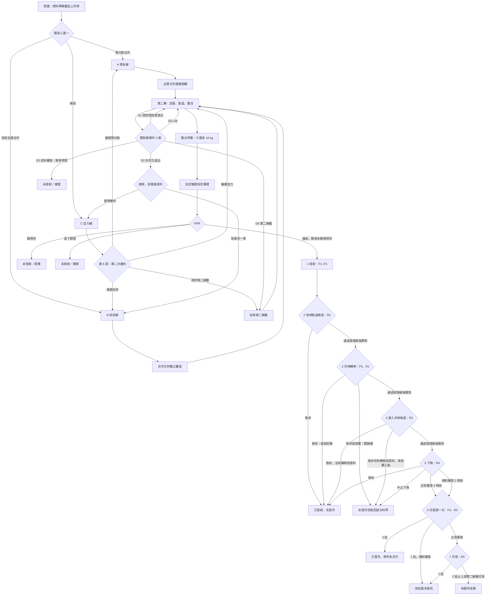

# 困難／登月計畫

團隊受邀將無人科學酬載送上月球。最低要求是酬載成功抵達月面，並回傳一批可用的資料。政府想把發表日提前，合作方各自帶著條件，飛行中的每一段都可能出狀況。這一章要玩家決定驗證投在哪裡，再帶著沒驗證的項目飛。

這份文件是第二版的故事架構。真實任務事件表在 [`lunar-history.md`](lunar-history.md)，文中用 H01–H32 引用。

**目前進度：** 資料檔 [`src/missions/lunar-mission.ts`](../../src/missions/lunar-mission.ts) 和測試 [`tests/lunar-mission.test.ts`](../../tests/lunar-mission.test.ts) 還是第一版（20 週、四步模擬、五種結局），尚未跟上本文件。規則章節已對齊共用的 [`src/game/risk.ts`](../../src/game/risk.ts)：四級驗證、每項擲一次、後果分降級和致命。「路線驗算」一節還是照第一稿的二元驗證寫的，要等模擬器寫好後用固定種子重算，該節開頭有說明。

文中的質量、經費、週數和門檻都是**遊戲設定**。工程因果對照 NASA 來源，連結附在各節和來源對照表。

## 三幕與時間預算

首次遊玩目標約 30 分鐘。估算以每個決策畫面 30–75 秒計，尚未實測。

| 幕 | 內容 | 決策數 | 時間 |
| --- | --- | ---: | ---: |
| 第一幕　受邀 | 任務簡報、三選一的合作、取捨研究、架構和初步設計。到 PDR 為止。 | 約 6 | 6 分鐘 |
| 第二幕　交期 | 定版、製造、整合。三張開發期事件、一個故事線事件、介面質量問題、決定驗證投在哪裡、送 FRR。 | 約 22 | 12 分鐘 |
| 第三幕　飛行 | 七步模擬。兩張飛行期事件，每個風險項目擲一次，降級時選應對。 | 約 10 | 9 分鐘 |
| 結算 | 任務成果、收尾文字、已接受的風險、任務檔案回顧。 | — | 3 分鐘 |

多週工作是一次操作。第二幕的 22 個決策約等於 12 次排工、5 次驗證取捨、4 次事件和 1 次送審。

## 任務與資源

| 項目 | 數值（遊戲設定） |
| --- | --- |
| 初始期限 | 26 週。期限當週的工作完成後仍可送 FRR。 |
| 初始經費 | 150 |
| 最低要求 | 登上月面，地面收到 1 批可用資料。 |
| 額外目標 | 地面收到 2 批以上，或完成基本委託並讓政府的第二酬載可用。 |
| 發射質量配額 | 起飛時含推進劑共 500 kg。 |
| 推進劑保留量 | FRR 要求餘裕 ≥ 10 kg。 |

期限從 20 週改成 26 週。多出的 6 週留給選做的驗證工作，每升一級 1 週。經費沒有跟著增加，所以時間夠做的驗證，錢不一定夠。

任務簡報把需求分給四個區段：發射、太空、地面、使用者。MDR 確認每項需求都有負責的組別。 [Design and Develop Science Missions 第 8、19 頁](https://www.nasa.gov/wp-content/uploads/2025/04/250323-design-and-develop-science-mission.pdf#page=8)

組別有四個：科學組、飛行系統組、軌道與導航組、地面與通訊組。 [Mission Design Lab](https://etd.gsfc.nasa.gov/capabilities/integrated-design-center/mission-design-lab/)

## 三條故事線

三條線從開局的選擇長出來。每條線有自己的中段事件。中途有四個轉線節點。

| 故事線 | 開局 | 資源特徵 | 中段事件 | 這條線的問題 |
| --- | --- | --- | --- | --- |
| A　資金線 | 預付款合作案 | 錢最多，合約工作 2 週。 | 出資方想在登陸器上裝直播相機。 | 錢約夠 9 級驗證。額外目標和驗證搶同一筆錢。 |
| B　技術線 | 技術支援合作案 | 3 個支援時段，合約工作 3 週。經費最緊。 | 合作方的獨立審查點出最弱的一項。 | 時段要換硬體、換工期，還是換驗證。 |
| C　自力線 | 婉拒 | 工期最寬，錢只夠 1–2 級驗證。 | 第 8 週的第二次邀約。 | 帶著大半沒驗證的項目飛，或中途轉線。 |

### 開局合約

只能有一份有效合約。合約工作每週占用一個主工作回合，不花經費。邀約保留到 PDR 通過前。合約要在送 FRR 前交件或終止。

| 選擇 | 合約工作 | 回報與取得時點 |
| --- | ---: | --- |
| 預付款合作案 | 2 週 | 簽約時 +40 經費。交件時 +20 經費。 |
| 技術支援合作案 | 3 週 | 交件時取得 3 個支援時段。 |
| 婉拒 | 0 週 | 無。 |

支援時段每個只能用一次。

| 用途 | 效果 |
| --- | --- |
| 借合作方試驗台測登陸器 | 「製造並測試登陸器」少 1 週、少 10 經費。 |
| 借合作方整合廠房 | 「整合、秤重與測試」少 1 週、少 10 經費。 |
| 請合作方製作輕量化安裝座 | 免付 16 經費。定版前選用不加工期。整合後才換要 1 週，並需重測。 |
| 借合作方設施做一級驗證 | 該級驗證免經費，仍要 1 週。 |

上一章履歷只提供額外條件，不是通關必需。

| 履歷 | 效果 |
| --- | --- |
| 入軌案準時交付 | 預付款合作案的交件款有 10 經費改在簽約時撥付。總額不變。 |
| 入軌案完整驗證紀錄 | 技術支援合作案多 1 個支援時段。 |

合作夥伴和整合測試方式屬於實作方案的一部分，要在概念成熟到一定程度時定下來。 [Concept Maturity Levels](https://dataverse.jpl.nasa.gov/dataset.xhtml?persistentId=hdl:2014/44299)

### 故事線事件

這三個事件固定觸發，不從事件池抽。數值是遊戲設定。

| 事件 | 觸發 | 選項 | 代價與後續 |
| --- | --- | --- | --- |
| A　出資方的直播相機 | 預付款合約交件時 | 裝在登陸器上 | +8 經費，乾質量 +2 kg。 |
| | | 改在任務控制室直播 | +3 經費。 |
| | | 婉拒 | 無。 |
| B　合作方的獨立審查 | 技術合約交件時。審查意見指出目前剩餘風險最高的項目。 | 用 1 個支援時段請對方代做 | 該項目的驗證升一級，不花工期和經費。 |
| | | 記下意見，自己排 | 無。時段留給硬體或工期。 |
| C　第二次邀約 | 第 8 週結束，且沒有有效合約 | 補簽預付款合約 | 合約工作 2 週。簽約時 +30 經費，沒有交件款。轉到 A 線。 |
| | | 補簽技術合約 | 合約工作 2 週。交件時 1 個支援時段。轉到 B 線。 |
| | | 向政府提案搭載第二酬載 | +30 經費，乾質量 +8 kg，整合前多 1 週介面工作。 |
| | | 繼續自力 | 無。 |

### 轉線節點

| 節點 | 何時 | 從哪到哪 |
| --- | --- | --- |
| PDR 前改變主意 | PDR 通過前 | C → A 或 B，條件同開局。 |
| 第二次邀約 | 第 8 週結束 | C → A、B，或接下政府的第二酬載。條件較差。 |
| 合作方退出 | 抽到 D2，且合約尚未交件 | A 或 B → C，或改簽另一家的補位合約。 |
| 政府追加第二酬載 | 抽到 D4，或 C 線在第二次邀約時提案 | 任何一條線都可以加掛。多一筆錢、多一份質量、多一種額外成果。 |

## 設計選項

定版前換選項不花工期。定版時一次付清硬體費。

| 決策 | 選項 | 經費 | 質量 | 直接效果 | 後續影響 |
| --- | --- | ---: | ---: | --- | --- |
| 科學酬載 | 巡查型光譜儀 | 20 | 20 kg | 每批要 2 個時段收集，最多 2 批。 | 正常著陸剛好交 1 批，剩 1 個時段。 |
| | 高速率光譜儀 | 34 | 30 kg | 每批要 1 個時段收集，最多 3 批。 | 正常著陸可交 2 批。傾斜著陸仍可交 1 批。 |
| 著陸感測器 | 單一雷射測高儀 | 12 | 6 kg | 下降時沒有備援。 | 測距儀出問題時，只能靠慣性與相機下降或中止。 |
| | 測高儀加備援光達 | 24 | 12 kg | 主感測器出問題時可切換。 | 多兩種應對，不用花推進劑懸停。 |
| 月面供電 | 月晝供電 | 0 | 0 kg | 月晝 4 個操作時段。 | 無。 |
| | 延長操作套件 | 16 | 12 kg | 日落後多 2 個時段。 | 巡查型光譜儀可交 2 批。整合時可拆掉換回 12 kg。 |
| 奔月路線 | 直接轉移 | 0 | 需 270 kg 推進劑 | 修正用 6 kg。 | 期限不變。 |
| | 低能量轉移 | 6 | 需 252 kg 推進劑 | 修正用 4 kg。 | 航程長，FRR 期限提前 2 週。 |
| 酬載安裝座 | 標準安裝座 | 0 | 實測 +10 kg | 各組依自己的圖面製作。 | 介面質量到整合秤重才出現。 |
| | 輕量化安裝座 | 16 或 1 個支援時段 | 實測 +2 kg | 依共同質量目標設計。 | 省下 8 kg 推進劑餘裕。 |

### 質量與推進劑

- 乾質量 ＝ 登陸器 190 kg ＋ 酬載 ＋ 感測器 ＋ 供電 ＋ 安裝座實測質量 ＋ 事件加上的質量。
- 可裝推進劑 ＝ 500 kg − 乾質量。硬體每多 1 kg，推進劑就少 1 kg。
- 餘裕 ＝ 可裝推進劑 − 路線需求。
- 定版前的預估不含安裝座質量。做過取捨研究後，預估會加入安裝座的 10 kg 或 2 kg。
- 飛行時，餘裕是第三幕的推進劑存量。修正機動和各種應對都從這裡扣。

質量超出發射方分析範圍的衛星可能被撤下，所以早期估值要留餘裕。 [CubeSat 101 §6.4](https://science.nasa.gov/wp-content/uploads/2023/06/nasa_csli_cubesat_101_508.pdf#page=65) 需求用秤重這類實測來驗證。 [Design and Develop Science Missions 第 19 頁](https://www.nasa.gov/wp-content/uploads/2025/04/250323-design-and-develop-science-mission.pdf#page=19)

低能量轉移用更長的航程換取大幅減少的燃料。NASA 的 CAPSTONE 走這種路線花了約四個月。 [CAPSTONE 的奔月路線](https://www.nasa.gov/missions/small-satellite-missions/capstone-uses-gravity-on-unusual-efficient-route-to-the-moon/) 這類軌道取捨可以用 NASA 的 GMAT 分析。本章的 270 kg 和 252 kg 是遊戲設定，沒有用 GMAT 算過。 [GMAT](https://software.nasa.gov/software/GSC-19468-1)

### 月面時段與資料

- 一個月晝分成 4 個操作時段。傾斜著陸時只有 2 個。延長操作套件在日落後再加 2 個。
- 每批資料要先收集，再用 1 個時段下傳。
- 可交付批數 ＝ 時段數 ÷（收集時段 ＋ 下傳時段），無條件捨去，不超過酬載上限。
- 用不完的時段留著。月夜後若喚醒，新時段和留下的時段合併計算。

Blue Ghost 1 號在月面操作約 14 個地球日，相當於一個月晝，並在日落後多運作數小時（H27、H31）。IM-2 側躺著陸，電池耗盡前只完成部分操作（H26）。

## 工作與成本

| 階段 | 工作 | 週數 | 經費 | 說明 |
| --- | --- | ---: | ---: | --- |
| 可行性 | 確認任務架構並分配需求 | 1 | 8 | 完成後通過 MDR。 |
| | 執行取捨研究（選做） | 1 | 6 | 顯示安裝座質量、路線差異和可交付批數。 |
| | 完成初步設計 | 1 | 8 | 預估餘裕 ≥ 10 kg 才通過 PDR。 |
| 詳細設計 | 完成詳細設計 | 1 | 8 | |
| | 確認設計定版 | 1 | 10 ＋ 硬體 | 通過 CDR。之後變更算返工。 |
| 製造 | 製造並測試登陸器 | 3 | 30 | 可用支援時段。 |
| | 製造並測試酬載 | 2 | 16 | |
| | 建置地面系統與資料鏈 | 1 | 8 | |
| 整合 | 整合、秤重與測試 | 2 | 20 | 可用支援時段。產生整合證據。 |
| | 重新執行整合測試 | 1 | 10 | 整合後有變更就要重測。 |
| 任何階段 | 做合約工作 | 1 | 0 | 做滿合約週數才算交件。 |
| | 做第二酬載的介面工作 | 1 | 0 | 接了第二酬載才有。要在整合前完成。 |
| | 讓時間經過一週 | 1 | 0 | |

全選基本硬體、走直接轉移時，主線要 12 週和 140 經費。這個配置整合後餘裕只有 4 kg。最便宜的處理是定版前改走低能量轉移，多 6 經費，共 146。

### 驗證工作

風險規則照 [`risk.ts`](../../src/game/risk.ts)。每個風險項目有四個驗證等級，逐級往上做。每升一級是一項工作，都是選做。

| 驗證等級 | 週數 | 經費 | 沿用設計的剩餘風險 | 新設計的剩餘風險 | 前置 |
| --- | ---: | ---: | ---: | ---: | --- |
| 沒驗證 | — | — | 20% | 40% | — |
| 分析 | 1 | 3 | 12% | 25% | 通過 MDR。 |
| 單元測試 | 1 | 6 | 5% | 10% | 該項的硬體已製造。 |
| 端到端測試 | 1 | 10 | 2% | 2% | 已整合。 |

剩餘風險的百分比是 `risk.ts` 的共用設定。週數和經費是本章的遊戲設定。

| 風險項目 | 分析 | 單元測試 | 端到端測試 | 單元測試要先有 |
| --- | --- | --- | --- | --- |
| R1 加壓系統 | 加壓系統洩漏分析 | 加壓檢漏 | 推進系統熱試車 | 登陸器 |
| R2 飛行軟體與故障保護 | 故障樹與介面文件審查 | 飛行軟體台架測試 | 端到端任務演練 | 地面系統 |
| R3 姿態控制推進器 | 推進器配置分析 | 推進器點火測試 | 閉迴路姿控測試 | 登陸器 |
| R4 著陸感測 | 下降軌跡模擬 | 感測器場測 | 降落時序演練 | 登陸器 |
| R5 科學酬載 | 酬載資料流分析 | 酬載功能測試 | 酬載端到端測試 | 酬載 |
| R6 月夜存活 | 熱模型分析 | 電池低溫測試 | 熱真空試驗 | 登陸器 |

六項全部驗到最高級要 18 週和 114 經費，沒有任何一條線做得到。期限 26 週扣掉主線 12 週、合約 2–3 週和提前的 2 週，剩 9–10 週。A 線的錢約夠 9 級。B 線約 4–5 級。C 線 1–2 級。

第一版的「降落時序演練」就是 R4 的端到端測試。

驗證等級對應 NASA 系統工程手冊的驗證方法。 [NASA 系統工程手冊 §5.3](https://www.nasa.gov/reference/5-3-product-verification/) 驗證要在訂需求時就規劃。 [Design and Develop Science Missions 第 19 頁](https://www.nasa.gov/wp-content/uploads/2025/04/250323-design-and-develop-science-mission.pdf#page=19) 取捨研究對應 CML 3，單點設計要有可接受的餘裕。 [Concept Maturity Levels](https://dataverse.jpl.nasa.gov/dataset.xhtml?persistentId=hdl:2014/44299)

## 審查門檻

| 審查 | 通過條件 | 不通過時 |
| --- | --- | --- |
| MDR | 完成架構與需求分配。 | 無法進入初步設計。 |
| PDR | 完成初步設計，預估餘裕 ≥ 10 kg。 | 退回。換選項後再送，不另花工期。 |
| CDR | 完成詳細設計並定版，經費付得起硬體。 | 無法開始製造。 |
| FRR | 見下表。 | 退回。修正、重測、簽豁免或簽收風險。 |

| FRR 項目 | 門檻 | 玩家可以怎麼過 |
| --- | --- | --- |
| 整合證據 | 對應目前的設計。 | 不能豁免。 |
| 推進劑 | 可裝推進劑 ≥ 路線需求。 | 不能豁免。 |
| 合作合約 | 已交件或已終止。 | 不能豁免。 |
| 推進劑保留量 | 餘裕 ≥ 10 kg。 | 可簽豁免。餘裕須 ≥ 0。 |
| 風險項目 | R1–R5 的剩餘風險 ≤ 5%。 | 高於 5% 的逐項簽字「接受風險」。畫面列出百分比和後果。 |

第一版的「降落演練」是可豁免的 FRR 項目。第二版把它併入風險項目：沒演練可以飛，結果不確定。5% 的簽字門檻照共用規則。R6 只在玩家嘗試過夜時才擲，不列入 FRR。

審查名稱和目的依 NPR 7123.1D 附錄 G。FRR 接受已評估的未結項目、豁免和殘餘風險。 [NPR 7123.1D 附錄 G](https://nodis3.gsfc.nasa.gov/displayDir.cfm?Internal_ID=N_PR_7123_001D_&page_name=AppendixG)

豁免和已接受的風險都寫進結算。

## 整合時的介面問題

這是固定的工程問題，不擲骰。標準安裝座在整合秤重時多出 10 kg。全選基本硬體走直接轉移時，餘裕剩 4 kg，FRR 退回。做過取捨研究的玩家在定版前就看得到。

整合後才執行的解法都要 1 週，之後還要 1 週和 10 經費重測。

| 解法 | 經費 | 效果 | 誰能用 |
| --- | ---: | --- | --- |
| 請合作方重做安裝座 | 0 | 介面質量 10 kg → 2 kg。 | 還有支援時段的玩家。 |
| 返工改用輕量化安裝座 | 16 | 介面質量 10 kg → 2 kg。 | 經費夠的玩家。 |
| 拆除延長操作套件 | 0 | 減 12 kg，放棄日落後 2 個時段。 | 選了延長操作套件的玩家。 |
| 改走低能量轉移 | 6 | 推進劑需求減 18 kg，FRR 期限提前 2 週。 | 提前後的期限還趕得上的玩家。 |
| 換成巡查型光譜儀 | 8 | 減 10 kg，每批收集改為 2 個時段。 | 選了高速率光譜儀的玩家。 |
| 簽豁免 | 0 | 帶著不足的保留量飛行。 | 餘裕 0–9 kg 的玩家。 |

各組單獨測試都過，不代表裝在一起也會過。 [CubeSat 101 §2.11](https://science.nasa.gov/wp-content/uploads/2023/06/nasa_csli_cubesat_101_508.pdf#page=33) 測試後再改動軟體或硬體，原測試作廢，需重測。 [CubeSat 101 §6.9.1–6.9.2](https://science.nasa.gov/wp-content/uploads/2023/06/nasa_csli_cubesat_101_508.pdf#page=69)

## 外部事件池

外部事件是抽牌。玩家的驗證工作不影響抽到哪一張。前期決策只影響某張牌能不能出現，以及手上有哪些選項。抽牌用 `risk.ts` 的 `drawFromPool`，同一個種子抽到同樣的牌。D1 落在第一張還是第二張也用它抽。其餘各張從還沒出現過的牌裡抽。

每局的張數：

- 開發期 3 張。在第 4、10、16 週結束時各翻一張。D1 一定出現在前兩張之一，另外兩張從 D2–D8 抽。
- 飛行期 2 張。發射時從 F1–F3 抽一張，之後從 F4、F6 抽一張。
- F5 只在失聯且沒有工程資料時出現。
- 抽到的牌條件不成立時，該週無事，不補抽。所以每局是 4 到 6 張。

每張牌都附任務檔案。牌面的數值是遊戲設定。

### 開發期

| 牌 | 出現條件 | 會改變它的前期決策 | 選項 | 代價與後續 | 取材 |
| --- | --- | --- | --- | --- | --- |
| D1　政府提前發表日 | 必出。第 4 或第 10 週。 | 走低能量轉移的人，有效期限再少 2 週。 | 接受提前 | 期限 −2 週，+12 經費。 | H03 |
| | | | 談成折衷 | 期限 −1 週。 | |
| | | | 拒絕 | 期限不變，−10 經費。政府不再提第二酬載（D4 不出現）。結算的合作關係記為「政府保持距離」。 | |
| D2　合作方退出 | 已簽約，尚未交件。 | 早點做完合約工作就不會遇到。 | 接受解約 | 剩下的合約工作取消。已收的預付款保留。交件款和支援時段取消。轉到 C 線。 | H01 |
| | | | 改簽另一家的補位合約 | 條件同「第二次邀約」。轉線。 | |
| | | | 花 1 週談判 | 預付款合約拿到 10 經費。技術合約拿到 1 個支援時段。之後合約終止。 | |
| D3　成本審查 | 手上的經費付不完剩下的主線工作。 | 選高規硬體、拒絕提前、沒有合作的人容易遇到。 | 接受附帶條件的補助 | +16 經費。審查方指定 R4 至少驗到單元測試，否則 FRR 不能簽收。 | H02 |
| | | | 砍掉額外目標 | 高速率光譜儀和延長操作套件退回基本款。定版前免費。定版後退回價差的一半，並且要重測。 | |
| | | | 接受停案 | 以「未發射／撤案」結算。硬體移交。 | |
| D4　政府追加第二酬載 | 簽過合約且未被終止、沒拒絕過 D1、尚未整合。 | 質量餘裕夠的人才接得起。 | 接受 | +30 經費，乾質量 +8 kg，整合前多 1 週介面工作。 | H14 |
| | | | 請對方自備輕量介面 | +18 經費，乾質量 +4 kg。 | |
| | | | 婉拒 | 無。 | |
| D5　供應延誤 | 登陸器尚未完成。 | 先做登陸器的人不會遇到。 | 等 | 「製造並測試登陸器」多 1 週。 | H02 |
| | | | 付急件費 | −8 經費。 | |
| | | | 改用庫存件 | 乾質量 +4 kg。 | |
| D6　發射載具延後 | 無。 | 無。 | 跟著延 | 期限 +2 週，−6 經費的待命成本。 | H02 |
| | | | 維持原訂日期 | 無。 | |
| D7　同型零件的在軌通報 | FRR 之前。 | R3 已驗到最高級的人，這張牌只是確認。 | 拆檢並沖洗管路 | 1 週，4 經費。R3 的驗證升一級。 | H16 |
| | | | 用支援時段請合作方檢查 | 1 個支援時段。R3 的驗證升一級。 | |
| | | | 照原樣飛 | 無。列入已接受的風險。 | |
| D8　介面文件對不上 | 尚未整合。 | 無。 | 開跨組介面審查 | 1 週。R2 的驗證升一級。之後 R2 失敗時，「上傳修正表」不花經費。 | H09、H11 |
| | | | 各組自行對表 | 無。之後 R2 失敗時，「上傳修正表」多 4 經費。列入已接受的風險。 | |

D4 的第二酬載是被動式酬載，只有登陸器直立在月面時才可用。這是遊戲設定。Peregrine 1 號上的雷射反射器陣列就是被動式，只能在月面運作（H14）。

### 飛行期

| 牌 | 出現條件 | 會改變它的前期決策 | 選項 | 代價與後續 | 取材 |
| --- | --- | --- | --- | --- | --- |
| F1　加注異常，當次發射取消 | 發射時抽到。 | 留著經費的人才等得起。 | 等下一個發射機會 | −8 經費。 | H05、H07 |
| | | | 壓縮發射前檢查，趕同一個窗口 | R2 的驗證降一級。 | |
| F2　發射場天氣 | 發射時抽到。 | 無。 | 撤回機庫等天氣 | −6 經費。 | H06 |
| | | | 改訂兩天後 | 錯過最佳轉移時點，修正機動多用 2 kg。 | |
| F3　升空遭雷擊 | 發射時抽到。 | R2 驗到端到端的人多一個選項。 | 在停泊軌道做完整檢查 | 軌道維持用掉 2 kg。 | H08 |
| | | | 照時間表奔月 | R2 的驗證降一級。 | |
| | | | 切到備用訊號調節 | 需要做過端到端任務演練。沒有代價。 | |
| F4　月面遇上日食 | 已登月。 | 有延長操作套件的人多一個選項。 | 關酬載保溫 | 月晝時段 −1。 | H09、H27 |
| | | | 用套件電池撐過 | 需要延長操作套件。日落後時段 2 → 1。 | |
| | | | 不保溫，照常操作 | R5 的驗證降一級。 | |
| F5　軌道器願意替你拍落點 | 已發射未登月，且沒有留下工程資料。 | 無。 | 提供預定落點並公開資料 | 結算加上「落點已確認」。 | H24 |
| | | | 婉拒 | 無。 | |
| F6　轉移途中的科學機會 | 轉移開始時抽到。 | 無。 | 酬載開機量測 | −4 經費。取得轉移段資料。之後 R5 失敗時，斷電重啟不花時段。 | H14 |
| | | | 保持關機 | 無。 | |

F6 的轉移段資料會改變失敗時的結局：之後任何一步失聯，都以「未登月但救回部分科學」結算。

## 風險項目與降級情境

通過 FRR 後，每個風險項目在自己的飛行步驟用 `rollItem` 擲一次。結果只有兩種：失敗或沒失敗。失敗機率是該項目的剩餘風險，由設計成熟度和驗證等級決定，最低 2%。

後果輕重是項目本身的屬性。

- **降級**：遊戲暫停，顯示發生了什麼、任務檔案和應對選項。應對用掉推進劑餘裕、經費或月面時段。選完之後全部用固定規則算，不再擲骰。
- **致命**：任務在那一步結束。
- 本章的致命項目最多兩個，都列在工作台上：單一測高儀的 R4，以及故障保護被關掉之後的 R3。
- **備援不降低機率。** 備援光達把 R4 從致命變成降級。

| 項目 | 飛行步驟 | 成熟度 | 後果 |
| --- | --- | --- | --- |
| R2 飛行軟體與故障保護 | 2 地球軌道檢查 | 新設計 | 降級 |
| R1 加壓系統 | 3 月球轉移 | 沿用設計 | 降級 |
| R3 姿態控制推進器 | 4 進入月球軌道 | 沿用設計 | 降級。R2 的保護被關掉時是致命。 |
| R4 著陸感測 | 5 下降 | 新設計 | 單一測高儀是致命。有備援光達是降級。 |
| R5 科學酬載 | 6 月面第一天 | 巡查型是沿用設計，高速率是新設計 | 降級 |
| R6 月夜存活 | 7 月夜 | 有延長操作套件是沿用設計，沒有是新設計 | 降級。只在嘗試喚醒時擲。 |

成熟度的分法是遊戲設定。

### R2　飛行軟體與故障保護（地球軌道檢查）

失敗時：太空船一啟動，故障保護就把反應輪關掉，指令鏈中斷。

| 應對 | 用掉什麼 | 帶到哪裡 |
| --- | --- | --- |
| 重讀介面文件，上傳修正表 | 6 經費（D8 開過審查為 0，沒開為 10）。 | 繼續。 |
| 等自主軟體重啟 | 錯過修正時點，3 kg。 | 繼續。 |
| 關掉這項保護繼續飛 | 無。 | 繼續。R3 變成致命項目。列入已接受的風險。 |

任務檔案：LADEE 一啟動，故障管理就關掉全部反應輪，原因是把警告旗標當成錯誤旗標，更新表格後恢復（H09）。CAPSTONE 因為一道格式錯誤的指令和飛行軟體的錯誤失聯，最後由自主軟體清除故障（H11）。Lunar Trailblazer 在電力系統間歇異常後失聯，沒有再聯絡上（H10），用在「關掉保護」選項的提醒。遊戲裡的誤觸發是簡化設定。

### R1　加壓系統（月球轉移）

轉移先扣修正機動的推進劑：直接轉移 6 kg，低能量轉移 4 kg。

失敗時：修正機動後加壓閥沒關緊，餘裕少 6 kg。

| 應對 | 用掉什麼 | 帶到哪裡 |
| --- | --- | --- |
| 改用緊急下降計畫 | 拿回 4 kg。原本驗證過的時序不再適用，R4 的驗證歸零。 | 繼續。 |
| 照原計畫 | 無。餘裕須 ≥ 0。 | 繼續。 |
| 放棄登月，酬載開機做飛掠觀測 | 登月。 | 未登月但救回部分科學。 |
| 放棄登月，把通聯留給推進系統診斷 | 登月和科學資料。 | 已發射、未登月。留下工程資料。 |

任務檔案：Surveyor 5 在中途修正後流失氦氣，團隊改用緊急著陸計畫，提早點火減速，最後軟著陸（H18）。Peregrine 1 號推進劑大量流失，業者宣布無法軟著陸，酬載在途中開機收資料，五項 NASA 酬載有四項收到資料（H14）。LCROSS 因感測器問題燒掉 140 kg 推進劑，仍以極小的餘裕完成任務（H12）。

### R3　姿態控制推進器（進入月球軌道）

進入軌道時餘裕須 ≥ 0，否則任務在這裡結束。

失敗時：點火後太空船自旋，轉速超過反應輪的能力。

| 應對 | 用掉什麼 | 帶到哪裡 |
| --- | --- | --- |
| 先在地面模擬，再上傳止旋指令 | 6 經費，2 kg。 | 繼續。 |
| 立刻反向點火 | 5 kg。 | 繼續。 |
| 放棄入軌，飛掠時觀測 | 登月。 | 未登月但救回部分科學。 |

R2 的保護已關時，這一項是致命：沒有安全模式接手，翻滾無法恢復。結局是已發射、未登月。有轉移段資料時改為救回部分科學。

任務檔案：CAPSTONE 在修正機動後自旋，團隊判斷最可能是推進器閥門問題，測試後上傳指令止旋（H15）。Surveyor 2 有一具微調引擎沒點著，翻滾後撞月（H13）。Lunar Flashlight 推力不足進不了月球軌道，團隊懷疑碎屑堵住燃料管路（H16）。LunaH-Map 的閥門卡住，飛掠時仍收到中子資料（H17）。

### R4　著陸感測（下降）

沒失敗時正常著陸，月晝 4 個時段。

失敗時：下降前幾小時，主測距儀無法啟動。

單一測高儀沒有別的距離來源，這一項是致命。結局是已發射、未登月。有轉移段資料時改為救回部分科學。

有備援光達時是降級。

| 應對 | 用掉什麼 | 帶到哪裡 |
| --- | --- | --- |
| 多繞一圈，上傳更新改用備援光達 | 3 kg。 | R4 驗到單元測試以上時正常著陸。否則臨時更新有錯，傾斜著陸，2 個時段。 |
| 直接切到備援光達 | 無。 | 傾斜著陸，2 個時段。 |
| 中止下降，留在軌道觀測 | 登月。 | 未登月但救回部分科學。 |

任務檔案：IM-1 著陸前數小時發現雷射測距儀因安全開關沒解除而打不開。團隊多繞一圈，上傳更新改用 NASA 的 NDL 酬載。NASA 當時的新聞稿說 NDL 扮演關鍵角色。NDL 團隊事後分析指出臨時更新有錯，NDL 資料沒被採用，登陸器靠慣性量測單元和相機著陸，沒有直立（H21）。Surveyor 3 的雷達在觸地前失鎖，引擎沒關，彈了兩次（H22）。Surveyor 4 在觸地前約 2.5 分鐘失聯，原因至今不明（H23）。Apollo 14 在下降前收到假的中止訊號，組員及時輸入軟體修改（H20）。

### R5　科學酬載（月面第一天）

失敗時：酬載開機後沒有回應。

| 應對 | 用掉什麼 | 帶到哪裡 |
| --- | --- | --- |
| 斷電重啟 | 1 個時段。F6 開過機的人不花時段。 | 繼續收資料。 |
| 改走低速率備援通道 | 每批下傳多 1 個時段。 | 繼續收資料。 |
| 把時段改給登陸器工程資料 | 全部科學資料。 | 已登月、資料未交付。留下工程資料。 |

之後玩家選月面操作計畫。

| 計畫 | 效果 |
| --- | --- |
| 優先交付必要資料 | 收到 1 批就停止。 |
| 所有時段都用於科學觀測 | 交付時段內做得完的全部批數。 |
| 保留時段下傳降落診斷 | 先扣 2 個時段給工程資料，剩下的給科學。留下工程資料。 |

任務檔案：Ranger 6 飛行正常，撞月前相機沒有送出任何影像，審查委員會判定最可能是發射後電源誤開時的電弧放電（H04）。IM-1 斜靠在月面上，在姿態造成的通訊限制下仍下載超過 500 MB 資料（H25）。IM-2 側躺，電池耗盡前只完成部分操作（H26）。

### R6　月夜存活（月夜）

只有正常著陸才有這一步。延長操作套件的日落後 2 個時段先結算，不擲骰。之後玩家決定要不要嘗試過夜。

| 選擇 | 用掉什麼 | 結果 |
| --- | --- | --- |
| 收工 | 無。 | 不擲。以目前批數結算。 |
| 維持地面團隊兩週，嘗試喚醒 | 10 經費。 | 沒失敗：第二個月晝多 2 個時段，和留下的時段合併重算批數。失敗：沒有醒來，以入夜前的批數結算。 |

任務檔案：Surveyor 1 撐過第一個月夜，第二個月晝再傳回照片，日落後電池電壓驟降而終止（H28）。Surveyor 3 在兩週的月夜後沒有再醒來（H29）。Surveyor 5 在第三和第四個月晝恢復傳輸（H30）。

## 任務模擬

七步依序進行。每一步先顯示前面保留下來的能力，再翻牌、擲骰、顯示結果。

| 步驟 | 用到的能力 | 發生什麼 | 玩家的決策 |
| --- | --- | --- | --- |
| 1 發射 | 實測乾質量、可裝推進劑、剩餘經費。 | 翻一張發射牌（F1–F3）。 | 牌面選項。 |
| 2 地球軌道檢查 | 端到端任務演練、介面審查。 | 擲 R2。 | 降級應對。 |
| 3 月球轉移 | 奔月路線、推進劑餘裕、加壓檢漏。 | 可能翻到 F6。扣修正機動。擲 R1。 | 牌面選項、降級應對。 |
| 4 進入月球軌道 | 餘裕、推進器點火測試、故障保護是否還開著。 | 餘裕 < 0 時結束。擲 R3。 | 降級應對。 |
| 5 下降 | 著陸感測器、降落時序演練、餘裕。 | 擲 R4。 | 降級應對。 |
| 6 月面第一天 | 酬載、月面供電、地面資料鏈、酬載端到端測試。 | 可能翻到 F4。擲 R5。 | 牌面選項、降級應對、月面操作計畫。 |
| 7 月夜 | 延長操作套件、熱真空試驗、剩餘經費。 | 結算日落後時段。選擇嘗試喚醒時擲 R6。 | 收工或嘗試喚醒。 |

## 任務檔案

外部事件和降級情境出現時，畫面顯示一段任務檔案。格式固定：

1. 哪個任務、哪一年、在哪個階段。
2. 當時發生了什麼。
3. 團隊怎麼處理。
4. 結果。
5. 來源連結。
6. 一句「這和你現在的情況有什麼關係」。

寫法的規則：

- 只引用 [`lunar-history.md`](lunar-history.md) 表內的內容。
- 遊戲裡的故障原因是簡化設定。文案寫「遊戲裡的情況是簡化的設定，不代表該任務的實際故障原因」。
- 來源沒說原因的，寫「原因在來源中沒有記載」。
- 兩個來源說法不同時兩種都寫，例如 IM-1 的 NDL。

第 6 項回答「為什麼會這樣」。例子：R2 降級時寫「介面文件裡一個旗標的意思，兩組人讀得不一樣。這種問題單獨測試看不出來，要整套系統一起跑才會出現。」

## 結局矩陣

結局由兩個軸決定。任務成果是一個軸。收尾是另一個軸，寫的是團隊留下什麼。

### 任務成果

| 成果 | 條件 |
| --- | --- |
| 未發射 | 期限前沒有通過 FRR，經費不足以支付下一項必要工作，或接受停案。 |
| 已發射、未登月 | 飛行在第 2–5 步結束，沒有帶回科學資料。 |
| 未登月但救回部分科學 | 沒有登月，但帶回轉移段、飛掠或軌道觀測資料。 |
| 已登月、資料未交付 | 抵達月面，地面收到 0 批。 |
| 完成基本委託 | 抵達月面，地面收到 1 批，沒有其他額外成果。 |
| 有額外成果 | 地面收到 2 批以上，或收到 1 批且第二酬載可用（正常著陸）。 |

### 收尾

失敗的成果看「關鍵項目」：直接讓任務停在那裡的風險項目或豁免。成功的成果看整趟飛行。

| 收尾 | 適用成果 | 條件 |
| --- | --- | --- |
| 準備過，運氣不好 | 未登月的兩種、資料未交付 | 關鍵項目擲骰時的剩餘風險 ≤ 10%。 |
| 清單上的那一項 | 未登月的兩種、資料未交付 | 關鍵項目擲骰時的剩餘風險 > 10%，或關鍵的是簽了豁免的保留量。 |
| 自己的取捨 | 資料未交付 | 酬載正常，0 批是月面操作計畫或應對選項的結果。 |
| 準備換來的 | 基本委託、額外成果 | 擲過的項目最多 1 項風險 > 10%，沒有項目失敗。 |
| 運氣撐住的 | 基本委託、額外成果 | 擲過的項目有 2 項以上風險 > 10%，沒有項目失敗。 |
| 救回來的 | 基本委託、額外成果 | 至少一個項目失敗，應對後仍然交付。 |
| 期限 | 未發射 | 到期時還有不能豁免的項目，或玩家不願簽收剩下的風險。 |
| 經費 | 未發射 | 付不出下一項必要工作。 |
| 撤案 | 未發射 | 在成本審查接受停案。 |

### 十六個結局

每一格都有條件和收尾文字的方向。「路線」欄對應下方的驗算。

| 任務成果 | 收尾 | 收尾文字的方向 | 路線 |
| --- | --- | --- | --- |
| 未發射 | 期限 | 風險清單清到剩最後一項，窗口關了。硬體和測試紀錄都在，下一個窗口可以直接用。 | E1 |
| | 經費 | 錢在整合前用完。結算指出哪一筆選擇讓缺口出現。 | E2 |
| | 撤案 | 審查後停案，硬體移交。引用 VIPER：儀器拆下再利用（H02）。 | E3 |
| 已發射、未登月 | 準備過，運氣不好 | 那一項測過，地面有基準資料可以比對。驗證降低風險，不會讓它歸零。 | A2 |
| | 清單上的那一項 | 失敗的項目就寫在 FRR 簽收的清單上。當時省下的那一週和那筆錢列出來。 | C2 |
| 未登月但救回部分科學 | 準備過，運氣不好 | 登月沒成，酬載在途中交出資料。引用 Peregrine 1 號（H14）。 | A3 |
| | 清單上的那一項 | 沒驗證的項目讓登月落空。救回的資料來自途中的一個決定。 | D3 |
| 已登月、資料未交付 | 準備過，運氣不好 | 登陸器站在月面上，酬載測過仍然失效。留下工程資料。 | A4 |
| | 清單上的那一項 | 到了月面才發現酬載不通。這項測試要 1 週和 6 經費。 | B2 |
| | 自己的取捨 | 酬載是好的。時段給了工程資料。委託沒完成，下一個團隊拿得到下降紀錄。 | A5 |
| 完成基本委託 | 準備換來的 | 每一步都有證據，沒有一步需要運氣。 | A1 |
| | 運氣撐住的 | 交付了。但清單上有四項沒驗證，每一項都剛好沒出事。結算把機率列出來。 | C1 |
| | 救回來的 | 途中出過狀況，用餘裕換回來。結算列出哪個前期決定留下了那份餘裕。 | B1 |
| 有額外成果 | 準備換來的 | 基本委託之外多一批。引用 Blue Ghost 1 號（H27）。 | A6 |
| | 運氣撐住的 | 成果最多，驗證最少。結算提醒這個結果重玩一次不一定還在。 | D1 |
| | 救回來的 | 酬載出狀況後救回，第二酬載補上額外成果。 | D2 |

每個任務成果至少有兩條不同的路：

| 任務成果 | 到達方式 |
| --- | --- |
| 未發射 | 期限、經費、撤案。 |
| 已發射、未登月 | 單一測高儀的 R4 失敗。保護關掉後 R3 失敗。R1 失敗後選診斷。簽保留量豁免後，餘裕在進入軌道前變負。 |
| 未登月但救回部分科學 | R1、R3、R4 失敗時選放棄並開酬載。有轉移段資料時遇到致命失敗。 |
| 已登月、資料未交付 | R5 失敗後時段不夠或選工程資料。月面計畫保留診斷時段。傾斜著陸加巡查型光譜儀。 |
| 完成基本委託 | 全通過。降級後用餘裕換回。傾斜著陸加高速率光譜儀。 |
| 有額外成果 | 高速率光譜儀。延長操作套件。月夜後喚醒。第二酬載。 |

「10%」是本章的遊戲設定，相當於新設計驗到單元測試、沿用設計驗到單元測試以上。

### 結算附帶的標籤

這些不改變結局是哪一格，只加在收尾文字後面。

| 標籤 | 可能的值 |
| --- | --- |
| 合作關係 | 出資方續約、技術夥伴共同署名、獨立完成、合作中止、政府搭載、政府保持距離。 |
| 已接受的風險 | FRR 簽收的未驗證項目、保留量豁免、關掉的故障保護、沒開的介面審查、沒處理的零件通報。 |
| 工程資料 | 有或沒有。來自診斷時段、推進系統診斷、酬載失效後的時段。 |
| 落點已確認 | F5 選了公開資料。 |

### 準備和運氣

結算有一欄把這趟飛行的擲骰列出來：每個風險項目當時的驗證等級、剩餘風險、擲出的數字和結果。失敗的項目另外寫出再升一級要花多少、會降到多少。

- 「準備過，運氣不好」的文字不責怪玩家，指出驗證做了什麼、沒能擋住什麼。
- 「運氣撐住的」的文字不稱讚，列出每一項沒驗證的機率，以及全部通過的機率有多低。
- 兩種都提供「用同一個種子重玩」和「換種子重玩」。同一個種子、同樣的操作，結果完全相同。

## 分支圖

## 路線驗算

> **這一節待重算。** 下面的路線是對齊 `risk.ts` 之前寫的：驗證只分做過和沒做，每項驗證 1 週、6–12 經費，擲骰有通過、降級、致命三種結果。現行規則是四級驗證（每級 1 週，3、6、10 經費）、每項只擲失敗與否、R4 用單一測高儀時失敗即致命。所以表中的驗證支出、「致命」的擲骰結果和 A2、A3、A4、B2、C2、D3 的走法都要改。主線工作、合約、事件牌和質量的數字不受影響。階段三寫好模擬器後，用固定種子重跑並重寫這一節。

所有路線都不含上一章履歷。開發期事件在第 4、10、16 週結束時翻牌。表中的牌序和擲骰結果是固定的輸入。

「剩餘」是該列結束後的經費。

### 開發路線

**Dev-A　資金線，做完五項驗證**（簽約 +40，開局 190）

設計：巡查型光譜儀、單一測高儀、月晝供電、直接轉移、輕量化安裝座。

| 週 | 工作與事件 | 支出 | 剩餘 |
| --- | --- | ---: | ---: |
| 1 | 架構與需求（MDR） | 8 | 182 |
| 2 | 取捨研究，改選輕量化安裝座 | 6 | 176 |
| 3 | 初步設計（PDR，預估餘裕 12 kg） | 8 | 168 |
| 4 | 合約工作。翻牌 D1：接受提前，期限 24，+12 | 0 | 180 |
| 5 | 合約工作。交件 +20。直播相機：婉拒 | 0 | 200 |
| 6 | 詳細設計 | 8 | 192 |
| 7 | 定版（10 ＋ 酬載 20 ＋ 感測器 12 ＋ 安裝座 16） | 58 | 134 |
| 8–10 | 登陸器。翻牌 D8：開跨組介面審查 | 30 | 104 |
| 11 | 跨組介面審查 | 0 | 104 |
| 12–13 | 酬載 | 16 | 88 |
| 14 | 地面系統 | 8 | 80 |
| 15–16 | 整合。乾質量 218 kg，推進劑 282 kg，餘裕 12 kg。翻牌 D6：維持原訂日期 | 20 | 60 |
| 17 | 加壓檢漏（R1） | 8 | 52 |
| 18 | 推進器點火測試（R3） | 8 | 44 |
| 19 | 端到端任務演練（R2） | 8 | 36 |
| 20 | 降落時序演練（R4） | 10 | 26 |
| 21 | 酬載端到端測試（R5）。送 FRR，期限第 24 週 | 6 | 20 |

支出合計 202。收入 150 ＋ 40 ＋ 12 ＋ 20 ＝ 222。飛行時餘裕 12 kg，經費 20。R1–R5 已驗證。

**Dev-B　技術線，做四項驗證**（開局 150）

設計同 Dev-A，安裝座用支援時段。

| 週 | 工作與事件 | 支出 | 剩餘 |
| --- | --- | ---: | ---: |
| 1 | 架構與需求（MDR） | 8 | 142 |
| 2 | 取捨研究，改選輕量化安裝座 | 6 | 136 |
| 3 | 初步設計（PDR） | 8 | 128 |
| 4–6 | 合約工作。翻牌 D5：等。交件取得 3 個支援時段。獨立審查：用 1 個時段代做加壓檢漏（R1） | 0 | 128 |
| 7 | 詳細設計 | 8 | 120 |
| 8 | 定版（10 ＋ 20 ＋ 12，安裝座用 1 個時段） | 42 | 78 |
| 9–11 | 登陸器（用 1 個時段少 1 週，供應延誤多 1 週，共 3 週）。翻牌 D1：接受提前，期限 24，+12 | 20 | 70 |
| 12–13 | 酬載 | 16 | 54 |
| 14 | 地面系統 | 8 | 46 |
| 15–16 | 整合。餘裕 12 kg。翻牌 D7：拆檢並沖洗管路 | 20 | 26 |
| 17 | 拆檢管路（R3） | 6 | 20 |
| 18 | 降落時序演練（R4） | 10 | 10 |
| 19 | 端到端任務演練（R2）。送 FRR，期限第 24 週 | 8 | 2 |

支出合計 160。收入 150 ＋ 12 ＝ 162。飛行時餘裕 12 kg，經費 2。R1–R4 已驗證，R5 未驗證。

**Dev-C　自力線，做一項驗證**（開局 150）

設計：巡查型光譜儀、單一測高儀、月晝供電、低能量轉移、標準安裝座。

| 週 | 工作與事件 | 支出 | 剩餘 |
| --- | --- | ---: | ---: |
| 1 | 架構與需求（MDR） | 8 | 142 |
| 2 | 初步設計（PDR，預估餘裕 32 kg，未含安裝座） | 8 | 134 |
| 3 | 詳細設計 | 8 | 126 |
| 4 | 定版（10 ＋ 20 ＋ 12 ＋ 路線 6）。翻牌 D1：接受提前，期限 24，低能量轉移為 22，+12 | 48 | 90 |
| 5–7 | 登陸器 | 30 | 60 |
| 8–9 | 酬載。第 8 週第二次邀約：繼續自力 | 16 | 44 |
| 10 | 地面系統。翻牌 D8：各組自行對表 | 8 | 36 |
| 11–12 | 整合。乾質量 226 kg，推進劑 274 kg，餘裕 22 kg | 20 | 16 |
| 13 | 降落時序演練（R4）。送 FRR，期限第 22 週 | 10 | 6 |

支出合計 156。收入 150 ＋ 12 ＝ 162。飛行時餘裕 22 kg，經費 6。只有 R4 已驗證。

**Dev-D　資金線，拚額外成果，不做驗證**（簽約 +40，開局 190）

設計：高速率光譜儀、單一測高儀、月晝供電、低能量轉移、輕量化安裝座。

| 週 | 工作與事件 | 支出 | 剩餘 |
| --- | --- | ---: | ---: |
| 1 | 架構與需求（MDR） | 8 | 182 |
| 2 | 取捨研究，改選高速率光譜儀、低能量轉移、輕量化安裝座 | 6 | 176 |
| 3 | 初步設計（PDR，預估餘裕 20 kg） | 8 | 168 |
| 4 | 合約工作。翻牌 D1：接受提前，期限 24，低能量轉移為 22，+12 | 0 | 180 |
| 5 | 合約工作。交件 +20。直播相機：裝上，+8，+2 kg | 0 | 208 |
| 6 | 詳細設計 | 8 | 200 |
| 7 | 定版（10 ＋ 34 ＋ 12 ＋ 路線 6 ＋ 安裝座 16） | 78 | 122 |
| 8–10 | 登陸器。翻牌 D4：請對方自備輕量介面，+18，+4 kg | 30 | 110 |
| 11–12 | 酬載 | 16 | 94 |
| 13 | 地面系統 | 8 | 86 |
| 14–15 | 整合。乾質量 234 kg，推進劑 266 kg，餘裕 14 kg。送 FRR，簽收六項風險 | 20 | 66 |

支出合計 182。收入 150 ＋ 40 ＋ 12 ＋ 20 ＋ 8 ＋ 18 ＝ 248。飛行時餘裕 14 kg，經費 66。沒有已驗證的項目。載有第二酬載。

**Dev-E　未發射／期限**（簽約 +40，開局 190）

設計：高速率光譜儀、單一測高儀、延長操作套件、低能量轉移、標準安裝座。

| 週 | 工作與事件 | 支出 | 剩餘 |
| --- | --- | ---: | ---: |
| 1 | 架構與需求（MDR） | 8 | 182 |
| 2 | 初步設計（PDR，預估餘裕 10 kg，未含安裝座） | 8 | 174 |
| 3–4 | 合約工作。翻牌 D5：等。交件 +20 | 0 | 194 |
| 5 | 詳細設計 | 8 | 186 |
| 6 | 定版（10 ＋ 34 ＋ 12 ＋ 套件 16 ＋ 路線 6） | 78 | 108 |
| 7–10 | 登陸器（供應延誤，共 4 週）。翻牌 D1：接受提前，期限 24，低能量轉移為 22，+12 | 30 | 90 |
| 11–12 | 酬載 | 16 | 74 |
| 13 | 地面系統 | 8 | 66 |
| 14–15 | 整合。乾質量 248 kg，餘裕 0 kg。FRR 退回，玩家不簽豁免 | 20 | 46 |
| 16 | 拆除延長操作套件。乾質量 236 kg。翻牌 D7：拆檢並沖洗管路 | 0 | 46 |
| 17 | 拆檢管路（R3） | 6 | 40 |
| 18 | 重測。餘裕 12 kg | 10 | 30 |
| 19 | 端到端任務演練（R2） | 8 | 22 |
| 20 | 降落時序演練（R4） | 10 | 12 |
| 21 | 酬載端到端測試（R5） | 6 | 6 |
| 22 | 期限當週。加壓檢漏要 8 經費，只剩 6。玩家不簽收 R1 | — | 6 |
| 23 | 讓時間經過一週。已過第 22 週期限 | 0 | 6 |

支出合計 216。收入 150 ＋ 40 ＋ 20 ＋ 12 ＝ 222。以未發射結算，原因是期限。第 22 週簽收 R1 就能發射。

**Dev-F　未發射／經費**（技術合作，開局 150）

設計：高速率光譜儀、測高儀加備援光達、月晝供電、低能量轉移、標準安裝座。

| 週 | 工作與事件 | 支出 | 剩餘 |
| --- | --- | ---: | ---: |
| 1 | 架構與需求（MDR） | 8 | 142 |
| 2 | 初步設計（PDR，預估餘裕 16 kg） | 8 | 134 |
| 3–5 | 合約工作。翻牌 D1：拒絕，−10。交件取得 3 個支援時段 | 10 | 124 |
| 6 | 詳細設計 | 8 | 116 |
| 7 | 定版（10 ＋ 34 ＋ 24 ＋ 路線 6） | 74 | 42 |
| 8–9 | 登陸器（用 1 個支援時段） | 20 | 22 |
| 10–11 | 酬載。翻牌 D6：維持原訂日期 | 16 | 6 |
| — | 地面系統要 8 經費，只剩 6 | — | 6 |

支出合計 144，含拒絕提前的 10。以未發射結算，原因是經費。

**Dev-G　未發射／撤案**（婉拒，開局 150）

設計：高速率光譜儀、單一測高儀、月晝供電、低能量轉移、標準安裝座。

| 週 | 工作與事件 | 支出 | 剩餘 |
| --- | --- | ---: | ---: |
| 1 | 架構與需求（MDR） | 8 | 142 |
| 2 | 初步設計（PDR） | 8 | 134 |
| 3 | 詳細設計 | 8 | 126 |
| 4 | 定版（10 ＋ 34 ＋ 12 ＋ 路線 6）。翻牌 D3：剩下的主線工作要 74，手上 64。接受停案 | 62 | 64 |

支出合計 86。以未發射結算，原因是撤案。

### 飛行路線

每條路線接在一條開發路線後面。「餘裕」和「經費」是該步結束後的值。沒有寫出第二張飛行牌的路線，抽到的是 F6，選保持關機。

| 路線 | 開發 | 1 發射 | 2 檢查 R2 | 3 轉移 R1 | 4 入軌 R3 | 5 下降 R4 | 6 月面 R5 | 7 月夜 R6 | 結局 |
| --- | --- | --- | --- | --- | --- | --- | --- | --- | --- |
| A1 | Dev-A | F2 撤回機庫。經費 14 | 通過 | 修正 6。餘裕 6。通過 | 通過 | 通過。4 時段 | 通過。優先交付。1 批，留 1 時段 | 收工 | 基本委託／準備換來的 |
| A2 | Dev-A | F2 撤回機庫。經費 14 | 通過 | 修正 6。餘裕 6。通過 | 致命 | — | — | — | 未登月／準備過，運氣不好 |
| A3 | Dev-A | F3 切備用訊號調節 | 通過 | 修正 6。致命。酬載開機 | — | — | — | — | 救回部分科學／準備過，運氣不好 |
| A4 | Dev-A | F2 撤回機庫。經費 14 | 通過 | 修正 6。餘裕 6。通過 | 通過 | 通過。4 時段 | 致命。時段給工程資料。0 批 | — | 資料未交付／準備過，運氣不好 |
| A5 | Dev-A | F2 撤回機庫。經費 14 | 通過 | 修正 6。餘裕 6。通過 | 通過 | 通過。4 時段 | 通過。保留診斷時段。剩 2 時段，0 批 | 收工 | 資料未交付／自己的取捨 |
| A6 | Dev-A | F2 撤回機庫。經費 14 | 通過 | 修正 6。餘裕 6。通過 | 通過 | 通過。4 時段 | 通過。全部觀測。1 批，留 1 時段 | 嘗試喚醒，經費 4。通過，+2 時段。共 3 時段，再 1 批 | 額外成果／準備換來的 |
| B1 | Dev-B | F2 改訂兩天後 | 降級。等自主重啟。餘裕 9 | 修正 6 ＋ 2。餘裕 1。通過 | 通過 | 通過。4 時段 | 通過。優先交付。1 批 | 收工 | 基本委託／救回來的 |
| B2 | Dev-B | F2 改訂兩天後 | 通過 | 修正 6 ＋ 2。餘裕 4。通過 | 通過 | 通過。4 時段 | 致命（未驗證）。0 批 | — | 資料未交付／清單上的那一項 |
| C1 | Dev-C | F3 停泊軌道檢查。餘裕 20 | 通過 | 修正 4。餘裕 16。通過 | 通過 | 通過。4 時段 | 通過。優先交付。1 批 | 收工 | 基本委託／運氣撐住的 |
| C2 | Dev-C | F1 經費 6 不夠等，壓縮檢查 | 致命（未驗證） | — | — | — | — | — | 未登月／清單上的那一項 |
| D1 | Dev-D | F1 等下一個機會。經費 58 | 通過 | F6 保持關機。修正 4。餘裕 10。通過 | 通過 | 通過。4 時段 | 通過。全部觀測。2 批 | 收工 | 額外成果／運氣撐住的 |
| D2 | Dev-D | F1 等下一個機會。經費 58 | 通過 | F6 保持關機。修正 4。餘裕 10。通過 | 通過 | 通過。4 時段 | 降級。斷電重啟，剩 3 時段。1 批。第二酬載可用 | 收工 | 額外成果／救回來的 |
| D3 | Dev-D | F1 等下一個機會。經費 58 | 通過 | F6 酬載開機。經費 54。修正 4。餘裕 10。通過 | 致命（未驗證）。有轉移段資料 | — | — | — | 救回部分科學／清單上的那一項 |
| E1 | Dev-E | — | — | — | — | — | — | — | 未發射／期限 |
| E2 | Dev-F | — | — | — | — | — | — | — | 未發射／經費 |
| E3 | Dev-G | — | — | — | — | — | — | — | 未發射／撤案 |

批數的算法：巡查型光譜儀每批 3 個時段，4 個時段交 1 批、留 1 個。A6 喚醒後 1 ＋ 2 ＝ 3 個時段，再交 1 批。高速率光譜儀每批 2 個時段，4 個時段交 2 批，3 個時段交 1 批。

A1 和 A6 的差別只在第 7 步。A6 擲過 R6，那一項未驗證，仍在「最多 1 項未驗證」之內。

### 其他已驗算的變化

| 變化 | 結果 |
| --- | --- |
| Dev-E 在第 15 週簽保留量豁免，餘裕 0 kg 就飛。 | 低能量轉移修正用 4 kg，餘裕 −4 kg，進不了月球軌道。已發射、未登月／清單上的那一項。 |
| Dev-C 的 R4 降級。單一測高儀，餘裕 16 kg，靠慣性與相機下降用 4 kg。 | 傾斜著陸，2 個時段。巡查型光譜儀要 3 個。已登月、資料未交付。 |
| Dev-D 的 R4 降級，同樣靠慣性與相機下降。 | 傾斜著陸，2 個時段。高速率光譜儀交 1 批。第二酬載不可用。完成基本委託／救回來的。 |
| Dev-B 的 R2 降級後，R4 再降級。 | 餘裕 1 kg，不夠懸停的 4 kg，沒有備援光達。只能中止下降。未登月但救回部分科學。 |
| C 線在第二次邀約接下政府第二酬載：第 4 週 D6 跟著延（期限 28，−6），第 8 週 +30、+8 kg，第 10 週做介面工作並抽到 D1 接受（期限 26，低能量轉移為 24，+12）。 | 第 13 週整合完成，乾質量 234 kg，餘裕 14 kg，剩 40。再做檢漏、點火測試、降落演練、任務演練，第 17 週送 FRR，剩 6。支出 186，收入 192。 |
| Dev-A 抽到 F1，經費 20，等下一個機會。 | 經費 12。之後 R2 降級時上傳修正表免費（開過介面審查）。 |

## 來源對照

| 分支或規則 | 工程因果 | 來源 |
| --- | --- | --- |
| 任務簡報、MDR | 任務分成發射、太空、地面、使用者四個區段。訂需求時就規劃驗證方式。 | [Design and Develop Science Missions](https://www.nasa.gov/wp-content/uploads/2025/04/250323-design-and-develop-science-mission.pdf#page=8) |
| 組別、取捨研究產出 | 任務設計涵蓋飛行動力、推進、電力、通訊、操作等學科。 | [Mission Design Lab](https://etd.gsfc.nasa.gov/capabilities/integrated-design-center/mission-design-lab/) |
| 取捨研究、PDR 預估餘裕、開局合作 | 先探索取捨空間，再做有餘裕的單點設計。合作夥伴屬於實作方案。 | [Concept Maturity Levels](https://dataverse.jpl.nasa.gov/dataset.xhtml?persistentId=hdl:2014/44299) |
| 奔月路線 | 低能量轉移省燃料，航程較長。 | [CAPSTONE](https://www.nasa.gov/missions/small-satellite-missions/capstone-uses-gravity-on-unusual-efficient-route-to-the-moon/) · [GMAT](https://software.nasa.gov/software/GSC-19468-1) |
| 質量配額與餘裕 | 質量超出發射方分析範圍會被撤下。早期估值要留餘裕。 | [CubeSat 101 §6.4](https://science.nasa.gov/wp-content/uploads/2023/06/nasa_csli_cubesat_101_508.pdf#page=65) |
| 整合介面問題 | 單獨測試通過，整合後仍可能出問題。 | [CubeSat 101 §2.11](https://science.nasa.gov/wp-content/uploads/2023/06/nasa_csli_cubesat_101_508.pdf#page=33) |
| 修正後重測 | 測試後變更會使原測試作廢。 | [CubeSat 101 §6.9.1–6.9.2](https://science.nasa.gov/wp-content/uploads/2023/06/nasa_csli_cubesat_101_508.pdf#page=69) |
| 審查、豁免、已接受的風險 | FRR 接受已評估的未結項目與殘餘風險。 | [NPR 7123.1D 附錄 G](https://nodis3.gsfc.nasa.gov/displayDir.cfm?Internal_ID=N_PR_7123_001D_&page_name=AppendixG) |
| D1 政府提前發表日 | 上級要求把登月時程提前，機構調整組織和計畫回應。 | H03 |
| D2 合作方退出 | 得標廠商因內部問題請求解除任務單。 | H01 |
| D3 成本審查、撤案 | 成本增加和延期使計畫終止，硬體再利用。 | H02 |
| D4 第二酬載 | 一艘登陸器載多項酬載。被動式酬載只在月面可用。 | H14 |
| D5、D6 延誤 | 供應鏈和登陸器的延期推遲備便日。 | H02 |
| D7 零件通報、R3 | 推進系統因管路堵塞或閥門問題推力不足、自旋或翻滾。 | H13、H15、H16、H17 |
| D8 介面文件、R2 | 旗標誤讀讓故障保護關掉反應輪。格式錯誤的指令使無線電停擺。 | H09、H11 |
| R2 致命 | 電力異常後失聯。 | H10 |
| F1、F2 發射延後 | 加注異常和天氣使發射取消或撤回。 | H05、H06、H07 |
| F3 雷擊 | 升空遭雷擊後，靠一個很少用的開關恢復數據。 | H08 |
| F4 日食 | 月面上遇到日食。軌道器撐過設計外的月食。 | H09、H27 |
| F5 落點影像 | 軌道器在著陸失敗後拍到地表變化。 | H24 |
| F6、救回部分科學 | 無法登月後，酬載在途中開機收資料。 | H14、H17 |
| R1 加壓系統 | 加壓氣體或推進劑流失後，改下降計畫或放棄登月。 | H12、H14、H18 |
| R4 著陸感測 | 著陸前才發現測距儀問題，臨時改用另一套感測器。 | H20、H21、H22、H23 |
| R5、傾斜著陸後的月面操作 | 酬載無回應。側躺或斜靠時只完成部分操作。 | H04、H25、H26 |
| R6、月面時段 | 月面操作約一個月晝。有的登陸器撐過月夜，有的沒有。 | H27–H31 |
| 帶著已接受的風險飛 | 查明原因後，沿用現有硬體並改變操作方式。 | H32 |

H 編號的來源連結在 [`lunar-history.md`](lunar-history.md)。真實任務只用來說明因果方向。遊戲裡的失敗原因是簡化過的設定，不代表這些任務的實際故障原因。

## 遊戲設定一覽

下列數值都是為了遊戲平衡自訂的，沒有 NASA 出處。

- 期限 26 週、經費 150、質量配額 500 kg、登陸器 190 kg、保留量 10 kg。
- 所有硬體的價格和質量、兩條路線的推進劑需求和修正用量。
- 合約的週數、預付款、交件款、支援時段數和用途。
- 各項工作和驗證的週數與經費。
- 事件牌的出現週次、每局張數、所有選項的代價。
- 降級時扣的推進劑、經費和時段。
- 月面時段數、每批資料需要的時段、月夜喚醒後的時段。
- 第二酬載是被動式、要直立才可用。
- 「準備過」以剩餘風險 10% 為界。「準備換來的」和「運氣撐住的」以 1 項和 2 項高於 10% 為界。
- 六個風險項目的成熟度分法。

剩餘風險的百分比、2% 下限和 5% 的簽字門檻是 `risk.ts` 的共用設定，不在本章調整。

## 實作備註

引擎和畫面這次都沒有改。接上登月關卡時需要下列支援。

1. **依任務切換規則。** `src/game/mission.ts` 直接匯入 `cubeSat`。登月的設計欄位是酬載、感測器、供電、路線、安裝座，判定改看質量餘裕和操作時段。
2. **多週工作。** `costs` 和 `remedies` 的 `weeks` 會大於 1。支援時段和事件會改變實際週數和經費。事件要能在多週工作中途的週次觸發。
3. **合作狀態。** 記錄簽了哪份合約、已做幾週、剩幾個支援時段、是否已終止。補位合約的條件和開局不同。
4. **履歷讀取。** `records` 要讀上一章的結算紀錄。
5. **事件牌堆。** `MissionEvent` 的 `trigger(game)` 目前是固定條件。牌堆需要：抽牌時點、用種子洗牌、D1 保證出現在前兩張、條件不成立時該週無事。`EventChoice.apply` 夠表達每個選項的效果，但選項要能依狀態停用（例如經費不夠、沒有備援光達）。
6. **風險項目狀態。** 每個項目記驗證等級 0–3。驗證工作、事件選項和應對都能升降它。形狀照入軌章的 `risks`：`kind`、`severity`、`segment`、三個 `steps`。R3 和 R4 的 `severity` 會隨狀態改變（保護是否關閉、有沒有備援光達），要用函式算。
7. **FRR 簽收。** 送審動作要帶豁免和已接受的風險清單，寫進紀錄。D3 的補助會讓某一項不能簽收。
8. **七步模擬。** 飛行狀態要記推進劑餘裕、經費、月面時段、留下的時段、故障保護是否關閉、有沒有轉移段資料和工程資料。每一步可以暫停等玩家選應對。
9. **降級應對。** 形狀和事件選項相同：條件、代價、結果。擲骰後全部用固定規則算。
10. **期限。** 有效期限 ＝ 目前期限 − 路線的 `leadWeeks`。D1 和 D6 改的是目前期限。
11. **預估與實測。** 定版前的預估不含安裝座質量。做過取捨研究後才納入。整合後一律用實測值，並加上事件帶來的質量。
12. **結算。** 要輸出任務成果、收尾、四種標籤，以及每個風險項目的狀態、機率和擲骰結果。
13. **文案變數。** 數值都用變數帶入。任務檔案的來源連結放在資料檔的 `sources`。
14. **多人提案。** `lunarProposals` 列出四個組別在介面問題上可提的解法。接多人模式時要同步更新 `firestore.rules`。
